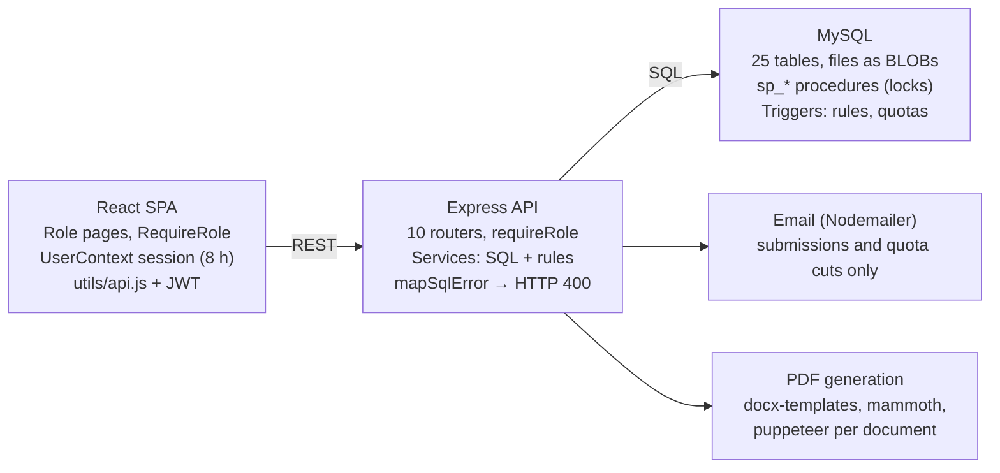

# FP Dual — Technical and UX Audit

_FP Dual · generated 2026-10-27 from a read-only review of the repository and the MySQL Workbench model. Companion document: [ROADMAP.md](ROADMAP.md) (sections E–F)._

The database layer is solid, but two workflows that should be blocking are not: a reservation cannot reach Anexo II/III or confirmation through the UI, and an authentication weakness lets anyone forge an administrator token locally. Fix those first (Phase 1); most other problems are consistency and integrity gaps that can be closed incrementally.

**Scope of this review.** I read the full backend `src/` (routes, services, middleware, helpers), the full frontend `src/` (≈10,800 lines), `db/after_schema_patch.sql`, migrations `002`–`010`, and the MySQL Workbench model you attached (25 tables, 16 routines, 12 triggers, 3 views, extracted and read in full). I ran the project's own ESLint config (0 warnings) and `node --check` on every backend file (all pass). Nothing was executed against a database or a browser, so every finding below comes from reading code. *Confirmed* means the code alone proves it; *suspected* means it depends on the live database or runtime and is listed with a verification step. UI judgments come from the JSX/CSS plus the three screenshots in `frontend/screenshots/`, which predate the current code.

## A. Executive summary

**Overall:** a capable, feature-rich system that has grown quickly. The data model and the reservation concurrency design are better than typical for this kind of project. The weak points are at the seams: role checks that differ per endpoint, business rules enforced only in one screen, the same workflow split across three pages, and database scripts that no longer match the database.

**Strengths worth preserving**

- Reservations are atomic. `sp_reservar_alumno`, `sp_reasignar_reserva` and `sp_confirmar_reserva` lock rows with `FOR UPDATE`, and triggers `trg_dr_bi_reglas`/`trg_dr_bu_reglas` re-check eligibility, quota and state transitions as a second line of defence.
- Quota reduction (`updateCupoEspecialidad`) locks the offer, makes the caller choose which pending reservations to cancel, and refuses to go below confirmed placements.
- Company data changes use a snapshot, conflict detection at approval, and copy-on-write for shared addresses and the legal representative (`empresaDatos.applyEmpresaDatos`).
- One document catalogue (`documentCatalogue.js`) drives permissions and a derived operational state; templates are versioned with a unique active version per type.
- All SQL is parameterised; dynamic fragments are built only from whitelisted keys. I found no SQL injection.
- `Seguimiento.jsx` and `ToastProvider.jsx` (toasts plus an accessible confirm dialog) are the quality bar the rest of the frontend should match.

**Most serious weaknesses**

1. **Reservation workflow deadlock (confirmed, Critical).** The only control for setting the contract type sits inside a viewer that opens only when an Anexo document already exists, and an Anexo cannot exist until the contract type is set.
2. **Forgeable tokens (confirmed locally, Critical).** `middleware/auth.js` falls back to a hard-coded JWT secret, and your local `.env` does not set `JWT_SECRET`.
3. **Student validation likely impossible (suspected, Critical).** In your Workbench model, `sp_validar_solicitud_alumno` requires document type IDs 1 and 2 (CV and the legacy `ANEXO_2`), while new applications upload `ANEXO_DGA`.
4. **Account takeover paths (confirmed, High).** Password change never requires the current password, and `must_change_password` is enforced only in the browser.
5. **Integrity gaps (confirmed, High).** Re-activated reservations inherit old validated annexes and signatures; the contract type can be changed after its annex is validated; validated documents can be replaced through two unguarded upload endpoints.
6. **Broken or hidden features (confirmed, High).** Company re-application is unreachable in the UI; convocatoria activation happens only when staff open the Convocatorias page.
7. **Scale and maintainability.** Every staff screen loads all years of data and paginates in the browser; there are no automated tests; the same modal, viewer and editor are implemented several times.

**Count of findings in section C:** 11 security, 19 workflow/integration, 6 suspected (need verification), 10 performance/maintainability.

## B. Architecture overview

A React (Create React App) single-page app talks to one Express 4 server through relative URLs. The server keeps business rules split between Node services and MySQL procedures and triggers, and stores every file as a `LONGBLOB`.

Rules sit on both sides of the SQL arrow: Node checks eligibility and permissions, and MySQL procedures and triggers re-check state, quotas and transitions.

**Frontend.** `App.js` mounts `UserContext` (localStorage session, 8 h), `ToastProvider` and React Router. Ten routes; seven wrapped in `RequireRole`. Data is fetched per page with `utils/api.js` (Bearer token, JSON errors); there is no shared cache, so each page loads its own lists. `Login.js`, `AddDualStudent` and `AddCompanyRequest` call `fetch` directly. Dev proxy: `frontend/package.json` → `http://localhost:3001`.

**Backend.** `src/index.js` → `routes/index.js` (10 routers, global 500 handler). Routes apply `requireAuth`/`requireRole`; services take `req`/`res`, run SQL against `db/pool.js`, and call procedures through `dbHelpers.callProcedure*`. MySQL `SIGNAL 45000` errors become HTTP 400 via `mapSqlError`. Email: Nodemailer (Gmail) in three places only: student submission, company submission (with the generated convenio attached) and quota reduction.

**Database (from your Workbench model).** 25 tables. Business state lives in `dual_solicitudes_alumno`, `dual_solicitudes_empresa`, `dual_solicitud_empresa_especialidades` (the offers and quotas), `dual_reservas`, `dual_documentos` (+ `_versiones`, `_firmas`, `_plantillas`), `dual_empresa_cambios` and `dual_empresa_tutores`; people and companies in the legacy `gf_alumnosfct`, `ge_empresas`, `ge_domicilios` and `ge_contactos`. Triggers enforce one active convocatoria, document parent rules, reservation transitions and quota, and role-to-link consistency for users. Note: `calendario`, `vw_*` views and `sp_activar_convocatoria` are not used by the code.

### Major workflows

1. **Convocatoria.** An administrator creates it inactive. `autoActivar()` (run only inside `GET /convocatorias`) sets `activa` from today's date. Both application forms, offers and the company student list depend on `activa = 1`.
2. **Student application.** Public multipart form → upsert into `gf_alumnosfct` by DNI → `dual_solicitudes_alumno` → CV and Anexo DGA via `sp_guardar_documento` → preferences → ALUMNO account (only if none exists). Staff review each document in *Enlazar*, then validate the application.
3. **Company application.** Public JSON form → one transaction creates company, addresses, two contacts, application, offers, transports, EMPRESA user and first tutor → after commit, CONVENIO is generated (DOCX → HTML → PDF) and emailed. When staff validate the CONVENIO, the company application is validated in the same transaction.
4. **Company self-service.** View data, propose changes (staff approve with conflict check), add specialities, change quotas, manage tutors, re-apply for a new convocatoria.
5. **Reservation.** Company (own validated offer, active convocatoria) or staff → `PENDIENTE`. Staff set contract type (beca → Anexo III, otherwise Anexo II). Annex generated or uploaded → signed by EMPRESA, centre and ALUMNO → validated → staff confirm (`CONFIRMADA`), which cancels the student's other pending reservations. Staff can cancel (any active state) or reassign; companies can cancel their own pending ones with a reason.
6. **Documents.** The catalogue decides who uploads, signs, reviews or only views each type. *Gestión de documentos › Seguimiento* lists every document requirement across applications and reservations with its operational state and pending actor; *Plantillas* manages DOCX templates.

### Role permissions (enforced by the backend)

| Capability | ADMINISTRADOR | COORDINADOR | EMPRESA | ALUMNO |
| --- | --- | --- | --- | --- |
| Create / edit convocatorias | Yes | View only | No | No |
| Reset any user's password | Yes | No (button still shown) | No | No |
| Review student and company applications | Yes | Yes | No | No |
| Validate / reject documents, generate, upload templates | Yes | Yes | No | No |
| Reserve, cancel, reassign, set contract type, confirm | Yes (any company) | Yes (any company) | Reserve and cancel own pending only | No |
| Edit company data directly (incl. CIF) | Yes | Yes | Propose changes only | No |
| Change quotas, add specialities | Yes | Yes | Own active application | No |
| Manage tutors | Any company | Any company | Own company | No |
| See eligible students (name, DNI, email, phone, CV) | All | All | Own specialities, active convocatoria | No |
| Upload | Anexo G, Excel | Anexo G, Excel | Convenio, Anexo XIV, Anexo II/III, Calendario | CV, Anexo DGA |
| Sign (attestation) | As centre | As centre | Convenio, annexes, Calendario | Annexes, Calendario |
| Own portal | — | — | Mis datos, Tutores, Mis reservas, Mis documentos | Mis datos, Mis reservas, Mis documentos |

## C. Technical audit

Findings are ordered by severity inside each group. IDs (SEC, WF, V, PM) are referenced by the roadmap in section E. Line numbers refer to the files as they are on disk today.

### C.1 Confirmed security and authorization issues

**SEC-1 · Critical · Backend — Hard-coded JWT signing secret**

- *Location:* `backend/src/middleware/auth.js` lines 3–4; `backend/.env`.
- *Evidence:* `const JWT_SECRET = process.env.JWT_SECRET || 'dual_jwt_secret_change_in_production'`. Your local `.env` sets `DBHOST`, `DBUSER`, `DBPASS`, `DBNAME`, `EMAIL_USER`, `EMAIL_PASS` and no `JWT_SECRET`.
- *Impact:* anyone with the source can sign `{"rol":"ADMINISTRADOR"}` and gain full access. Production is safe only if its environment sets the variable, which I cannot see.
- *Fix:* refuse to start when `JWT_SECRET` is missing or shorter than 32 bytes; rotate the secret wherever the fallback may have been used; add a `.env.example` listing required names.

**SEC-2 · High · Backend + Frontend — Password change without the current password; forced change not enforced**

- *Location:* `services/authService.js` `changePassword` (lines 108–136); `pages/Login.js` lines 41–46 and 72–80.
- *Evidence:* the current password is checked only `if (currentPassword)`, and `Login.js` never sends it. After login with `must_change_password = 1` the frontend stores the full token (`setUser`) before the change, and no route checks the flag.
- *Impact:* a stolen or unattended session can permanently take over the account. Temporary passwords issued by administrators remain usable indefinitely if the user navigates away.
- *Fix:* require `currentPassword` unless the account has `must_change_password = 1`; while the flag is set, have `requireAuth` allow only `/auth/me` and `/auth/changePassword`; add a “Cambiar contraseña” screen that asks for the current one.

**SEC-3 · High · Backend — Public student form overwrites an existing student's personal data**

- *Location:* `services/solicitudesAlumnoService.js` `create`, lines 83–105.
- *Evidence:* the student row is looked up by DNI and `UPDATE`d (name, email, phones, address, Social Security number, legal guardian) before the duplicate-application check. When the student has no application in the active convocatoria (e.g. returning from a previous year), the update is committed without any login, and the confirmation email goes to the submitted address.
- *Impact:* anyone who knows a DNI can replace a student's contact data. Company registration, by contrast, rejects an existing CIF (409).
- *Fix:* when the DNI already exists, do not update `gf_alumnosfct` from the public form. Either require the student to log in and re-apply from the portal, or create the application but queue the data changes for staff review.

**SEC-4 · High · Backend — Companies can edit the principal coordinator without approval**

- *Location:* `services/empresaTutoresService.js` `update` (line 174+) and `deactivate`; `services/solicitudesEmpresaService.js` `create`/`reapply` insert the coordinator as a tutor.
- *Evidence:* the coordinator contact is also a row in `dual_empresa_tutores`. `PATCH /tutores/:id` updates `ge_contactos` by `id_contacto` with no check that it is the application's `id_coordinador_empresa`. `TutoresEmpresa.jsx` offers *Editar* on every tutor.
- *Impact:* name, email, phone and DNI of the coordinator (the convenio contact and email recipient) change without the staff approval that *Mis datos* promises.
- *Fix:* reject tutor edits and deactivation when the contact is the coordinator of any application of that company, and point the user to *Editar datos*; mark the principal tutor in the UI.

**SEC-5 · Medium · Backend — Upload endpoints apply different rules**

- *Location:* `services/documentosService.js` `uploadEmpresa` (84–120), `uploadReserva` (124–168), `uploadAlumno` (32–73), `uploadContexto` (430–524).
- *Evidence:* only `uploadContexto` and `uploadAlumno` call `workflow.canUpload` and block replacing a `VALIDADO` document. `uploadReserva` (used by the company UI for Anexo II/III) and `uploadEmpresa` (unused by the UI but routed) do neither. `sp_guardar_documento` then resets the document to `PENDIENTE` and `saveByClave` resets signatures. Conversely, the `/documentos/alumno/...` route admits staff, but the catalogue gives staff only `review`, so they always get 403.
- *Impact:* a company can silently replace a validated convenio or annex; behaviour depends on which URL is called.
- *Fix:* one `assertCanUpload(user, def, parents)` used by every upload route; remove or redirect `uploadEmpresa`/`uploadAlumno`.

**SEC-6 · Medium · Backend — Template upload can run code on the server**

- *Location:* `routes/documentosRoute.js` (`POST /documentos/plantillas`, ADMINISTRADOR and COORDINADOR); `services/documentGenerationService.js` `createReport`.
- *Evidence:* `docx-templates` evaluates JavaScript inside `<< >>` commands; its documentation states the built-in sandbox is not a security boundary.
- *Impact:* a compromised coordinator account can read `.env` (database and email credentials) or run arbitrary code.
- *Fix:* restrict template upload to ADMINISTRADOR; configure the library so commands resolve only plain data paths (check the custom JS-runner option in the installed version); keep generation in a low-privilege process.

**SEC-7 · Medium · Backend — No anti-automation on login and public forms**

- *Location:* `routes/authRoute.js`, `solicitudesAlumnoRoute.js`, `solicitudesEmpresaRoute.js`; `solicitudesEmpresaService.js` lines 455–461.
- *Evidence:* no rate limit anywhere. The public company form launches Chromium and sends an email with a PDF to the submitted coordinator address *before* responding.
- *Impact:* password guessing on DNI/CIF accounts; the server can be used to send email to arbitrary addresses and to exhaust CPU.
- *Fix:* per-IP and per-identifier limits on `/auth/login` and both public POSTs; move convenio generation and email out of the request (respond first).

**SEC-8 · Medium · Backend — Deactivated users keep access for up to 8 hours**

- *Location:* `middleware/auth.js` `requireAuth`.
- *Evidence:* only the JWT signature and expiry are checked; `dual_usuarios.activo` and role changes are ignored after login.
- *Fix:* load `activo`, role and `must_change_password` per request (one indexed query), or shorten token life and add refresh.

**SEC-9 · Low · Backend — PDF uploads trusted by declared MIME type**

- *Location:* `pdfUpload` in `documentosRoute.js` and `solicitudesAlumnoRoute.js`.
- *Evidence:* `file.mimetype` comes from the client; files are served back inline without `X-Content-Type-Options: nosniff`.
- *Fix:* check the `%PDF-` signature in the buffer; add `nosniff` and `Content-Security-Policy: sandbox` on download responses.

**SEC-10 · Low · Backend — Unescaped values in email HTML and headers**

- *Location:* `sendConfirmationEmail` (student), `sendCompanyConfirmationEmail`, `sendCupoReductionEmail`; `plantillasService.descargar` `Content-Disposition`.
- *Evidence:* names typed in public forms are interpolated into HTML; the uploaded template filename goes unescaped into a header.
- *Fix:* HTML-escape interpolated values; sanitise or RFC 5987-encode filenames.

**SEC-11 · Low · Cross-layer — Personal data shown more widely than needed**

- *Evidence:* `GET /alumnos/disponibles` returns DNI, email and phone of every eligible student to every matching company; students see the company's free-text cancellation reason (`StudentMain/MisReservas.jsx`); `GET /usuarios` lists all users to coordinators though nothing uses it.
- *Fix:* agree a data-minimisation rule (e.g. companies see contact details only for students they reserved); add a separate internal reason vs. message to the student; remove unused endpoints.

### C.2 Confirmed workflow, business-logic and integration bugs

**WF-1 · Critical · Cross-layer — Contract type cannot be set, so reservations cannot progress**

- *Location:* `AdminCompanyView/components/ReservasAdmin.jsx` `FilaReserva` (line 115); `ReservaDocViewer.jsx` (the only caller of `POST /reservas/:id/tipo-contrato`); `reservasService.getAll` (`id_documento_reserva` subquery, lines 231–238); `CompanyView/MisReservas.jsx` lines 219–226.
- *Evidence:* the contract-type selector lives only in `ReservaDocViewer`, which opens only from the *Ver doc* button, shown only when `r.id_documento_reserva` is set. That value is computed only when the reservation already has a contract type (`WHEN tc.id_tipo_contrato IS NULL THEN '__ninguno__'`). The company sees “El Anexo II o III se podrá subir cuando el centro indique el tipo de contrato”, and Seguimiento lists annexes only after the type is set.
- *Impact:* a new reservation can never reach annex upload, signature, validation or confirmation through the UI.
- *Fix:* show the contract-type control on every pending reservation row (ReservasAdmin and the *Reservas* tab of the student card); build one reservation-detail panel (see WF-5, PM-3).

**WF-2 · High · Frontend — Company re-application is unreachable**

- *Location:* `CompanyView/index.js` `fetchSolicitud` (521–541), `MisDatos` early return (46–54), `ReapplyForm` (rendered inside `MisDatos`); `solicitudesEmpresaService.getMia`.
- *Evidence:* `GET /solicitudes/empresa/mia` returns 404 unless the company already has an application in the active convocatoria. On 404 the page sets `solicitud = null`, `MisDatos` returns “No se encontraron datos…” and the re-apply form is never rendered. When it *is* rendered, the company already has an application, so `reapply` answers 409.
- *Impact:* returning companies cannot join a new convocatoria themselves.
- *Fix:* add `GET /solicitudes/empresa/mias` (history) or let `mia` return the latest application with `convocatoria_activa`; show the re-apply card when the latest application belongs to a past convocatoria and one is active.

**WF-3 · High · Backend — Convocatoria activation depends on someone opening a page**

- *Location:* `services/convocatoriasService.js` `autoActivar` (5–13), `getAll` (16–26); trigger `trg_convocatorias_bu_una_activa` (Workbench model).
- *Evidence:* activation runs only inside `GET /convocatorias` (staff page); `getActiva`, both public forms and `getActiveConvocatoria` read the stored flag. The single `UPDATE … CASE` can violate the one-active trigger (overlapping ranges, or a newer convocatoria with a lower id), and the error is swallowed (`catch {}`).
- *Impact:* forms stay closed after the start date or open after the end date; a failed switch is invisible. (Correction to my earlier note: the trigger does prevent two active convocatorias.)
- *Fix:* derive “active” from dates at read time in one helper, or run activation on server start and daily through `sp_activar_convocatoria`; validate `fecha_inicio ≤ fecha_fin` and non-overlap on create/update; log failures.

**WF-4 · High · Database — Re-activated reservations inherit old documents, signatures and tutor**

- *Location:* `sp_reservar_alumno` and `sp_reasignar_reserva` (model and migration 003); `dual_documentos.id_reserva`.
- *Evidence:* both procedures reuse the existing `(alumno, oferta)` row when it is `CANCELADA` and only reset state, contract type and reason. Annexes, versions and `dual_documento_firmas` stay attached to that `id_reserva`; the model's procedures also keep `id_empresa_tutor` (migration 007 reset it, the model's version does not).
- *Impact:* after a cancel-and-rebook, a previously validated and signed Anexo reappears as soon as the same contract family is chosen, and could support a confirmation for a different placement.
- *Fix:* on reactivation, mark previous reservation documents `es_actual = 0` (they remain in history) and clear the tutor; or always insert a new reservation row (requires dropping the unique key — needs your approval).

**WF-5 · High · Cross-layer — Contract family can change after the annex exists; confirmation rule lives only in the UI**

- *Location:* `reservasService.setTipoContrato` (687–713), `confirmar` (716–733); `ReservaDocViewer.jsx` 64–126.
- *Evidence:* `setTipoContrato` blocks only `CANCELADA`; it accepts `CONFIRMADA` and ignores existing annexes. `confirmar` passes whatever type the request carries to `sp_confirmar_reserva`, which overwrites the stored one; the viewer's confirm selector starts empty instead of the current type. Requiring a validated annex before confirming is checked only by `puedeConfirmar` in the browser.
- *Impact:* switching “Beca” ↔ contract after validation hides the validated Anexo III and requires a new Anexo II; any staff API call can confirm without documents.
- *Fix:* lock the contract type once an annex file exists (or require explicit regeneration); confirm with the stored type; enforce “annex validated and fully signed” in `confirmar` (needs your confirmation of the business rule).

**WF-6 · Medium · Cross-layer — Review and signature order is inconsistent between screens**

- *Location:* `documentCatalogue.deriveDocumentState` (319–332); `documentosWorkflow.projectItem` `puedeRevisar`; `DocViewer.jsx`, `ReservaDocViewer.jsx`, `ConvenioViewer.jsx`; `documentosService.validar`.
- *Evidence:* Seguimiento offers *Validar* only after every signature (`PENDIENTE_VALIDACION`), but the three viewers and the API validate at any time. Once validated, the state becomes `VALIDADO` even with signatures missing. Validating the auto-generated CONVENIO (unsigned by the company) also validates the whole company application.
- *Impact:* companies can be validated, and annexes accepted, before anyone signed.
- *Fix:* decide the rule (sign then validate, as Seguimiento assumes) and enforce it in `documentosService.validar`; show pending signatures alongside “Validado”.

**WF-7 · Medium · Backend — Convenio replacement or rejection does not touch company validation**

- *Evidence:* `validar` cascades CONVENIO → company `VALIDADO`; `rechazar` and re-upload (`uploadEmpresa`, SEC-5) have no inverse. `ConvenioViewer` has no *Rechazar* button at all.
- *Fix:* define transitions (e.g. rejecting the convenio returns the application to `PENDIENTE`); add reject to the convenio viewer.

**WF-8 · Medium · Cross-layer — Confirmed students cannot be reassigned from the UI**

- *Evidence:* `getOfertasElegibles` excludes students with any `CONFIRMADA` reservation (`ACTIVE_PAIR_SQL`), so `EmpresaControl` hides *Reasignar* for them, although `sp_reasignar_reserva` supports it.
- *Fix:* add an `incluir_confirmadas` mode for reassignment.

**WF-9 · Medium · Frontend — Company list mixes convocatorias**

- *Location:* `AdminCompanyView.jsx` lines 18–26, 145–167, 399–401.
- *Evidence:* each card is one application (one convocatoria), but receives every reservation of the company across all years (`r.idempresa === empresa.id_empresa`). The *Curso* filter is derived from the submission date (`fechaPeticion`), not the convocatoria, so a January submission lands in the next course.
- *Fix:* filter by `id_solicitud_empresa` (add it to `GET /reservas`); filter by convocatoria.

**WF-10 · Medium · Frontend — Reset-password button shown to coordinators**

- *Evidence:* `CompanyCard.jsx` 539–545 always renders *Resetear contraseña*; the route is ADMINISTRADOR-only, so coordinators get a 403 toast. The temporary password then stays on screen until reload.
- *Fix:* render by role; clear the password after copy or a timeout.

**WF-11 · Medium · Backend — Re-application and coordinator edits rewrite previous years**

- *Evidence:* `reapply` updates the existing coordinator contact in place and replaces company-wide transports; `applyEmpresaDatos` copies addresses and representative on write but updates the coordinator contact in place. Both change what earlier applications (and their convenios) show.
- *Fix:* apply the same copy-on-write to the coordinator; decide whether transports belong to the application.

**WF-12 · Medium · Frontend — Company registration stores invented data**

- *Location:* `AddCompanyRequest/index.js` lines 36, 50–51, 149–159.
- *Evidence:* coordinator DNI, representative email and phone are never asked: the coordinator gets the legal representative's DNI, the representative gets the coordinator's email and the company phone; the work address copies CP and province from the legal address. `cifValido` runs only in the browser.
- *Fix:* collect the missing fields (or make the columns optional); validate CIF and password length in the backend too.

**WF-13 · Medium · Frontend — Student form: double submit, stale state, misleading success**

- *Location:* `AddDualStudent/index.js` `handleSubmit` and the submit button (lines 161, 517–522).
- *Evidence:* no `submitting` guard; `formRef.current.reset()` clears the DOM but not React state or the selected files; returning students (account already exists) are told “Ya puedes iniciar sesión” while the new password was silently ignored.
- *Fix:* lock the button; reset state explicitly; return `cuenta_existente` from the API and adapt the message.

**WF-14 · Medium · Frontend — LinkStudents hides errors and loading**

- *Location:* `LinkStudents/hooks/useLinkStudents.js` 38–57; `LinkStudents/index.js` 49–101.
- *Evidence:* for companies, one `Promise.all` includes `/solicitudes/empresa/mia`; any failure (including 404 between convocatorias) leaves `companyStatus = null`, which renders “Tu empresa todavía no está validada”. There is no loading state, so “No hay alumnos…” flashes while loading and stays on errors.
- *Fix:* separate loading/error/empty states, as Seguimiento does.

**WF-15 · Low · Frontend — Status badges that mean something else**

- *Evidence:* in `StudentCard.jsx` both the *A2/A3* and *Cal* badges turn green when any reservation is `CONFIRMADA`, not when the annex or calendar document exists; `ReservaDocViewer` titles the viewer “Acuerdo firmado” even for unsigned files; the company banner says assignment is not final “hasta la firma del Anexo 2 o 3”, while confirmation is a staff action.
- *Fix:* drive badges from `documentos[].estado_operativo`; use one vocabulary (see D).

**WF-16 · Low · Frontend — Session handling**

- *Evidence:* `api.js` has no 401 handling, so an expired token leaves the user “logged in” with every call failing; `Login.handleChangePassword` calls `setUser` again, extending the client expiry by 8 h while the token keeps its original expiry.
- *Fix:* on 401, clear the session and redirect to `/login` with a message; store the token's `exp` instead of a client timer.

**WF-17 · Low · Frontend — Error detection by message text**

- *Evidence:* `StudentMain/index.js` treats a missing application as `err.message.includes("404")` or a regex; `ReapplyForm` treats any 409 as “ya existe”.
- *Fix:* use `err.status` and a stable `code` in error bodies.

**WF-18 · Low · Cross-layer — Missing reverse transitions**

- *Evidence:* rejected student or company applications can never be reopened (UI shows actions only for `PENDIENTE`; no endpoint); a student cannot re-apply in the same convocatoria (unique key).
- *Fix:* add “Reabrir solicitud” for staff.

**WF-19 · Low · Backend — No notifications after submission**

- *Evidence:* `sendMail` is called only on submission and quota reduction. Validation, rejection (with reason), reservation, cancellation and confirmation are silent.
- *Fix:* a small notification service called after each transition (outside the transaction).

### C.3 Strongly suspected issues (need verification)

These depend on the live database or runtime. Each has a one-step check.

**V-1 · Critical if confirmed · Database — Student validation always fails**

- *Evidence:* in your Workbench model, `sp_validar_solicitud_alumno` counts validated documents with `id_tipo_documento = 1` and `= 2` and raises “deben estar validados CV y ANEXO_2”. New applications store `ANEXO_DGA`, inserted later by migration 008, so it cannot be id 2 (`ANEXO_2` is still a separate legacy type). The repo's own version of this procedure (`after_schema_patch.sql`) has no document check at all — so the scripts and the database differ.
- *Impact:* *Validar alumno* returns 400 for every new application; no student can become `VALIDADO`, so nothing downstream (offers, reservations) works.
- *Verify:* `SHOW CREATE PROCEDURE sp_validar_solicitud_alumno; SELECT * FROM dual_tipos_documento;`
- *Fix:* resolve types by name (`CV`, `ANEXO_DGA`) inside the procedure, or drop the check from the procedure and keep it in `missingStudentValidation` (already done by name).

**V-2 · High if confirmed · Database — Preference tables missing**

- *Evidence:* the model contains no `dual_preferencias`, `dual_solicitud_preferencias` or `dual_convenio_tokens` (created only by `after_schema_patch.sql`). The code reads the first in `GET /preferencias` and writes the second inside the student-application transaction.
- *Impact:* the preference selectors stay empty (500, logged only to the console); if a preference is ever sent, the whole application rolls back with “Error interno del servidor”.
- *Verify:* `SHOW TABLES LIKE 'dual_%preferencias';`

**V-3 · Medium · Cross-layer — Dates shift by one day**

- *Evidence:* `db/pool.js` sets no `dateStrings`/`timezone`, so `mysql2` returns `DATE` columns as JS `Date` at local midnight, serialised to UTC. On a server in Europe/Madrid `2026-09-01` becomes `2026-08-31T22:00:00.000Z`; `Convocatorias.jsx` and `StudentMain/MisDatos.jsx` take `split('T')[0]`.
- *Impact:* convocatoria dates display one day early, and saving the edit form writes the earlier date back.
- *Verify:* open `GET /convocatorias` in the browser's network tab and compare `fecha_inicio` with the database.
- *Fix:* `dateStrings: ['DATE']` on the pool (affects every DATE consumer; test once).

**V-4 · Medium · Database — Repository scripts cannot rebuild the database**

- *Evidence:* differences between the model and the repo: `sp_validar_solicitud_alumno` (V-1); `sp_reasignar_reserva` lacks migration 007's tutor reset; three patch tables absent; `after_schema_patch.sql` still seeds `CONFIRMADO`/`CANCELADO` and omits the `ALUMNO` role; the base schema `dbfinal.txt` and migration `001` are not in the repo; nothing records which migrations ran.
- *Impact:* a new environment built from the repo behaves differently from yours; re-running the patch after migration 003 breaks reservations.
- *Fix:* take a schema dump as the new baseline (`000_baseline.sql`), retire `after_schema_patch.sql`, add a `schema_migrations` table and a simple runner.

**V-5 · Medium · Deployment — Mail configuration not in Git**

- *Evidence (confirmed):* `.gitignore` ignores every `config.js`; `git ls-files` shows `backend/src/mail/config.js` and `backend/src/db/config.js` are untracked. Both services `require('../mail/config')` inside `try {}`.
- *Impact:* a deployment from a fresh clone silently sends no email.
- *Fix:* track `mail/config.js` (it contains no secrets; credentials come from the environment); narrow the ignore rule.

**V-6 · Low · Database — Student lookups lock the whole table**

- *Evidence:* `gf_alumnosfct.dni` has a non-unique index; lookups use `UPPER(TRIM(dni)) = ? FOR UPDATE`, which cannot use it, so each public submission scans and locks every student row until commit.
- *Impact:* concurrent submissions queue behind each other near deadlines.
- *Fix:* store DNI normalised (it already is on insert), query `dni = ?`, and add a unique key after cleaning duplicates (needs approval).

### C.4 Performance and maintainability

**PM-1 · Medium · Cross-layer — Unbounded lists, paginated in the browser.** `GET /solicitudes/alumno?include=full`, `/solicitudes/empresa/todas` and `/reservas` return every year with documents and reservations; *Enlazar* and *Empresas colaboradoras* filter and paginate client-side. `/documentos/seguimiento` rebuilds every document item for every year on each request (each filter change and each debounced keystroke). *Fix:* default to the active convocatoria; server-side filter, search and pagination with the Seguimiento query contract.

**PM-2 · Medium · Frontend — N+1 requests.** `TutorAssignSelect` fetches `/tutores/empresa/:id` on mount, once per reservation row in `ReservasAdmin` (all non-cancelled reservations of all years). *Fix:* return tutors per company once, or embed them in the list.

**PM-3 · Medium · Backend — PDF generation cost.** Each generation launches and closes a full Chromium (`docxBufferToPdf`); the public company registration waits for it. *Fix:* one shared browser instance with a small queue; generate after responding.

**PM-4 · Medium · Cross-layer — Business rules duplicated.** Annex family (“beca” → III) lives in `anexoClaveForContrato` and in four SQL `CASE` blocks in `reservasService`; validation states are string literals across services; procedures and triggers use numeric state and type IDs (1/2/3) while Node resolves by name. *Fix:* one constants module for validation states; build the annex lookup once (or store the family on `dual_tipos_contrato`).

**PM-5 · Medium · Backend — Untestable structure, no tests, no audit trail.** Services read `req` and write `res` directly, so logic cannot be called from a test or a script; there are no test files; `sp_validar_documento`, rejections, confirmations and signatures record no user (`dual_documento_firmas` has only `rol` and time). *Fix:* extract pure functions incrementally where you change code; add API tests for the reservation and document flows; add `validado_por`/`firmado_por` columns (needs approval).

**PM-6 · Low · Backend — Non-transactional document save.** `documentosStore.saveByClave` runs the procedure, the provenance update and the signature resets as separate pool queries. A failure mid-way leaves a file with wrong provenance or stale signatures. *Fix:* one connection and transaction.

**PM-7 · Low · Frontend — Duplicated components.** Four reason-entry modals (`StudentCard`, `EmpresaControl`, `ReservasAdmin`, `CompanyView/MisReservas`), three PDF viewers (`DocViewer`, `ReservaDocViewer`, `ConvenioViewer`), two quota editors (`CompanyCard.EspecialidadList`, `EspecialidadCuposEditor`), two annex upload paths for companies (`MisReservas.SubirDocReserva`, `DocumentoItem`), several copies of `formatDate`/`ReadField`.

**PM-8 · Low · Cross-layer — Dead code and unused surface.** Unused: `AppHeader.jsx`, `DocumentViewAction.jsx`, `buildPostOptions`, `validDate`, `buildYearOptions`, `db/config.js`; routes with no caller (`POST /documentos/firmar`, `/documentos/alumno/:id/:tipo`, `/documentos/empresa/:id/convenio`, `GET /usuarios`, `GET /solicitudes/empresa`, `GET /solicitudes/alumno/:id[/documentos]`); dependencies never imported (see project instructions); the `ER_NO_SUCH_TABLE` fallback in `getTodas`.

**PM-9 · Low · Cross-layer — Inconsistent API shapes.** Some lists are arrays, others `{items}` or `{tipos}`; `getTodas` adds aliases “for frontend compatibility” (`razonSocial`/`empresa`, `idAuxEmpresa`, `fechaPeticion`), and `CompanyView` reads each field under two or three names. *Fix:* one naming convention per resource, applied as screens are touched.

**PM-10 · Low · Frontend — Large mixed components.** `CompanyView/index.js` (688 lines, three components), `Seguimiento.jsx` (680), `CompanyCard.jsx` (640), `AddDualStudent` (530, 29 `useState`). Split only where a change is already planned.

## D. UI/UX audit

The visual base (dark sidebar, red brand, Roboto, white cards on a warm grey surface) is clean and professional and does not need a redesign. The problems are structural: one workflow is spread across three screens, navigation labels point to the wrong places, states and labels change from page to page, and the custom modals are not keyboard-accessible. This review is based on the code; the three screenshots in `frontend/screenshots/` predate the current Home page.

### D.1 Navigation and information architecture

- **Menu labels mislead staff.** For ADMINISTRADOR/COORDINADOR, *Alumnos* and *Empresas* open the **public application forms** (`Header.js` items 2–3), while student management is called *Enlazar* and company management *Empresas colaboradoras*. Suggested staff menu: *Panel*, *Alumnos* (today's Enlazar), *Empresas* (today's Empresas colaboradoras), *Reservas*, *Documentos*, *Convocatorias*; public forms only for anonymous users.
- **The reservation lifecycle is split across three screens.** Reserve, cancel and reassign live in *Enlazar › tarjeta › Reservas*; contract type, annex review and confirmation in *Empresas colaboradoras › Reservas › Ver doc*; generation and signature in *Documentos › Seguimiento*. One reservation-detail panel (state, contract type, annex, signatures, tutor, actions), reachable from all three, would remove WF-1 and most of WF-5/WF-6.
- **Home is a menu, not a dashboard.** Staff land on four link cards with no indication of pending work. Seguimiento already computes “Acción del centro”; a staff home with counters (solicitudes por revisar, documentos por validar, reservas pendientes de tipo de contrato, cambios de empresa pendientes) and links straight to filtered lists would be the highest-value UI change.
- **No search in the two main lists.** *Enlazar* filters only by convocatoria and especialidad (options derived from loaded rows, convocatoria defaulting to *Todas*); *Empresas colaboradoras* has no name/CIF search. Add search by name/DNI/CIF and default to the active convocatoria.
- **Public visitors are not told whether applications are open.** Both forms render even without an active convocatoria; the 409 arrives only after a long form is completed. Show the active convocatoria and its dates on Home and above each form, and disable the form when closed.
- **Desktop sidebar** collapses on any click outside it and remembers that (`Header.js` 30–52, `PageLayout.jsx`). Users who want it open cannot keep it open, and the content reflows on every toggle.

### D.2 Consistency of states, labels and colours

- **Raw enum values on screen:** reservation states (`PENDIENTE`, `CONFIRMADA`) in `EmpresaControl`, `CompanyView/MisReservas`, `CompanyCard`; the role (`ADMINISTRADOR`) in the header.
- **Same concept, different words:** student application = “En revisión / Aprobada” (StudentCard), “Pendiente de revisión / Solicitud validada” (EstadoSolicitud), “Solicitud en revisión / aprobada para Dual” (student portal); confirmed reservation = “Confirmado”, “Asignado definitivamente”, “Plaza confirmada”, “Ya asignado”. Annexes are “Anexo II/III” in most places but “Anexo 2 o 3” and “A2/A3” elsewhere.
- **Proposal:** one `utils/labels.js` with label and badge variant per state (solicitud, reserva, documento operativo, firma), used by every screen and by `StatusBadge`.
- **Colour roles drift:** active tabs use `brand-500` in some pages and `red-600` in others; the positive action *Reservar alumno* is a red outline that reads as destructive; components mix the theme tokens (`brand`, `charcoal`, `surface`) with raw `gray-*`, `red-*`. Reserve red for brand and destructive actions; use one primary style for positive actions.
- **Read-only data styled as inputs:** `ReadField` renders `
` in the company and student portals, so data looks editable. Use a definition-list style.

### D.3 Per-role review

**Administrators and coordinators**

- Pain points: the WF-1 deadlock; three different document viewers with different rules (WF-6); reset button that fails for coordinators (WF-10); company cards that show other years' reservations and a *Curso* filter based on submission date (WF-9); no way to reopen a rejected application (WF-18).
- Seguimiento is the best screen: server-side filters, debounced search, skeletons, retry, explicit empty states. Use it as the template for Enlazar and Empresas.
- Bulk actions are missing where volume is high (e.g. validate several CVs, assign contract type to several reservations).

**Companies**

- Re-application is invisible (WF-2); between convocatorias *Mis datos* shows “No se encontraron datos”, and *Enlazar* says the company is not validated (WF-14).
- Annex upload exists twice with different status wording (*Mis reservas* and *Mis documentos*).
- The *Tutores* tab lets them change the principal coordinator, contradicting the *Mis datos* text that changes go through review (SEC-4).
- After registering with a password they chose, the first login forces them to choose another (`must_change_password = 1` in `create`).
- *Mis reservas* shows contract type and document state but not which offer/ciclo each reservation consumed when they have several.

**Students**

- The portal is read-only for personal data; to correct a phone number they must contact the centre. A “solicitar cambio” or limited self-edit would reduce staff work.
- They see each company's free-text cancellation reason (SEC-11).
- No email when their documents are rejected or a company reserves them (WF-19), so they must keep checking the portal.

**Public forms**

- `AddDualStudent`: 29 separate state variables, validation messages appear once at the bottom (`FormMessage`), no section progress, no submit lock (WF-13), email pattern with no hint about the required `@zaragoza.salesianos.edu` domain.
- `AddCompanyRequest`: does not ask for coordinator DNI or representative contact (WF-12); single free-text work address.
- Recommendation: group into steps (Datos personales → Contacto → Documentos → Cuenta), inline field errors next to inputs, a summary before submit.

### D.4 Accessibility

- **Labels:** 62 `<label>` elements, only 16 with `htmlFor`. Login, filters, the company forms' selects and most modals have unlabeled controls for screen readers.
- **Dialogs:** of 12 modal implementations, only three declare `role="dialog"` (`ConfirmDialog`, which also handles Escape and initial focus; `CupoReductionDialog`; the Seguimiento reject dialog). The others have no Escape, no focus trap and no return of focus. A single `<Modal>` built from `ConfirmDialog` fixes all of them (PM-7).
- **Click-only headers:** `StudentCard` and `CompanyCard` headers are `div onClick`; the arrow buttons have no `aria-label`/`aria-expanded`.
- **Mobile drawer:** when closed it is only translated off-screen, so its links stay in the tab order (`Header.js` 344–395). Add `inert`/`aria-hidden` when closed, Escape to close, focus to the first link on open.
- **Status by colour:** some chips (A2/A3, Cal, `BoolChip`) rely on red/green plus an icon; keep the text and add a tooltip or legend.
- **Good already:** toasts use `role="alert"`/`"status"`; nav links set `aria-current`; focus-visible rings exist on most buttons.

### D.5 Responsiveness

- Layouts are card-based and wrap reasonably; Seguimiento and the portals use responsive grids.
- PDF viewers are 88 vh × 92% wide modals with toolbars that do not wrap well on phones; on mobile, opening the PDF in a new tab is the usable path — make it the primary action there.
- Card headers in *Enlazar* can show up to six chips (state, cuenta, confirmado, A2/A3, Cal, up to three companies) that wrap into several lines on small screens; collapse them into one summary chip on mobile.
- The old mobile screenshot shows horizontal overflow on Home; the current code adds `break-words`, but there are no current screenshots to confirm. Re-capture at 360, 768 and 1280 px as part of Phase 4.

## E–F. Development roadmap and strategy

See [ROADMAP.md](ROADMAP.md).

## G. Missing information

Only what is needed to confirm or size specific findings.

| Needed | Why | Findings |
| --- | --- | --- |
| Which database the attached `.mwb` was reverse-engineered from (local, staging, production) | Decides whether V-1, V-2 and V-4 describe production | V-1, V-2, V-4 |
| Output of `SHOW CREATE PROCEDURE sp_validar_solicitud_alumno`, `SELECT * FROM dual_tipos_documento`, `SHOW TABLES LIKE 'dual_%preferencias'` | Confirms the two potential blockers | V-1, V-2 |
| Rows of `dual_roles`, `dual_estados_reserva`, `dual_estados_validacion`, `dual_tipos_contrato` | Procedures and triggers hard-code IDs 1/2/3; annex choice depends on contract names containing “beca” | PM-4, WF-5 |
| Production environment variable **names** and how the backend is served (reverse proxy, HTTPS, CORS) | SEC-1 rollout; security headers and rate limits depend on the proxy | SEC-1, SEC-7, SEC-9 |
| Server time zone, MySQL version and `sql_mode` | Date shift and string-length behaviour | V-3 |
| Approximate yearly volumes (students, companies, reservations, documents) | Sizes the pagination and generation work | PM-1, PM-3 |
| Business decisions listed under Phases 1 and 2 | Several fixes change behaviour users see | SEC-3, WF-5, WF-6, WF-18, SEC-11 |

Not needed for now: the frontend build output, `backend.zip`, files in `backend/uploads/`.
