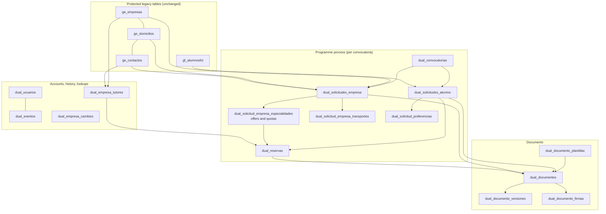

# FP Dual — Database Architecture Audit

_FP Dual · 2026-10-28 · read-only review of the local development database `proyecto_dual` (MySQL 8.0.44, localhost) and of the repository at commit `ffede73`. Companion document: [DATABASE_IMPROVEMENT_PLAN.md](DATABASE_IMPROVEMENT_PLAN.md). Finding IDs (`DB-nn`) are used in both._

**How this was done.** Schema dumped with the project's own read-only tool (`backend/scripts/schema.js dump`, which runs inside `START TRANSACTION READ ONLY`); metadata from `information_schema`; aggregate integrity queries (counts only — no names, DNIs, emails, hashes or files were read); `EXPLAIN` on representative backend queries. No statement that writes was executed, no migration was run, no test database was created. Every finding is marked **Confirmed** (proved by schema, code or data), **Suspected** (needs a check that is listed in §12) or **Design** (a structural weakness, not a current defect).

**Scale caveat.** The development database is small (largest table: 46 documents, ~360 KB of files). Plans and integrity counts are real; timings are not meaningful at this size, so no performance claim below is a measured slowdown.

---

## 1. Executive summary

**Verdict: mostly preserve, with targeted improvements and one partial restructuring around reservations and document history.** The core of the model is sound: foreign keys are declared everywhere (53 FKs, all `RESTRICT`), reservation procedures lock the rows they depend on, triggers act as a second line of defence, state and type lookups are resolved by name (migration 012), the audit trail is append-only, and the repository now rebuilds the live schema exactly. A redesign outside the protected tables is not justified.

The problems are concentrated in four places:

1. **Application data stored on the person (DB-01, High, Confirmed).** A student's ciclo/especialidad lives only in the protected `gf_alumnosfct.id_especialidad_dual`, and re-applying in a new convocatoria overwrites it. Every earlier application, reservation, trigger check and Seguimiento row then reads the new value. It has not happened yet on dev (no student has two applications), but it will the first time a student repeats with a different ciclo.
2. **Transactions that cannot be composed (DB-06, DB-07, Medium–High, Confirmed).** Four reservation procedures open and commit their own transaction. The backend therefore cannot put the procedure, its audit event and its side effects in one unit: audit events are written after commit and may be lost, a *baja* commits before its reservations are cancelled, and lock order differs between procedures (deadlocks would surface as HTTP 500).
3. **Reservation rows are reused (DB-04, DB-05, Design + Confirmed).** The unique key `(alumno, oferta)` forces a cancelled reservation to be *reactivated* instead of creating a new one. This needs special code in two procedures and a trigger, clears the contract type and tutor of the cancelled attempt, mixes documents of different attempts under one `id_reserva`, and the reactivation path skips the eligibility checks that the insert trigger performs.
4. **Document history is incomplete (DB-02, DB-03, Medium, Confirmed).** Signatures are reset in place when a new file is uploaded, so who signed a superseded version is lost; "one current document per parent and type" is assumed by every reader but not enforced.

Smaller confirmed issues: a non-sargable `UPPER(TRIM(cif))` lookup that scans and locks every company row during registration (DB-08); quota reduction cancels reservations through a third, unaudited code path (DB-10); company, tutor, quota, user and convocatoria changes are outside the audit trail (DB-11); the application connects as MySQL `root` (DB-13); seven obsolete objects remain (DB-15).

**Protected tables.** The real company table is **`ge_empresas`** (plural), verified with `SHOW TABLES LIKE 'ge_%'`; `ge_empresa` does not exist. The four protected tables are `ge_contactos`, `ge_domicilios`, `ge_empresas`, `gf_alumnosfct`. Every recommendation below leaves them untouched. One historical conflict must be decided: **migration 015 already changed `gf_alumnosfct`** (it replaced the index `ix_gf_alumnosfct_dni` with the unique key `uq_gf_alumnosfct_dni`) — see §9 and decision D1 in the plan.

---

## 2. Current database architecture

| Item | Value (verified) |
| --- | --- |
| Server / database | MySQL 8.0.44 on `localhost`, schema `proyecto_dual` |
| Character set / collation | `utf8mb4` / `utf8mb4_0900_ai_ci` (database and every table) |
| Engine | InnoDB everywhere |
| `sql_mode` | `ONLY_FULL_GROUP_BY, STRICT_TRANS_TABLES, NO_ZERO_IN_DATE, NO_ZERO_DATE, ERROR_FOR_DIVISION_BY_ZERO, NO_ENGINE_SUBSTITUTION, IGNORE_SPACE` |
| Isolation / lock wait | `REPEATABLE-READ` / 50 s |
| Time zone | `SYSTEM` (Romance Standard Time); pool uses `dateStrings: ['DATE']` |
| Objects | 30 base tables, 3 views, 5 functions, 14 procedures, 14 triggers, 0 events, 18 CHECK constraints, 53 foreign keys |
| Migration history | `schema_migrations`: `000` (baseline, marked), `012`, `013`, `014`, `015` (2026-10-27 09:43–09:49), `016` (2026-10-27 20:11) |
| Connecting account | `root@localhost`, global `ALL PRIVILEGES … WITH GRANT OPTION` (DB-13) |

The model has three layers:

Business rules are enforced in three places, by design: Node services (`estadoReglas.js`, catalogue, permissions), stored procedures (reservation state changes under row locks, validation preconditions), and triggers (invariants that must hold whatever the caller: one parent per document, motive on rejection/cancellation, quota, one confirmed reservation, one active convocatoria, role ↔ link consistency for users, immutable audit).

---

## 3. Inventory

### 3.1 Tables

Row counts are approximate (`information_schema.TABLE_ROWS`) except where marked exact.

| Table | Purpose | Used by (backend) | Rows | Notes |
| --- | --- | --- | --- | --- |
| **`ge_empresas`** 🔒 | Company master record (CIF, name, contact) | registration, company data, all company lists | 11 | Unique CIF. Updated in place (DB-12). |
| **`ge_domicilios`** 🔒 | Company addresses | applications (legal and work address), contacts | 12 | Belongs to a company via `idempresa`. |
| **`ge_contactos`** 🔒 | People of a company: representative, coordinator, tutors | applications, tutors, EMPRESA users | 22 | No `idempresa`: company is derived through `iddomicilio → ge_domicilios.idempresa`. |
| **`gf_alumnosfct`** 🔒 | Student master record | applications, reservations, lists, documents | 18 | Holds `id_especialidad_dual` (DB-01). Legacy FCT columns `idempresa`, `iddomicilio`, `idrepresentante`, `idtutorempresa`, `mesFCT` unused (0 non-null). Unique DNI added by 015. |
| `dual_convocatorias` | Academic-year call | everywhere | 3 | Stored `activa` flag, synced by `convocatoriasService` from dates. CHECK `fecha_fin ≥ fecha_inicio`. |
| `dual_solicitudes_alumno` | Student application per convocatoria | student flow, Enlazar, reservations | 18 | Unique `(id_alumno, id_convocatoria)`. No speciality column (DB-01). |
| `dual_solicitudes_empresa` | Company application per convocatoria | company flow, Empresas | 11 | Points at representative, coordinator and two addresses; trigger checks they belong to the same company. |
| `dual_solicitud_empresa_especialidades` | Offer: speciality + quota of one application | reservations, quotas | 18 | Unique `(solicitud, especialidad)`. Quota floor not enforced in DB (DB-10). |
| `dual_solicitud_empresa_transportes` | Transports per application (014) | company data | 24 | Replaces `dual_empresa_transportes`. |
| `dual_empresa_transportes` | Transports per company (legacy) | **nothing** (only a test) | 22 | Obsolete since 014 (DB-15). |
| `dual_reservas` | Student ↔ offer placement | reservations, documents, panel | 16 | Unique `(alumno, oferta)` forces reuse (DB-04). Generated `id_solicitud_alumno_confirmada` + unique = one confirmed placement per student. |
| `dual_empresa_tutores` | Company tutors (link company ↔ contact) | tutors, reservation tutor | 11 | Company-wide, not per convocatoria. Edits rewrite history (DB-12). |
| `dual_empresa_cambios` | Company data change requests (JSON payload, snapshot) | company portal, staff approval | 7 | Generated `id_solicitud_pendiente` + unique = one pending request per application. Good design. |
| `dual_documentos` | Current document per parent and type, file as `LONGBLOB` | all document flows | 46 | CHECK exactly one parent; triggers check parent per type. No uniqueness of the current row (DB-03). |
| `dual_documento_versiones` | Archived previous files | `sp_guardar_documento` (write), nothing reads | 0 | Missing FKs, type mismatch, no signatures (DB-02). |
| `dual_documento_firmas` | Signature per document and role | signing, validation, confirmation | 3 | Unique `(documento, rol)`; reset on every new file (DB-02). |
| `dual_documento_plantillas` | DOCX templates, versioned | generation | 0 | Generated `activa_tipo` + unique = one active template per type. Good design. |
| `dual_eventos` | Append-only audit trail (013) | most state transitions | 22 | Update/delete refused by triggers. Entity list too narrow (DB-11). |
| `dual_usuarios` | Portal accounts | auth | 16 | Role ↔ link enforced by triggers; bcrypt hashes (16/16). |
| `dual_preferencias` / `dual_solicitud_preferencias` | Preference catalogue and student choices | student form | 0 / 0 | Feature present but the catalogue is empty (decision D9). |
| `dual_especialidades` | Ciclos (code + shift) | everywhere | 7 | Centre data; not in the baseline (loaded per environment). |
| `dual_roles`, `dual_estados_validacion`, `dual_estados_reserva`, `dual_tipos_documento`, `dual_tipos_contrato`, `dual_transportes` | Lookups with fixed ids | everywhere | 4/4/3/13/4/6 | Seeded by the baseline. `ANEXO_2`, `ANEXO_H`, `FORMULARIO`, `OTRO` are legacy types still referenced by data (16 + 3 documents). |
| `calendario` | Legacy per-student calendar with a BLOB | **nothing** | 2 (both with a file) | The current CALENDARIO is a document type. Obsolete (DB-15). |
| `schema_migrations` | Migration runner history | `scripts/migrate.js` | 6 | Version, checksum, user, time. |

🔒 = protected; structure must not change.

### 3.2 Views

| View | Used | Notes |
| --- | --- | --- |
| `vw_alumnos_disponibles` | No | Hard-codes state ids `2` (VALIDADO, CONFIRMADA). Reads speciality from `gf_alumnosfct` (DB-01). |
| `vw_cupos_empresa_disponibles` | No | Calls `fn_reservas_activas` and `fn_cupos_disponibles` per row (two correlated counts). Hard-codes `2`. |
| `vw_reservas_detalle` | No | Duplicates the joins of `reservasService.getAll`. |

All three are `SQL SECURITY DEFINER` with definer `root`. None is referenced by the backend, tests or scripts.

### 3.3 Functions and procedures

| Routine | Called by | Transaction | Review |
| --- | --- | --- | --- |
| `fn_id_estado_reserva`, `fn_id_estado_validacion`, `fn_id_tipo_documento` | procedures, triggers | — | Good: name → id with a clear error. Declared `DETERMINISTIC` although they read data (harmless here; documents the intent). |
| `fn_reservas_activas`, `fn_cupos_disponibles` | `reservasService`, `solicitudesEmpresaService` | — | Correct; `fn_reservas_activas` joins state names per call. Fine at this scale. |
| `sp_reservar_alumno` | reservations | **own** `START TRANSACTION … COMMIT` | Locks offer → offer's reservations → application → student's reservations. Reactivation path lacks eligibility checks (DB-05). |
| `sp_reasignar_reserva` | reservations | **own** | Lock order: origin reservation → destination offer → application → … (DB-07). Same reactivation gap. |
| `sp_confirmar_reserva` | reservations | **own** | Locks reservation → application. Checks stored contract type and validated annex; signatures are checked by Node before the call (acceptable: a new upload resets the annex to PENDIENTE, which the procedure catches). |
| `sp_cancelar_reserva` | company cancel, *baja* | none (single `UPDATE … WHERE estado = PENDIENTE`) | Atomic by construction. Clears contract type (DB-04). |
| `sp_cancelar_reserva_admin` | staff cancel, *baja* | **own** | Locks the row. Cannot join a caller's transaction (DB-06). |
| `sp_guardar_documento` | `documentosStore.saveByClave`, student form | none (runs in caller's transaction) | No lock on the "current" lookup (DB-03); archives the file but not its signatures (DB-02); inserts `origen_documento = 'LEGACY'`, which the caller overwrites. |
| `sp_validar_documento`, `sp_rechazar_documento` | documents | none | Thin wrappers; the rules (signatures first, current version only) live in Node. |
| `sp_validar_solicitud_alumno` / `_empresa`, `sp_rechazar_solicitud_alumno` / `_empresa` | `solicitudTransiciones`, convenio validation | none | Correct since 012 (CV + ANEXO_DGA by name). |
| `sp_activar_convocatoria` | **nothing** | **own** | Superseded by `convocatoriasService` sync. Obsolete (DB-15). |
| `sp_asignar_transporte_empresa` | **nothing** | none | Writes the obsolete `dual_empresa_transportes`. Obsolete (DB-15). |

### 3.4 Triggers

| Trigger | Rule | Review |
| --- | --- | --- |
| `trg_convocatorias_bi/bu_una_activa` | At most one active convocatoria | Keep. Message of the BU trigger names `sp_activar_convocatoria`, which nobody calls. |
| `trg_dsa_bi_reglas` | Student must have a speciality; insert only into the active convocatoria; rejection needs motive | Speciality read from `gf_alumnosfct` (DB-01). |
| `trg_dsa_bu_reglas`, `trg_dse_bu_reglas` | Motive only on RECHAZADO | Forced the *baja* reason into `dual_eventos` (accepted in 016). |
| `trg_dse_bi_reglas`, `trg_dse_bu_reglas` | Contacts and addresses belong to the application's company; insert only into the active convocatoria | Keep. Compensates for `ge_contactos` having no company column. |
| `trg_dr_bi_reglas` | Insert: both applications VALIDADO, same convocatoria and speciality, free place, no confirmed placement | Keep. |
| `trg_dr_bu_reglas` | Immutable pair; legal transitions; quota on reactivation; motive and contract-type rules | Does not re-check eligibility on reactivation (DB-05); forbids contract type on CANCELADA (DB-04). |
| `trg_dd_bi/bu_reglas` | One parent; parent matches the type; motive only on RECHAZADO | Keep. Type lists are duplicated from `documentCatalogue.js` (acceptable; changes are rare). |
| `trg_de_bu/bd_inmutable` | Audit rows cannot change | Keep. |
| `trg_dual_usuarios_bi/bu_role_links` | EMPRESA ↔ contact, ALUMNO ↔ student, staff need email | Keep. |

### 3.5 Important indexes and constraints

Index coverage of joins is complete: every FK column has an index, and `EXPLAIN` of the heaviest queries shows only `eq_ref`/`ref` access (see §7). Notable designs worth keeping:

- `dual_reservas.uq_dual_reservas_confirmada_alumno` on a generated column → one confirmed placement per student, enforced by the engine.
- `dual_empresa_cambios.uq_dec_solicitud_pendiente` → one pending change request per application.
- `dual_documento_plantillas.uq_plantilla_activa` → one active template per type.
- `dual_documentos.chk_dd_un_padre` → exactly one parent.

Redundant indexes (each is a left prefix of a unique key on the same table):

| Table | Redundant | Covered by |
| --- | --- | --- |
| `dual_empresa_tutores` | `ix_dual_empresa_tutores_empresa (id_empresa)` | `uq_dual_empresa_tutores_empresa_contacto (id_empresa, id_contacto)` |
| `dual_documento_plantillas` | `ix_plantilla_tipo (id_tipo_documento)` | `uq_plantilla_tipo_version (id_tipo_documento, version)` |

Low-value: `ix_dual_empresa_tutores_activo` (boolean, never filtered alone).

---

## 4. Relationship analysis

**Company vs application across convocatorias — correct.** `ge_empresas` is the stable identity; `dual_solicitudes_empresa` is one participation per convocatoria (unique `(empresa, convocatoria)`), and offers, quotas, transports, documents and change requests hang off the application. Previous years remain separate rows.

**Company contacts and addresses — correct but indirect.** `ge_contactos` has no company column, so ownership is derived through the contact's address. The `trg_dse_*` triggers and `dual_empresa_tutores.id_empresa` compensate; data shows no mismatch (0 tutors whose contact belongs to another company). This is a limitation of the protected structure; no change is proposed beyond keeping those checks.

**Historical company data — partly preserved.** Addresses, representative and coordinator use copy-on-write when an earlier application points at the same row (`empresaDatos.freezeCoordinadorForOtherSolicitudes` and the address logic), and transports are per application since 014. Not preserved: the `ge_empresas` row itself (name, CIF, phone, web) and **tutor contacts**, which `empresaTutoresService.update` edits in place (DB-12).

**Students vs applications — incorrect for speciality.** `dual_solicitudes_alumno` carries convocatoria, state and motive but **not the speciality**; it is read from the person (`gf_alumnosfct.id_especialidad_dual`) by both triggers, by `validateReservaTargets`, by `buildStaffList`, by notifications and by the views (DB-01).

**Tutors — associated with the right company, not with the right year.** A tutor belongs to a company (not to an application), which is reasonable (the same person tutors across years). The reservation ↔ tutor company match is enforced only in `empresaTutoresService.assignTutor` (Node); there is no database check. Data: 0 mismatches.

**Specialities and quotas — correct entity.** Quotas live on the offer (`dual_solicitud_empresa_especialidades`), per application and convocatoria.

**Reservations isolated by convocatoria — yes, by construction.** A reservation links an application (one convocatoria) to an offer (one convocatoria); `trg_dr_bi_reglas` requires the same convocatoria.

**Documents and signatures — cannot be attached to the wrong parent type** (CHECK + triggers), and signatures are per document row. They *can* be confused across reservation attempts, because a reactivated reservation keeps its `id_reserva` (DB-04), and across file versions, because signatures are not versioned (DB-02).

**Duplicated personal data — limited.** Student data lives once in `gf_alumnosfct`; DNIs and names are not copied into process tables; `dual_eventos` stores ids only (good). `dual_empresa_cambios.payload` holds snapshots of company contact data (necessary for conflict detection). Generated PDFs naturally contain personal data.

**Relationships that depend on application code only:**

| Rule | Enforced by | Gap |
| --- | --- | --- |
| Reservation tutor belongs to the reservation's company | Node (`assignTutor`) | No DB check. |
| Quota ≥ active reservations when reducing | Node (`updateCupoEspecialidad`) | No DB check (DB-10). |
| One current document per parent and type | `sp_guardar_documento` logic | No constraint, no lock (DB-03). |
| Reactivated reservation's applications are VALIDADO | Node (`validateReservaTargets`) | Not in trigger or procedure (DB-05). |
| Student and company application in the same speciality | `trg_dr_bi_reglas` on insert | Reads a value that can change later (DB-01). |

---

## 5. Data-integrity findings

Aggregate checks run on dev (all read-only):

| Check | Result |
| --- | --- |
| Duplicate current documents (parent + type) | 0 |
| Current documents without a file | 0 |
| Validated signed-type documents with a missing signature (not exempt) | 0 |
| Tutors of another company on a reservation / inactive tutor on an active reservation | 0 / 0 |
| Reservations whose student speciality ≠ offer speciality (today) | 0 |
| Active reservations of a non-VALIDADO student or company | 0 / 0 |
| Offers with more active reservations than places | 0 |
| Overlapping convocatorias | 0; `activa` matches dates for all 3 |
| Non-normalised DNIs / CIFs | 0 / 0 (11 companies) |
| Orphan contacts / addresses | 0 / 0 |
| Students or companies with more than one application | 0 / 0 |
| Cancelled reservations that still have current documents | 1 (expected by design: documents stay as history until reactivation) |
| Signature rows on non-current documents | 3 |

The data is consistent. The findings below are about what the schema *allows*, not about corrupted rows.

**DB-01 · High · Confirmed — Speciality is stored on the person, not on the application.**
- *Evidence:* `dual_solicitudes_alumno` has no speciality column. `solicitudesAlumnoService.create` (returning student, lines 147–159) runs `UPDATE gf_alumnosfct SET … id_especialidad_dual = ?`. Readers: `trg_dsa_bi_reglas`, `trg_dr_bi_reglas`, `reservasService.validateReservaTargets` and `getAlumnosDisponibles`, `documentosWorkflow.buildStaffList`, `notificaciones`, `vw_alumnos_disponibles`.
- *Impact:* when a returning student applies for a different ciclo, every earlier application and reservation is shown under the new ciclo, Seguimiento filters them wrongly, and confirmed placements of earlier years appear to violate "same speciality" (the rule is checked only on insert). The original value cannot be recovered afterwards.
- *Proposal (plan, Stage 1):* add `id_especialidad` to `dual_solicitudes_alumno`; keep writing `gf_alumnosfct.id_especialidad_dual` as "latest" for legacy consumers.

**DB-02 · Medium · Confirmed — Signature history of superseded files is lost; the version table is incomplete.**
- *Evidence:* `dual_documento_firmas` is unique on `(id_documento, rol)`; `documentosStore.saveByClave` resets every row with `ON DUPLICATE KEY UPDATE estado='SIN_FIRMAR', firmado_por=NULL…` on each new file. `sp_guardar_documento` archives file, state, motive and provenance into `dual_documento_versiones`, but not signatures, `registrado_en` or `firmas_exentas_legacy`. `dual_documento_versiones` has no FK on `id_estado_validacion`, `id_usuario_origen`, `id_plantilla`, and declares `id_estado_validacion` as `INT` while every other table uses `TINYINT UNSIGNED`. `dual_eventos` FIRMAR rows record the document id but not the version.
- *Impact:* after a re-upload nobody can show who signed the previous file and how; a dispute about an older annex cannot be answered from the database.

**DB-03 · Medium · Confirmed (race), not observed — "One current document per parent and type" is not enforced.**
- *Evidence:* no unique key; `sp_guardar_documento` finds the current row with a plain `SELECT … LIMIT 1` (no lock) and inserts when none exists. Two simultaneous first uploads (double click, two signers uploading) both insert. Readers (`latestDocs`, `currentAnexos`, `sp_confirmar_reserva`) silently take the highest id.
- *Impact:* a validated or signed row can be hidden behind a newer duplicate.

**DB-04 · Medium · Design — Reservation rows are reused on rebooking.**
- *Evidence:* `uq_dual_reservas_alumno_oferta (id_solicitud_alumno, id_solicitud_empresa_especialidad)`. Rebooking the same student on the same offer, and reassigning to an offer the student was once cancelled from, *reactivate* the old row: `sp_reservar_alumno` and `sp_reasignar_reserva` clear motive, contract type and tutor and mark the documents non-current. On cancel, `sp_cancelar_reserva`, `sp_cancelar_reserva_admin`, `sp_confirmar_reserva` (siblings) and the quota-reduction path all set `id_tipo_contrato = NULL`, because `trg_dr_bu_reglas` forbids a contract type on CANCELADA.
- *Impact:* the cancelled attempt loses its contract type and (on reactivation) its tutor and motive; documents of two attempts share one `id_reserva` and can only be told apart by date; three code paths carry reactivation logic.

**DB-05 · Medium · Confirmed — The reactivation path skips eligibility checks.**
- *Evidence:* `trg_dr_bi_reglas` checks VALIDADO, same convocatoria and speciality on INSERT; `trg_dr_bu_reglas` checks only quota and confirmed placement on CANCELADA → PENDIENTE. The procedures do not check application state. Node checks in `validateReservaTargets` *before* the CALL, outside any lock.
- *Impact:* a *baja* or rejection committed between the Node check and the procedure lets a reservation be reactivated for an ineligible student or company. Narrow window, but the database is meant to be the backstop.

**DB-06 · Medium–High · Confirmed — Procedures own their transactions, so related changes are not atomic.**
- *Evidence:* `sp_reservar_alumno`, `sp_reasignar_reserva`, `sp_confirmar_reserva`, `sp_cancelar_reserva_admin` (and the unused `sp_activar_convocatoria`) contain `START TRANSACTION … COMMIT`. A `START TRANSACTION` inside a caller's transaction implicitly commits it, so the backend calls them on the pool and writes audit events afterwards with `recordEventAfterCommit`, which only logs on failure (`auditLog.js` lines 25–33). `bajaService` commits the application change (line 140) and only then cancels reservations one by one (line 153).
- *Impact:* (a) an audit event can be lost for a committed transition; (b) a *baja* can leave PENDIENTE/CONFIRMADA reservations on a BAJA application if one cancellation fails; (c) the confirmation's sibling cancellations and their events are not in one unit.

**DB-07 · Medium · Suspected (not reproduced) — Inconsistent lock order between reservation procedures; deadlocks map to HTTP 500.**
- *Evidence:* `sp_reservar_alumno` locks offer → offer's reservations → application → application's reservations; `sp_confirmar_reserva` locks reservation → application, then updates the application's other reservations; `sp_reasignar_reserva` locks origin reservation → destination offer → application → reservations. `mapSqlError` does not handle `ER_LOCK_DEADLOCK` (1213) or `ER_LOCK_WAIT_TIMEOUT` (1205), so they become "Error interno del servidor".
- *Impact:* under concurrent staff and company actions on the same student, InnoDB will pick a victim; the user sees a generic error and nothing retries. Correctness is preserved (rollback), usability is not.

---

## 6. Business-rule findings

**Applications.** The transitions in [STATE_TRANSITIONS.md](STATE_TRANSITIONS.md) are enforced in Node and the procedures; triggers guarantee the motive rules. Reopen and *baja*/*reactivar* are recorded in `dual_eventos`. Remaining gaps: DB-01 (speciality), DB-06 (*baja* not atomic). Re-application in the same convocatoria is impossible by the unique key, which is the intended rule.

**Reservations.** Double allocation of places is prevented three times (procedure count under `FOR UPDATE` on the offer and its reservations, trigger count, Node pre-check) and one confirmed placement per student is guaranteed by a unique key. These are sound. Gaps: DB-04, DB-05, DB-07, and:

**DB-09 · Low · Confirmed — Contract-type rule duplicated by name pattern.** `sp_confirmar_reserva` derives the annex family with `LOWER(nombre) LIKE '%beca%'`, mirrored in `documentCatalogue.anexoClaveForContrato` and `anexoClaveSql`. The family is a property of the contract type and belongs in `dual_tipos_contrato` (e.g. `id_tipo_documento_anexo`). Low priority: four rows, rarely changed.

**DB-10 · Medium · Confirmed — Quota reduction is a third, unaudited cancellation path; the quota floor is not enforced in the database.**
- *Evidence:* `solicitudesEmpresaService.updateCupoEspecialidad` (≈ lines 2040–2080) cancels pending reservations with its own `UPDATE dual_reservas …` instead of `sp_cancelar_reserva`, records no `dual_eventos` row for those cancellations or for the quota change, and then lowers `cantidad_alumnos`. Nothing in the database stops `cantidad_alumnos` from going below the active reservations.
- *Impact:* cancellations caused by a quota cut are invisible in the reservation history; a future code path could over-commit an offer.

**Documents.** Sign-then-validate, current-version-only and validated-annex-before-confirmation are enforced (Node + procedure). Old signatures cannot validate a new file because the new file resets them; old annexes cannot support a new placement because reactivation retires them (WF-4). Gaps: DB-02, DB-03.

**Historical integrity by entity:**

| Entity | Past convocatorias protected? |
| --- | --- |
| Company addresses, representative, coordinator | Yes (copy-on-write) |
| Company name/CIF/contact (`ge_empresas`) | No — updated in place (DB-12) |
| Tutors | No — contact edited in place (DB-12) |
| Student personal data | No — one person record (acceptable; documents keep their content) |
| Student speciality | **No** (DB-01) |
| Quotas and offers | Yes (per application) |
| Transports | Yes since 014; earlier applications marked `transportes_conocidos = 0` |
| Documents | File versions yes; signatures no (DB-02) |
| Applications | Yes; transitions in `dual_eventos` |

**DB-11 · Medium · Confirmed — The audit trail covers four entities only.** `chk_de_entidad` and `auditLog.ENTIDADES` allow `SOLICITUD_ALUMNO`, `SOLICITUD_EMPRESA`, `RESERVA`, `DOCUMENTO`. Not audited (0 `recordEvent` calls in the service): tutor create/edit/deactivate and tutor assignment to a reservation (`empresaTutoresService`), direct staff edits and approvals of company data (`empresaDatos`; `dual_empresa_cambios` covers requests only), quota changes and new offers, convocatoria create/edit/activation, template uploads, password resets and account (de)activation outside *baja*.

**DB-12 · Medium · Confirmed — Tutor edits and company master edits rewrite history.** `empresaTutoresService.update` runs `UPDATE ge_contactos … WHERE idcontacto = ?` for any tutor (line 271), so confirmed placements of earlier years show the new name, email and phone. `ge_empresas` is updated in place by `empresaDatos` (line 451). Generated PDFs keep the values of the day, which limits the damage for signed documents.

---

## 7. Performance analysis

**Measured:** plans only. All joins of the heaviest queries use primary or secondary keys:

| Query (backend) | Plan |
| --- | --- |
| Staff reservation list (`reservasService.getAll`, 13 joins) | All `eq_ref`; filter by convocatoria uses `ix_dual_reservas_estado` then `eq_ref` |
| Current documents for Seguimiento (`latestDocs`) | `index_merge` sort-union of the three parent indexes |
| Current document lookup in `sp_guardar_documento` | `ref` on `ix_dd_reserva`, backward scan |
| Available students (`getAlumnosDisponibles`) | `ref` on `ix_dsa_convocatoria_estado`; anti-join through `uq_dual_reservas_alumno_oferta` |
| Company of a user (`getCompanyIdFromUser`) | 3 × `const` |
| Audit history of an entity | `ref` on `ix_de_entidad` + filesort on `creado_en` |
| Pending company changes per convocatoria | `ref` on `ix_dec_estado` |

There is **no missing index** that matters. The real cost driver is **result size**, confirmed in code:

- `GET /reservas` (`reservasService.getAll`) has no `WHERE`: every reservation of every year, plus two correlated subqueries per row and a per-row document summary.
- `documentosWorkflow.buildStaffList` loads every student application, company application and non-cancelled reservation of every year, builds the requirement list in Node and only then filters and paginates (`documentStaffQuery.buildStaffPage`). `panelService` calls it on every dashboard load.
- Student and company lists (`include=full`, `/solicitudes/empresa/todas`) are also all-years.

These are linear in the number of years and will be the first thing to slow down. The fix is a convocatoria filter **in SQL** (cheap, uses existing indexes), then server-side pagination where lists are large. Not measured; to be measured with realistic volumes before and after.

**DB-08 · Medium · Confirmed — Non-sargable CIF lookups lock the whole company table.**
- *Evidence:* `solicitudesEmpresaService.js:206` runs `SELECT … FROM ge_empresas WHERE UPPER(TRIM(cif)) = ? FOR UPDATE` inside the public registration transaction; `authService.js:64` and `empresaDatos.js:423` use the same expression without the lock. The function on the column prevents use of `uq_ge_empresas_cif`; under `REPEATABLE READ` the locking read scans and locks every row (next-key locks).
- *Verified:* all 11 stored CIFs are already trimmed and upper-case; the collation is case-insensitive.
- *Fix:* query `cif = ?` (code only; no change to the protected table) — the same correction migration 015 made for DNI.

**Other optimisations (theoretical, low priority):** drop the two redundant indexes (§3.5); `dual_eventos (entidad, id_entidad, creado_en)` to avoid the filesort when histories grow; `LIKE '%…%'` searches on names scan the table — acceptable for hundreds of rows, revisit only with measurements.

---

## 8. Document storage

Four `LONGBLOB` columns: `dual_documentos.archivo`, `dual_documento_versiones.archivo`, `dual_documento_plantillas.archivo`, `calendario.calendarioDoc` (obsolete). Dev totals ~356 KB; largest file 181 KB. List queries never select `archivo` (they test `archivo IS NULL`), and InnoDB stores large BLOBs off-page, so listing performance is unaffected by file volume.

| Option | For | Against |
| --- | --- | --- |
| **Keep in MySQL** (current) | One transaction covers file, version, signatures and audit; one backup; access control in one place; works the same in development | Backup and restore size grows with files; `mysqldump` gets slow beyond a few GB; files are not deduplicated |
| Filesystem/object storage + metadata | Small database; cheap storage; streaming | File and row can diverge (no shared transaction); two backups to keep in step; permissions and paths on the server; more moving parts locally |
| Hybrid (move only archived versions) | Keeps current files transactional | Two code paths for reads; little gain at current volume |

**Recommendation: keep files in MySQL.** Rough sizing (to confirm with real numbers): a few hundred students × ~6 files × ~300 KB ≈ 0.5 GB per year — well within what InnoDB and a nightly dump handle. Improve the metadata instead (plan, Stage 3): store size, SHA-256 and MIME type with each file and version (integrity check, duplicate detection, correct download headers), and keep the "never select `archivo` in lists" rule. Revisit when the database exceeds ~5–10 GB or backups exceed the maintenance window.

---

## 9. Migration consistency

**Repository ↔ live database: consistent.** Comparing `000_baseline.sql` plus migrations 012–016 with the live dump (DEFINER and AUTO_INCREMENT ignored, whitespace normalised):

- All 19 routines, 14 triggers and 3 views are **identical**.
- The 6 table differences are exactly the `ALTER`s of 013 (`dual_documento_firmas`, `dual_documentos`), 014 (`dual_solicitudes_empresa`) and 015 (`gf_alumnosfct`), plus `IF NOT EXISTS` in the `CREATE TABLE`s of 013/014.
- `sp_015_comprobar_dni` is created and dropped by 015 itself (expected).
- `schema_migrations` lists 000, 012–016, matching `db/migrations/`.

**MySQL Workbench model: not available.** No `.mwb` file is in the repository or under the project folder. The model used by [AUDIT.md](AUDIT.md) predates 012–016, so it is out of date by definition; the live schema and `000_baseline.sql` are the reference.

**Backend expectations ↔ schema:** consistent. Every table, column and routine the backend references exists; nothing references the objects listed as obsolete in §3.

**Protected-table conflict — Confirmed.** Migration 015 (`ALTER TABLE gf_alumnosfct ADD UNIQUE KEY uq_gf_alumnosfct_dni, DROP INDEX ix_gf_alumnosfct_dni`) changed a table that is now declared protected. The backend relies on it (`SELECT … WHERE dni = ? FOR UPDATE` in `solicitudesAlumnoService.create`). Reverting it would re-open duplicate students and remove a working guarantee. **Recommendation: keep it and record it as an accepted pre-existing exception** (decision D1).

**Other gaps:**
- A clean install from the repository has not been verified (open item since Phase 2): it needs a disposable schema (decision D8).
- `dual_especialidades` is not in the baseline, so a fresh install accepts no application until specialities are loaded; `db/README.md` says so, but there is no seed file for it.
- `db/README.md` still says "Roll back in reverse order (015 → 012)" although 016 exists.
- Procedures with internal transactions make "a migration that calls a procedure" non-composable (same root cause as DB-06).

---

## 10. Security and personal data

**DB-13 · High (for production) · Confirmed on dev — The application connects as `root`.** The pool and the scripts use `root@localhost` with global `ALL PRIVILEGES, FILE, SUPER, CREATE USER … WITH GRANT OPTION`. Any SQL-level compromise (none was found: all SQL is parameterised) or a leaked `.env` gives control of the whole server, including reading files from disk (`FILE`). All routines and views are `SQL SECURITY DEFINER` with definer `root`. Production's account is unknown (§12).
*Proposal:* `fpdual_app` with `SELECT, INSERT, UPDATE, DELETE, EXECUTE` on `proyecto_dual.*`; `fpdual_migrator` with DDL for the runner; a non-login definer account for routines and views.

**DB-14 · Medium · Confirmed — Sensitive personal data and no retention path.**
- `gf_alumnosfct` stores Social Security number (17 of 18 rows), date of birth, sex, nationality and the legal guardian's DNI in plain text. These columns cannot be changed (protected). Exposure is limited by code: no `SELECT *` touches student rows; `numeroSS` is only written, never returned in lists.
- Every FK is `RESTRICT` and `dual_eventos` is immutable, so a student or company can never be deleted, and there is no anonymisation procedure. Documents (BLOBs) contain DNIs and signatures and are kept forever; archived versions too.
- *Proposal:* a documented retention period and an anonymisation procedure that overwrites personal columns of the protected tables (data change, not structure) and deletes file contents of closed convocatorias older than the period, logging an event. Needs a policy decision (D7). Disk/tablespace encryption should be done at server level (`default_table_encryption` or volume encryption), not by altering protected tables.

**What is already right:** bcrypt for all 16 hashes; stateless password-reset tokens bound to a hash fingerprint (no token table to leak); audit rows store ids only; DNIs normalised and unique; no SQL injection surface found.

---

## 11. Prioritised recommendations

Grouped as requested. Effort: L/M/H/VH. Details, SQL and migration steps are in the plan.

**Confirmed problems**

| ID | Recommendation | Priority | Effort |
| --- | --- | --- | --- |
| DB-01 | Speciality on `dual_solicitudes_alumno`; triggers, views and queries read it | High | M |
| DB-06 | Procedures without internal transactions; backend owns the transaction; audit event in the same transaction; atomic *baja* | High | M |
| DB-13 | Least-privilege database accounts (dev now, production before go-live) | High | L |
| DB-05 | Eligibility re-checked on any transition into PENDIENTE (trigger) | Medium | L |
| DB-03 | Unique "current document" key + parent lock in `saveByClave` | Medium | L |
| DB-10 | Quota floor trigger; quota-reduction cancellations through the common path, with events | Medium | L |
| DB-08 | `cif = ?` instead of `UPPER(TRIM(cif)) = ?` (code only) | Medium | L |
| DB-02 | Version table completed (FKs, types, provenance) and signatures archived per version | Medium | M |
| DB-11 | Audit entities extended (EMPRESA, TUTOR, OFERTA, CONVOCATORIA, USUARIO) and recorded | Medium | M |
| DB-12 | Tutor copy-on-write when referenced by a past convocatoria | Medium | L–M |

**Strongly suspected (verify first)**

| ID | Recommendation | Priority | Effort |
| --- | --- | --- | --- |
| DB-07 | One lock order (application → offer → reservations) + one retry on deadlock and a 409 message | Medium | M |

**Structural improvements**

| ID | Recommendation | Priority | Effort |
| --- | --- | --- | --- |
| DB-04 | One row per reservation attempt (unique only on the *active* pair); keep contract type and tutor on cancelled rows; remove reactivation code | Medium | M–H |
| DB-09 | Annex family as a column of `dual_tipos_contrato` | Low | L |

**Performance**

| Recommendation | Priority | Effort |
| --- | --- | --- |
| Convocatoria filter in SQL for reservations, applications and Seguimiento; then server-side pagination where measured | Medium | M |
| Drop 2 redundant indexes; add `(entidad, id_entidad, creado_en)` on `dual_eventos` | Low | L |

**Cleanup (DB-15)**

| Object | Action |
| --- | --- |
| `dual_empresa_transportes`, `sp_asignar_transporte_empresa` | Drop after export (014 said "remove in a later migration") |
| `calendario` (2 rows with files) | Export, then drop (decision D4) |
| `sp_activar_convocatoria` | Drop; fix the trigger message that names it |
| `vw_alumnos_disponibles`, `vw_cupos_empresa_disponibles`, `vw_reservas_detalle` | Drop (unused, hard-coded ids). No new views proposed: the backend's queries are clearer kept next to their services. |

**Optional future enhancements:** file metadata (size, SHA-256, MIME) — Stage 3; snapshot table for `ge_empresas` values per application if the centre needs exact historical company names in screens (PDFs already keep them); retention/anonymisation tooling (D7).

---

## 12. Areas that should remain unchanged

- The four protected tables (`ge_contactos`, `ge_domicilios`, `ge_empresas`, `gf_alumnosfct`), including the accepted 015 index (D1).
- Company identity vs per-convocatoria application; offers and quotas on the application; per-application transports.
- The lookup-by-name functions and fixed-id lookup seeds.
- `uq_dual_reservas_confirmada_alumno` (one confirmed placement), quota checks under `FOR UPDATE`, `chk_dd_un_padre` and the parent-type triggers, role ↔ link triggers, immutable `dual_eventos`, the one-active-convocatoria triggers.
- `dual_empresa_cambios` (snapshot + one pending request) and versioned templates with one active per type.
- Copy-on-write for addresses, representative and coordinator.
- Files in MySQL (with better metadata).
- The migration system: baseline + numbered migrations + rollbacks + `schema_migrations` with checksums; never edit an applied migration.
- Stateless password reset; bcrypt; `dateStrings: ['DATE']`.

---

## 13. Unverified issues and required checks

| Check | Why | SQL / action (read-only) |
| --- | --- | --- |
| Production uses the same schema (000 + 012–016) | Everything above was verified on dev only | On production: `SELECT version, checksum FROM schema_migrations ORDER BY version;` then `npm run db:schema -- dump` and compare with dev |
| Production database account | DB-13 | `SHOW GRANTS FOR CURRENT_USER();` with the production credentials |
| Students who changed speciality between convocatorias (production) | Decides whether the DB-01 backfill can be exact | `SELECT COUNT(*) FROM (SELECT id_alumno FROM dual_solicitudes_alumno GROUP BY id_alumno HAVING COUNT(*) > 1) x;` — if > 0, the earlier applications' original speciality must be confirmed by the centre |
| Duplicate current documents (production) | Must be 0 before the DB-03 unique key | `SELECT COALESCE(id_solicitud_alumno,0), COALESCE(id_solicitud_empresa,0), COALESCE(id_reserva,0), id_tipo_documento, COUNT(*) FROM dual_documentos WHERE es_actual = 1 GROUP BY 1,2,3,4 HAVING COUNT(*) > 1;` |
| Offers over quota (production) | Must be 0 before the DB-10 trigger | `SELECT id_solicitud_empresa_especialidad FROM dual_solicitud_empresa_especialidades WHERE fn_reservas_activas(id_solicitud_empresa_especialidad) > cantidad_alumnos;` |
| Deadlocks under concurrency | DB-07 is inferred from lock order | Two sessions on a disposable schema: confirm reservation A while reserving the same student on another offer; `SHOW ENGINE INNODB STATUS` |
| Yearly volumes and file sizes (production) | Sizing for §7 and §8 | `SELECT COUNT(*), SUM(LENGTH(archivo)) FROM dual_documentos;` and counts per convocatoria |
| Clean install equals dev | §9 | Build a disposable schema from the repository and run `npm run db:schema -- diff` (needs approval, D8) |
| Who reads `calendario` outside this application | Before dropping it | Ask the centre whether any other tool or report uses the legacy tables |
