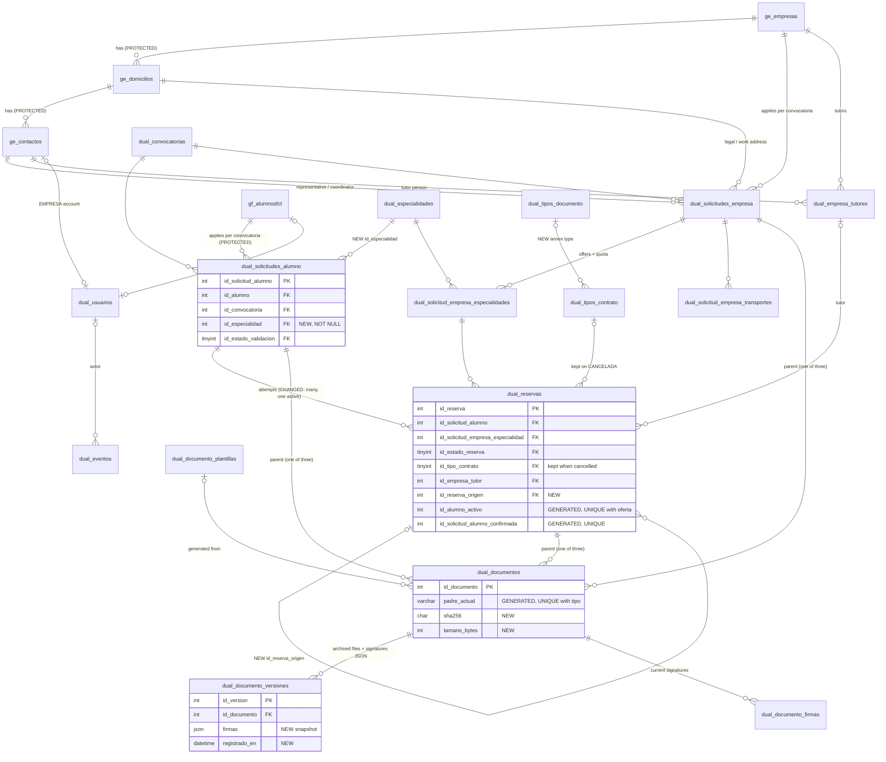

# FP Dual — Database Improvement Plan

_FP Dual · 2026-10-28 · Companion document: [DATABASE_AUDIT.md](DATABASE_AUDIT.md), which defines the findings `DB-01`…`DB-15` and the evidence for each. Decisions are numbered `D1`…`D9` (§11)._

## Progress

| Stage | Status |
| --- | --- |
| 1 — Integrity fixes (017) | **Complete.** Verified on the isolated database, then applied to `proyecto_dual` on 2026-10-28 with your approval and verified there (branch `database-improvements`, not committed). Report: [DATABASE_STAGE_1_REPORT.md](DATABASE_STAGE_1_REPORT.md). |
| 2 — Reservation model and transactions (018) | **Implemented and verified on the isolated database** (branch `database-improvements-stage-2`, based on the committed Stage 1). **018 is NOT applied to `proyecto_dual`**: it needs your approval. Report: [DATABASE_STAGE_2_REPORT.md](DATABASE_STAGE_2_REPORT.md). |
| 3 — Document history and audit | Not started. |
| 4 — Cleanup, performance, security | Not started. |

**Context given on 2026-10-28:** the application runs locally only; there is no production environment. The production checks in audit §13 therefore do not apply; the read-only pre-flight of each migration's guards runs on `proyecto_dual` instead. Each stage needs your approval before it starts, and before any migration touches `proyecto_dual`.

**Scope.** The database stays mostly as it is. The plan adds one column where application data is stored on the person, changes how reservations are recorded so each attempt is its own row, moves transaction control to the backend, completes document history, and removes obsolete objects. The four protected tables — `ge_contactos`, `ge_domicilios`, **`ge_empresas`** (verified name), `gf_alumnosfct` — are not altered by any step.

---

## 1. Recommended target architecture

Same three layers as today (protected master data → per-convocatoria process → documents and history), with five changes:

1. **Application-scoped speciality.** `dual_solicitudes_alumno.id_especialidad` becomes the source of truth for the ciclo of each application (DB-01). `gf_alumnosfct.id_especialidad_dual` keeps being written with the latest value, for legacy readers only.
2. **One row per reservation attempt.** Uniqueness applies only to the *active* pair (PENDIENTE/CONFIRMADA). Rebooking and reassignment always insert; a cancelled row is final and keeps its contract type, tutor, motive and documents (DB-04, DB-05).
3. **Backend-owned transactions.** Reservation procedures keep their checks and row locks but no longer `START TRANSACTION`/`COMMIT`. A single backend helper opens the transaction, calls the procedure, writes the audit event and commits. One lock order for all of them (DB-06, DB-07).
4. **Complete document history.** One current row per parent and type is enforced by a unique key; each archived version keeps its provenance and the signatures it had; files carry size, hash and MIME type (DB-02, DB-03).
5. **Wider audit and least privilege.** `dual_eventos` covers offers, tutors, company data, convocatorias, users and templates; the application uses a restricted MySQL account (DB-11, DB-13).

What is deliberately **not** proposed: moving files out of MySQL (audit §8), new views (the services' queries are clearer next to their code), replacing triggers with Node checks (they are the backstop that makes concurrent use safe), splitting or renaming working tables.

---

## 2. Changes to existing tables

| Table | Change | Finding | Stage |
| --- | --- | --- | --- |
| `dual_solicitudes_alumno` | + `id_especialidad INT NOT NULL` (FK `dual_especialidades`, index `ix_dsa_especialidad`) — _done in 017; the composite index was dropped: no query needs it yet_ | DB-01 | 1 |
| `dual_documentos` | + generated `padre_actual`, unique `(padre_actual, id_tipo_documento)` | DB-03 | 1 |
| `dual_documentos` | + `tamano_bytes`, `sha256`, `mime_type` | §8 | 3 |
| `dual_reservas` | Replace `uq_dual_reservas_alumno_oferta` with a unique key on the *active* pair; + `id_reserva_origen` (self FK, reassignment link); + plain index on `id_solicitud_alumno` | DB-04 | 2 |
| `dual_documento_versiones` | `id_estado_validacion` → `TINYINT UNSIGNED`; FKs on state, user, template; + `registrado_en`, `firmas_exentas_legacy`, `firmas JSON`, `tamano_bytes`, `sha256`, `mime_type` | DB-02 | 3 |
| `dual_eventos` | Wider `chk_de_entidad`; `estado_anterior/nuevo` → `VARCHAR(40)`; index `(entidad, id_entidad, creado_en)` replacing `ix_de_entidad` | DB-11 | 2–3 |
| `dual_tipos_contrato` | + `id_tipo_documento_anexo` (FK `dual_tipos_documento`) | DB-09 | 3 |
| `dual_empresa_tutores` | Drop redundant `ix_dual_empresa_tutores_empresa`, `ix_dual_empresa_tutores_activo` | §3.5 | 4 |
| `dual_documento_plantillas` | Drop redundant `ix_plantilla_tipo` | §3.5 | 4 |

Triggers and routines modified:

| Object | Change | Stage |
| --- | --- | --- |
| `trg_dsa_bi_reglas` | Require `NEW.id_especialidad` — _done; the "is active" check was not added (it would change behaviour)_ | 1 |
| `trg_dsa_bu_reglas` | Refuse changing `id_especialidad` while the application has active reservations — _added in 017_ | 1 |
| `sp_guardar_documento` | "Current document" lookup becomes a locking read — _brought forward to 017 after the isolated concurrency test_ | 1 |
| `trg_dr_bi_reglas` | Compare offer speciality with `sa.id_especialidad` | 1 |
| new `trg_dsee_bu_cupo` | Quota cannot go below active reservations | 1 |
| `trg_dr_bu_reglas` | CANCELADA is final; contract type allowed on CANCELADA; the pair stays immutable | 2 |
| `sp_reservar_alumno`, `sp_reasignar_reserva`, `sp_confirmar_reserva`, `sp_cancelar_reserva_admin` | No internal transaction; one lock order (application → offer → reservations); always insert; keep contract type on cancel | 2 |
| `sp_cancelar_reserva` | Keep contract type on cancel | 2 |
| `sp_guardar_documento` | Lock the parent; archive signatures and provenance; take provenance as parameters | 3 |
| `sp_confirmar_reserva` | Annex family from `dual_tipos_contrato.id_tipo_documento_anexo` | 3 |
| `trg_convocatorias_bu_una_activa` | Message no longer names `sp_activar_convocatoria` | 4 |

---

## 3. New and removed objects

**New:** `trg_dsee_bu_cupo` (Stage 1). No new tables are required. (A snapshot table for `ge_empresas` per application is listed as optional in §8, Stage 4, only if you want exact historical company names on screens.)

**Removed (Stage 4, after export, decision D4):**

| Object | Why it is safe | Kept until |
| --- | --- | --- |
| `dual_empresa_transportes` (22 rows) | Not read since 014; data already copied to `dual_solicitud_empresa_transportes` for latest applications | Export to CSV in `db/archive/` |
| `sp_asignar_transporte_empresa` | Writes the table above; no caller | — |
| `calendario` (2 rows, both with a file) | No code reads it; the calendar is now the CALENDARIO document | Export rows and files; confirm no external tool uses it |
| `sp_activar_convocatoria` | No caller; conflicts with `convocatoriasService` | — |
| `vw_alumnos_disponibles`, `vw_cupos_empresa_disponibles`, `vw_reservas_detalle` | No caller; hard-coded ids | — |

**Kept although legacy:** document types `ANEXO_2`, `ANEXO_H`, `FORMULARIO`, `OTRO` (referenced by 19 documents; removing them would orphan history), `dual_preferencias`/`dual_solicitud_preferencias` (decision D9), `estado_workflow`.

---

## 4. Protected-table compatibility

| Protected table | How the plan treats it |
| --- | --- |
| `ge_empresas` | Untouched. CIF lookups switch to `cif = ?` in code (DB-08) so the existing `uq_ge_empresas_cif` is used. |
| `ge_domicilios` | Untouched. Copy-on-write logic unchanged. |
| `ge_contactos` | Untouched. Tutor edits switch to copy-on-write when a past convocatoria references the tutor (new rows are inserted, existing rows are not altered) — decision D3. |
| `gf_alumnosfct` | Untouched. `id_especialidad_dual` remains and is still written (latest value). The unique DNI key added by **migration 015 stays** as an accepted pre-existing exception (decision D1). Personal-data minimisation is done through queries, account privileges and a retention procedure that changes *values*, never structure (D7). |

Every new relationship that touches a protected table is a foreign key **from** a non-protected table **to** a protected primary key, which does not modify the protected table.

---

## 5. Updated relationships and ER diagram

Cardinality changes: a student application now has exactly one speciality (`N:1`); a pair (application, offer) can have **many** reservation rows over time but at most one active; a reservation may point to the reservation it was reassigned from; a document version carries its own signatures snapshot.



Unchanged keys worth repeating: `uq_dual_solicitudes_alumno (id_alumno, id_convocatoria)`, `uq_dual_solicitudes_empresa (id_empresa, id_convocatoria)`, `uq_dsee_solicitud_especialidad`, `uq_dual_reservas_confirmada_alumno`, `uq_dec_solicitud_pendiente`, `uq_plantilla_activa`, `uq_dual_documento_firmas_doc_rol`.

---

## 6. Migration strategy

**Rules (as today):** one numbered file per stage (`017`…`020`), applied with `npm run db:migrate -- up --yes --to NNN`; a matching `rollback/NNN_*.down.sql`; never edit an applied file; every data-dependent step starts with a guard procedure that **stops without changing anything** if the data does not satisfy the new constraint (the pattern of 015); backend deployed in the order stated per stage.

**New practice — verify a clean install per stage** (needs D8): build a disposable schema from `000_baseline.sql` + all migrations, then `npm run db:schema -- diff <disposable>` against dev must report no differences. Add a seed file for `dual_especialidades` used only by that check and by new environments.

**Representative SQL** (proposals; to be finalised in each migration file):

```sql
-- 017 · DB-01 · speciality on the application
-- Guard: stop if any student has several applications (backfill would copy today's
-- value into earlier years). The centre then supplies the original values.
ALTER TABLE dual_solicitudes_alumno
  ADD COLUMN id_especialidad INT NULL AFTER id_convocatoria,
  ADD CONSTRAINT fk_dsa_especialidad FOREIGN KEY (id_especialidad)
      REFERENCES dual_especialidades (id_especialidad) ON DELETE RESTRICT ON UPDATE RESTRICT,
  ADD KEY ix_dsa_conv_esp_estado (id_convocatoria, id_especialidad, id_estado_validacion);

UPDATE dual_solicitudes_alumno sa
  JOIN gf_alumnosfct a ON a.idalumno = sa.id_alumno
   SET sa.id_especialidad = a.id_especialidad_dual;   -- trg_dsa_bu_reglas allows it (motive rules unchanged)

ALTER TABLE dual_solicitudes_alumno MODIFY id_especialidad INT NOT NULL;
-- then CREATE TRIGGER trg_dsa_bi_reglas / trg_dr_bi_reglas reading sa.id_especialidad
```

```sql
-- 017 · DB-03 · one current document per parent and type
-- Guard: stop if the duplicate check in DATABASE_AUDIT.md §13 returns rows.
ALTER TABLE dual_documentos
  ADD COLUMN padre_actual VARCHAR(16) GENERATED ALWAYS AS (
    CASE WHEN es_actual = 1 THEN
      CASE WHEN id_solicitud_alumno  IS NOT NULL THEN CONCAT('A', id_solicitud_alumno)
           WHEN id_solicitud_empresa IS NOT NULL THEN CONCAT('E', id_solicitud_empresa)
           ELSE CONCAT('R', id_reserva) END
    END) STORED,
  ADD UNIQUE KEY uq_dd_actual (padre_actual, id_tipo_documento);
```

```sql
-- 017 · DB-10 · quota floor
CREATE TRIGGER trg_dsee_bu_cupo BEFORE UPDATE ON dual_solicitud_empresa_especialidades
FOR EACH ROW BEGIN
  IF NEW.cantidad_alumnos < OLD.cantidad_alumnos
     AND NEW.cantidad_alumnos < fn_reservas_activas(NEW.id_solicitud_empresa_especialidad) THEN
    SIGNAL SQLSTATE '45000'
      SET MESSAGE_TEXT = 'No se pueden reducir las plazas por debajo de las reservas activas.';
  END IF;
END
```

```sql
-- 018 · DB-04 · one row per reservation attempt
-- Ids 1 and 2 are PENDIENTE and CONFIRMADA. Generated columns cannot call functions;
-- the existing id_solicitud_alumno_confirmada already relies on id 2. A DB test
-- asserts these ids so a reseeded lookup cannot silently break the key.
ALTER TABLE dual_reservas
  ADD KEY ix_dr_solicitud_alumno (id_solicitud_alumno),          -- FK index once the old unique key goes
  ADD COLUMN id_reserva_origen INT NULL AFTER id_empresa_tutor,
  ADD CONSTRAINT fk_dr_reserva_origen FOREIGN KEY (id_reserva_origen)
      REFERENCES dual_reservas (id_reserva) ON DELETE RESTRICT ON UPDATE RESTRICT,
  ADD COLUMN id_alumno_activo INT GENERATED ALWAYS AS
      (CASE WHEN id_estado_reserva IN (1, 2) THEN id_solicitud_alumno END) STORED,
  ADD UNIQUE KEY uq_dr_par_activo (id_alumno_activo, id_solicitud_empresa_especialidad),
  DROP INDEX uq_dual_reservas_alumno_oferta;
-- trg_dr_bu_reglas: OLD CANCELADA → anything else is refused ("crea una reserva nueva");
-- the "no contract type on CANCELADA" rule is removed.
-- Procedures: no START TRANSACTION/COMMIT; lock order application → offer → reservations;
-- always INSERT (reasignar sets id_reserva_origen); cancellations keep id_tipo_contrato.
```

```sql
-- 019 · DB-02 · complete versions
ALTER TABLE dual_documento_versiones
  MODIFY id_estado_validacion TINYINT UNSIGNED NULL,
  ADD COLUMN registrado_en DATETIME NULL,
  ADD COLUMN firmas_exentas_legacy TINYINT(1) NOT NULL DEFAULT 0,
  ADD COLUMN firmas JSON NULL COMMENT 'Signatures the file had when it was archived',
  ADD COLUMN tamano_bytes INT UNSIGNED NULL,
  ADD COLUMN sha256 CHAR(64) NULL,
  ADD COLUMN mime_type VARCHAR(100) NULL,
  ADD CONSTRAINT fk_ddv_estado FOREIGN KEY (id_estado_validacion) REFERENCES dual_estados_validacion (id_estado_validacion),
  ADD CONSTRAINT fk_ddv_usuario FOREIGN KEY (id_usuario_origen) REFERENCES dual_usuarios (id_usuario),
  ADD CONSTRAINT fk_ddv_plantilla FOREIGN KEY (id_plantilla) REFERENCES dual_documento_plantillas (id_plantilla);
-- sp_guardar_documento archives: … , (SELECT JSON_ARRAYAGG(JSON_OBJECT('rol', rol, 'estado', estado,
--   'firmado_en', firmado_en, 'firmado_por', firmado_por, 'metodo', metodo))
--   FROM dual_documento_firmas WHERE id_documento = v_id)
```

Why a JSON snapshot rather than a version-signature table: archived signatures are written once, never queried individually, and always read together with their version. A JSON column keeps the history immutable and the procedure simple. If you prefer strict relational history, a `dual_documento_version_firmas (id_version, rol, estado, firmado_en, firmado_por, metodo)` table works the same way at slightly higher effort.

```sql
-- 020 · DB-13 · accounts (run by a DBA, not by the runner; passwords are not in the repo)
CREATE USER 'fpdual_app'@'localhost' IDENTIFIED BY '<secret>';
GRANT SELECT, INSERT, UPDATE, DELETE, EXECUTE ON proyecto_dual.* TO 'fpdual_app'@'localhost';
CREATE USER 'fpdual_migrator'@'localhost' IDENTIFIED BY '<secret>';
GRANT ALL PRIVILEGES ON proyecto_dual.* TO 'fpdual_migrator'@'localhost';
-- Routines and views are recreated with a dedicated DEFINER that has only the rights they need.
```

**Data preservation per stage:** 017 copies values (no row lost; guard for multi-year students); 018 changes no existing row (old reactivated rows keep their mixed history, documented as such); 019 adds nullable columns (existing versions keep NULL signatures — nothing to recover, there are 0 versions on dev); 020 exports before dropping.

---

## 7. Backend and frontend compatibility changes

| Stage | Backend | Frontend |
| --- | --- | --- |
| 1 | `solicitudesAlumnoService.create` writes `id_especialidad` on the application (and still on the student). Every reader switches from `a.id_especialidad_dual` to `sa.id_especialidad`: `reservasService` (`validateReservaTargets`, `getAlumnosDisponibles`, eligibility queries), `documentosWorkflow.buildStaffList`/`buildAlumnoList`, `notificaciones`, `panelService`, `seedPruebas.js`. `documentosStore.saveByClave` locks the parent row first and maps `ER_DUP_ENTRY` on `uq_dd_actual` to 409. CIF lookups → `cif = ?` (3 places). `mapSqlError` maps 1213/1205 to 409 "Inténtalo de nuevo". | None (same fields returned). |
| 2 | New `withTransaction` helper used by every reservation call; `recordEvent` (in-transaction) replaces `recordEventAfterCommit` for reservations; one retry on deadlock. `bajaService` does state + accounts + cancellations + events in one transaction. `updateCupoEspecialidad` cancels through `sp_cancelar_reserva` inside its transaction and records events (reservation `CANCELAR`, offer `CUPO`). `loadReservaPair`/`resolveReservaId` prefer the active row (`ORDER BY id_estado_reserva IN (1,2) DESC, id_reserva DESC`). `getOfertasElegibles`/`ACTIVE_PAIR_SQL` unchanged in meaning. Audit for offers and tutors. | Reservation lists hide CANCELADA by default (already filterable); the detail panel shows "Reasignada desde #…" and earlier attempts in the history tab. |
| 3 | `sp_guardar_documento` takes provenance parameters; `saveByClave` computes size, SHA-256 and MIME; a "Historial" endpoint returns versions with their signatures. `anexoClaveForContrato` reads the annex type from the lookup. Tutor update: copy-on-write when the tutor is on a reservation of a non-active convocatoria (D3). Audit for company data, convocatorias, templates, password resets, account changes. | Document history view lists versions with signers; tutor edit text explains that past years keep the old data. |
| 4 | List endpoints filter by convocatoria in SQL (default: active); Seguimiento builds items only for the requested convocatoria; server-side pagination where measurements justify it. `.env` uses `fpdual_app`; the runner uses `fpdual_migrator`. | Lists already send the convocatoria filter (Phase 4); no change unless pagination moves server-side. |

---

## 8. Implementation stages

### Stage 1 — Integrity fixes without behaviour change (migration 017)

- **Objective:** close the gaps where the database allows wrong data today, with no visible change for users.
- **Database:** DB-01 speciality column + triggers; DB-03 unique current document; DB-10 quota floor trigger.
- **Backend:** readers of the speciality; parent lock and 409 in `saveByClave`; DB-08 CIF queries; deadlock/lock-timeout mapping.
- **Frontend:** none.
- **Data migration:** backfill speciality (guarded); verify 0 duplicate current documents and 0 over-quota offers before the keys/triggers (guarded).
- **Dependencies:** none. Production checks in audit §13 first.
- **Risks:** a returning student in production whose earlier speciality differs (guard stops the migration; the centre supplies values). A missed reader of `id_especialidad_dual` would still show the latest value — mitigated by `grep` list above and tests.
- **Tests:** DB tests: application insert without speciality fails; reservation with mismatched speciality fails; a second current document for the same parent and type fails with `ER_DUP_ENTRY`; reducing quota below active reservations fails. API: student re-applies with a new ciclo → earlier application and its reservation keep the old ciclo in lists and Seguimiento.
- **Acceptance:** all existing tests green; new tests green; `schema.js diff` against a clean install empty; registration `EXPLAIN` shows `const` on `uq_ge_empresas_cif`.
- **Result (2026-10-28):** implemented; on the isolated database 14/14 Stage 1 DB tests and 6/6 Phase 2 DB tests pass; backend unit 87 pass with 1 failure that also fails on `main` (mail-config test reads the local `.env`); frontend 28/28; clean install from the repository equals `proyecto_dual`; registration lookup is a `const` read on `uq_ge_empresas_cif` (was a full index scan); read-only pre-flight of the 017 guards on `proyecto_dual` all zero. **017 applied to `proyecto_dual` on 2026-10-28 and verified there** (clean-install diff empty, protected tables unchanged, DB and smoke tests pass). Details: [DATABASE_STAGE_1_REPORT.md](DATABASE_STAGE_1_REPORT.md).

### Stage 2 — Reservation model and transaction ownership (migration 018)

- **Objective:** every reservation transition is one atomic unit with its audit event; each attempt is its own row; no reactivation path.
- **Database:** DB-04 active-pair key, `id_reserva_origen`, final CANCELADA, contract type kept on cancel; DB-06 procedures without internal transactions; DB-07 one lock order; `dual_eventos` entity list widened for `OFERTA` and `TUTOR`, `estado_*` → `VARCHAR(40)`, index `(entidad, id_entidad, creado_en)`.
- **Backend:** `withTransaction` + in-transaction events; atomic *baja*; quota reduction through the common cancellation; pair lookups prefer the active row; tutor and offer events.
- **Frontend:** CANCELADA hidden by default; reassignment link and earlier attempts in the detail panel.
- **Data migration:** none to existing rows.
- **Dependencies:** Stage 1 (speciality used by the insert trigger). Decision D2 (and D5 for keeping the contract type).
- **Risks:** a caller that forgets the transaction would run a procedure in autocommit, so its `FOR UPDATE` locks would last one statement — **highest risk of the plan**. Mitigation: the procedures are called only from one module, through `withTransaction`; a test fails if any `CALL sp_reservar_alumno|sp_reasignar_reserva|sp_confirmar_reserva|sp_cancelar_reserva_admin` appears outside it. If you prefer not to take this risk, the fallback (D6) is to keep the procedures' own transactions and pass the acting user so each procedure writes its own event — atomic for events, but *baja* would still need a dedicated procedure.
- **Tests:** concurrency tests on a disposable schema: two sessions reserving the last place (one wins); confirm vs reserve on the same student (no deadlock, or one retried); *baja* with two active reservations rolls back fully if one cancellation fails; rebook after cancel creates a new id and the old row keeps its contract type and documents; reassignment sets `id_reserva_origen`.
- **Acceptance:** every reservation transition writes exactly one event in the same transaction (test kills the event insert → no state change); `SHOW ENGINE INNODB STATUS` shows no deadlock in the concurrency suite; no `UPDATE … CANCELADA → PENDIENTE` path remains.
- **Result (2026-10-28):** implemented. Changes from this plan, found during the isolated tests:
  - The lock order became application → company application → **offers (ascending)** → reservations. Nothing changes a reservation's state without holding its offer, because the first stress run showed a booking/cancellation deadlock across the offer index.
  - Locking counts pin their index, and backend transactions run at READ COMMITTED.
  - The procedures refuse `autocommit = 1` (SQLSTATE 45001), so the "forgotten transaction" risk is enforced by the database itself, not only by a static test (which also exists).
  - Eligibility is checked before places.
  - Tutor assignment and document review now lock in the same order.

  On the isolated database: 21/21 real-MySQL tests, in 8 consecutive clean runs with no deadlock and no retry. Stage 1 14/14, Phase 2 6/6, mocked 94 pass (1 failure that predates Stage 1), frontend 28/28, ESLint 0, build OK, browser check OK. The rollback is exact only before any second attempt or OFERTA/TUTOR event; after that its guard refuses and only the backup restore remains. **018 not applied to `proyecto_dual` (awaiting approval).**

### Stage 3 — Document history and audit coverage (migration 019)

- **Objective:** any past file can be shown with who signed it and how; every administrative change is in the audit trail.
- **Database:** DB-02 version table completed, signatures archived; file metadata on documents and versions; DB-09 annex type on `dual_tipos_contrato`; `dual_eventos` entities `EMPRESA`, `CONVOCATORIA`, `USUARIO`, `PLANTILLA`.
- **Backend:** `sp_guardar_documento` signature and provenance parameters; hash/size/MIME at upload; history endpoint; DB-12 tutor copy-on-write (D3); events for company data, convocatorias, templates, password resets and account changes.
- **Frontend:** version history with signers; tutor edit message.
- **Data migration:** backfill `tamano_bytes`/`sha256` for existing files with one `UPDATE … SET tamano_bytes = LENGTH(archivo), sha256 = SHA2(archivo, 256)` (reads every file once — schedule off-hours); annex type: BECA → ANEXO_III, others → ANEXO_II.
- **Dependencies:** Stage 2 (transaction helper, events in transaction).
- **Risks:** procedure signature change must be deployed together with the backend (order: migration, then backend; rollback restores the old procedure).
- **Tests:** upload v1, sign as two roles, upload v2 → v1 version row has two signatures in `firmas`; download sends the stored MIME and the hash matches; tutor edited after a past placement → past placement still shows the old tutor data.
- **Acceptance:** history endpoint returns every version with signatures; `grep` finds no state-changing service without an event.

### Stage 4 — Cleanup, performance and security (migration 020 + configuration)

- **Objective:** remove what is obsolete, keep lists fast as years accumulate, run with least privilege, and define retention.
- **Database:** drop obsolete objects (§3) after export; drop redundant indexes; fix the convocatoria trigger message.
- **Backend:** convocatoria filter in SQL for `GET /reservas`, student/company lists and Seguimiento; server-side pagination where measured; switch to `fpdual_app`/`fpdual_migrator`.
- **Frontend:** only if pagination moves server-side.
- **Data migration:** exports of `calendario` and `dual_empresa_transportes` into `db/archive/` (outside Git if they contain personal data).
- **Dependencies:** none on Stage 3 for the cleanup; accounts can be done any time (recommended first on dev, production before go-live).
- **Risks:** an external report reading a dropped object (check with the centre, audit §13); a privilege missing for the app account (test every route with the new account).
- **Tests:** full API suite under `fpdual_app`; timing of list endpoints with a realistic dataset before/after (target from the roadmap: < 500 ms with a year of data).
- **Acceptance:** `information_schema` lists none of the dropped objects; app account has no global privilege; list endpoints meet the target; retention procedure documented and (if approved) dry-run on a copy.

**Optional (not scheduled):** per-application snapshot of `ge_empresas` values (`dual_solicitud_empresa_datos`), only if staff need exact historical company names on screens; generated PDFs already freeze them.

---

## 9. Tests and acceptance criteria (summary)

| Area | Test | Where |
| --- | --- | --- |
| Speciality | Application keeps its ciclo after the student re-applies with another | DB test + API test |
| Reservations | Last-place race; confirm vs reserve; rebook creates new row; reassignment link; cancelled keeps contract type | DB tests (disposable schema), API tests |
| Atomicity | Forced failure of the event insert or of one *baja* cancellation rolls back everything | DB tests |
| Documents | Duplicate current row refused; version keeps signatures; hash/MIME stored | DB + API tests |
| Quota | Reduction below active reservations refused by the DB | DB test |
| Audit | Every state-changing endpoint writes one event | API tests (event count before/after) |
| Schema | Clean install equals dev (`schema.js diff`) after each stage | CI or manual (D8) |
| Privileges | Whole suite passes under `fpdual_app` | API tests |
| Performance | List endpoints < 500 ms with a year of data | Measurement script |

Existing suites (backend 75+, frontend 27+, DB 6) must stay green at every stage.

---

## 10. Estimated effort and risk

| Stage | Effort | Risk | Main risk |
| --- | --- | --- | --- |
| 1 — Integrity fixes | Medium (≈ 2–3 days) | Low | Multi-year students in production (guarded) |
| 2 — Reservation model and transactions | High (≈ 5–7 days incl. concurrency tests) | Medium–High | A procedure called outside a transaction (mitigated by one module + test) |
| 3 — Document history and audit | Medium (≈ 3–4 days) | Medium | Procedure signature change deployed out of order |
| 4 — Cleanup, performance, security | Medium (≈ 3 days + production account work) | Low–Medium | Unknown external consumer of dropped objects |

Stages are independent enough to ship one at a time; the application is fully usable after each.

---

## 11. Decisions requiring your approval

**Your decisions (2026-10-28):** D1 keep the 015 DNI index as a pre-existing exception, no further structural change to the protected tables · D2 approved in principle · D3 approved · D4 conditionally approved: verify there are no external dependencies and export all legacy data and files first · D5 approved · D6 conditionally approved: only after comprehensive atomicity, rollback and concurrency testing on an isolated MySQL database · D7 deferred: no automatic anonymisation or deletion without an agreed retention policy · D8 approved: isolated verification database with synthetic data · D9 keep preferences.

Original proposals:

| # | Decision | Recommendation |
| --- | --- | --- |
| **D1** | Migration 015 already altered protected `gf_alumnosfct` (unique DNI index). Keep it or revert? | **Keep** as an accepted pre-existing exception; reverting re-opens duplicate students and the backend relies on it. |
| **D2** | Change reservations to one row per attempt (unique only on the active pair; CANCELADA final). | **Approve.** Removes reactivation logic and DB-05; preserves each attempt's history. If rejected: keep reuse and add eligibility checks to `trg_dr_bu_reglas` (smaller fix). |
| **D3** | Tutor edits: copy-on-write when a past convocatoria references the tutor, or keep editing in place? | **Copy-on-write**, same rule as the coordinator. |
| **D4** | Drop `calendario` (2 legacy rows with files) and `dual_empresa_transportes` after export. | **Approve**, after the centre confirms no other tool reads them. |
| **D5** | Keep the contract type on cancelled reservations (needs a trigger change). | **Approve** (history), together with D2. |
| **D6** | Transaction ownership: backend-owned (procedures without `START TRANSACTION`) or procedure-owned with in-procedure audit. | **Backend-owned**, with the single-module guard. |
| **D7** | Retention and anonymisation policy for students, companies and files of closed convocatorias. | Define the period with the centre; then an anonymisation procedure that changes values only. |
| **D8** | Permission to create a disposable schema on the dev server for clean-install and concurrency tests. | **Approve** (e.g. `proyecto_dual_verify`, dropped after each run). |
| **D9** | Student preferences: the catalogue is empty; keep the feature or remove it? | Ask the centre; if unused for a year, remove in Stage 4. |

Also useful (no decision): realistic yearly volumes, for the Stage 4 measurements. There is no production environment.

Each stage starts only after your approval, and no migration is applied to `proyecto_dual` without it.
