# Manual de usuario de FP Dual

_Gestor FP Dual · Centro Salesiano Ntra. Sra. del Pilar (Salesianos Zaragoza)_
_Versión del manual: 27/10/2026. Describe la aplicación tal y como funciona en esta fecha._

> Las capturas de este manual se han hecho con **datos de prueba** (empresas, alumnos y correos inventados). Algunos estados que aparecen en ellas solo sirven de ejemplo.

---

## Índice

1. [Introducción](#introduccion)
2. [Acceso a la aplicación](#acceso)
   - [Iniciar sesión](#iniciar-sesion) · [Cerrar sesión](#cerrar-sesion) · [Cambiar la contraseña](#cambiar-contrasena) · [Contraseña temporal](#contrasena-temporal) · [Sesión caducada](#sesion-caducada) · [Si no puedes entrar](#no-puedes-entrar)
3. [Navegación general](#navegacion)
   - [Menú principal](#menu) · [Listas, búsqueda y filtros](#filtros) · [Estados e indicadores](#estados) · [Botones y ventanas habituales](#botones)
4. [Solicitudes públicas (alumnos y empresas nuevos)](#solicitudes-publicas)
   - [Comprobar si el plazo está abierto](#plazo) · [Solicitud de alumno](#solicitud-alumno) · [Solicitud de empresa](#solicitud-empresa) · [Después de enviar](#despues-enviar)
5. [Manual del administrador](#administrador)
   - [Panel](#panel) · [Convocatorias](#convocatorias) · [Alumnos](#staff-alumnos) · [Empresas](#staff-empresas) · [Reservas](#staff-reservas) · [Documentos](#staff-documentos) · [Plantillas](#plantillas) · [Cuentas y contraseñas](#cuentas) · [Dar de baja](#baja)
6. [Manual del coordinador](#coordinador)
7. [Manual de empresa](#empresa)
   - [Portal de la empresa](#portal-empresa) · [Datos y cambios](#empresa-datos) · [Ciclos y plazas](#empresa-plazas) · [Tutores](#empresa-tutores) · [Alumnos disponibles y reservas](#empresa-reservar) · [Documentos y firmas](#empresa-documentos) · [Nueva convocatoria](#empresa-reaplicar)
8. [Manual del alumno](#alumno)
   - [Portal del alumno](#portal-alumno) · [Mis documentos](#alumno-documentos) · [Mis reservas y firma del anexo](#alumno-reservas) · [Corregir datos personales](#alumno-datos)
9. [Situaciones especiales y preguntas frecuentes](#situaciones-especiales)

---

## 1. Introducción

FP Dual es la aplicación del centro para gestionar la Formación Profesional Dual: quién se apunta, qué empresas ofrecen plazas, qué alumno va a cada empresa y toda la documentación que hay que firmar y revisar por el camino.

**Quién la usa**

| Perfil | Qué hace |
| --- | --- |
| **Administración** (ADMINISTRADOR) | Gestiona todo el proceso, las convocatorias, las plantillas de documentos y las contraseñas de las empresas. |
| **Coordinación** (COORDINADOR) | Revisa solicitudes y documentos, gestiona reservas y empresas. Tiene casi los mismos permisos que Administración ([diferencias](#coordinador)). |
| **Empresa** | Presenta su solicitud, firma el convenio, reserva alumnos y firma los anexos. |
| **Alumno** | Presenta su candidatura, sube su documentación y firma el anexo de su plaza. |
| **Visitantes** | Sin cuenta: pueden ver si el plazo está abierto y presentar una solicitud. |

**El proceso, en resumen**

1. El centro abre una **convocatoria** (un curso, por ejemplo 2026/2027).
2. Alumnos y empresas presentan su **solicitud** desde la página de inicio.
3. El centro **valida** a los alumnos (revisando su CV y su Anexo DGA) y a las empresas (cuando su convenio firmado está validado).
4. Las empresas **reservan** a los alumnos que les interesan.
5. Para cada reserva, el centro indica el **tipo de contrato**, se prepara el **Anexo II o III**, lo firman empresa, alumno y centro, y el centro lo **valida**.
6. El centro **confirma** la reserva: la plaza pasa a ser definitiva.

**Cómo está organizado este manual**

Los capítulos 2 y 3 sirven para todo el mundo. Después hay un capítulo por perfil: busca el tuyo en el [índice](#indice). El capítulo 9 explica las situaciones que más dudas generan; merece la pena leerlo aunque no tengas ningún problema.

---

## 2. Acceso a la aplicación

### Iniciar sesión

1. En el menú de la izquierda pulsa **«Acceder»** (o el botón **«Acceder»** de la página de inicio).
2. En **«Usuario»** escribe tu identificador. Depende de tu perfil:

   | Perfil | Usuario |
   | --- | --- |
   | Administración y Coordinación | Tu correo electrónico |
   | Empresa | El CIF de la empresa |
   | Alumno | Tu DNI/NIE |

3. Escribe tu **«Contraseña»** y pulsa **«Entrar»**.

Entrarás directamente en tu página principal: el **Panel** si eres personal del centro, **«Mi empresa»** si eres una empresa y **«Mi proceso Dual»** si eres alumno.

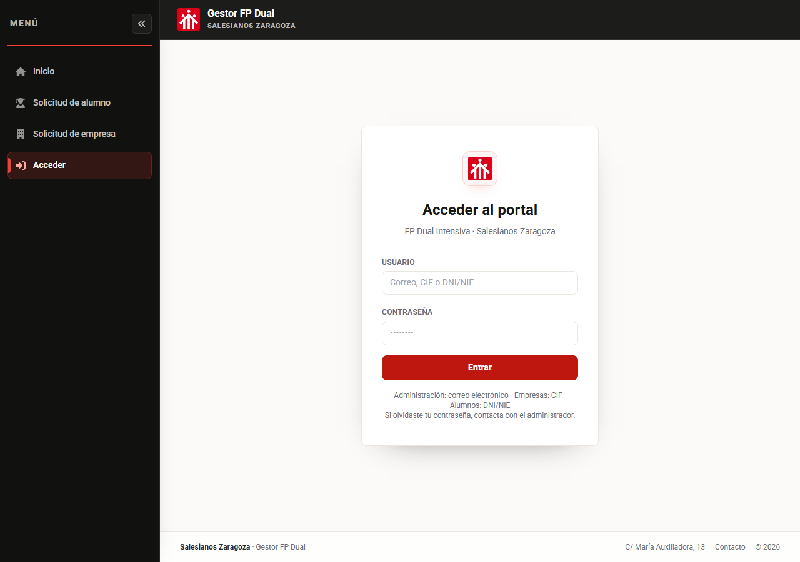
_Pantalla de inicio de sesión. Debajo del botón se recuerda qué usuario corresponde a cada perfil._

### Cerrar sesión

Pulsa **«Salir»** (arriba a la derecha) o **«Cerrar sesión»** (al final del menú lateral). Si usas un ordenador compartido, cierra siempre la sesión al terminar.

### Cambiar la contraseña

Puedes cambiarla siempre que quieras, sea cual sea tu perfil.

1. Al final del menú lateral, pulsa **«Cambiar contraseña»** (icono de llave).
2. Escribe tu **«Contraseña actual»**.
3. Escribe la **«Nueva contraseña»** (mínimo 8 caracteres) y repítela en **«Confirmar nueva contraseña»**. El icono del ojo muestra lo que has escrito.
4. Pulsa **«Cambiar contraseña»**.

A la derecha verás una lista que se marca sola: al menos 8 caracteres, distinta de la actual y que las dos contraseñas coincidan. La barra de **«Seguridad»** es solo orientativa.

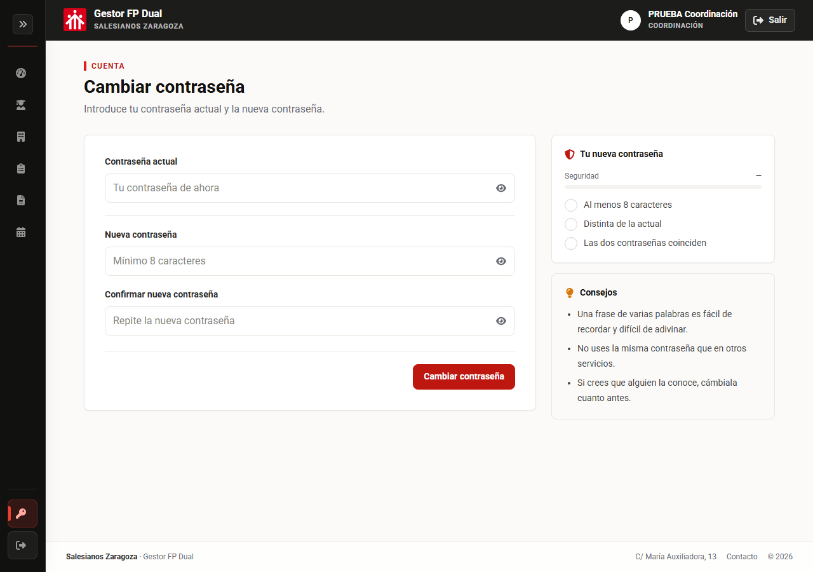
_Cambio de contraseña. El panel de la derecha indica qué requisitos se cumplen._

### Contraseña temporal (cambio obligatorio)

Si Administración te ha **restablecido la contraseña**, te dará una contraseña temporal. Al entrar con ella aparece la pantalla **«Cambiar contraseña — Debes establecer una nueva contraseña antes de continuar»**:

1. Escribe la **«Nueva contraseña»** (mínimo 8 caracteres) y repítela en **«Confirmar contraseña»**.
2. Pulsa **«Establecer contraseña»**.

Hasta que no la cambies no puedes usar el resto de la aplicación. Las empresas que se registran ellas mismas eligen su contraseña en el formulario y **no** tienen que cambiarla al entrar por primera vez.

### Sesión caducada

Por seguridad, la sesión dura unas **8 horas**. Cuando caduca, la aplicación te lleva a la pantalla de acceso con el aviso **«Tu sesión ha caducado. Inicia sesión de nuevo.»** Vuelve a entrar; lo que ya estaba guardado no se pierde, pero sí lo que estuvieras escribiendo sin enviar.

También puedes ver estos avisos:

- **«Tus permisos han cambiado. Inicia sesión de nuevo.»**: el centro ha cambiado algo de tu cuenta. Vuelve a entrar.
- **«Tu cuenta está desactivada. Contacta con el centro.»**: no podrás entrar hasta que el centro la reactive.

### Si no puedes entrar

| Mensaje | Qué significa y qué hacer |
| --- | --- |
| «Credenciales incorrectas.» | El usuario o la contraseña no son correctos. Comprueba que usas el identificador de tu perfil (correo, CIF o DNI/NIE) y que no tienes activadas las mayúsculas. |
| «Demasiados intentos fallidos. Vuelve a intentarlo en N minuto(s).» | Tras 5 intentos fallidos seguidos, el acceso se bloquea unos minutos (como máximo 15). Espera y vuelve a probar. |
| «La cuenta está desactivada. Contacte con el administrador.» | Habla con el centro. |

**¿Has olvidado la contraseña?** La aplicación no tiene un enlace para recuperarla por correo. Ponte en contacto con el centro (la propia pantalla de acceso lo indica: _«Si olvidaste tu contraseña, contacta con el administrador.»_). Ver también [«He olvidado la contraseña»](#faq-contrasena).

---

## 3. Navegación general

### Menú principal

El menú está a la izquierda. Cada perfil ve solo sus secciones:

| Perfil | Secciones del menú |
| --- | --- |
| Administración y Coordinación | Panel · Alumnos · Empresas · Reservas · Documentos · Convocatorias |
| Empresa | Mi empresa · Alumnos disponibles |
| Alumno | Mi proceso Dual |
| Visitante | Inicio · Solicitud de alumno · Solicitud de empresa · Acceder |

Al final del menú están **«Cambiar contraseña»** y **«Cerrar sesión»**. Arriba a la derecha aparecen tu nombre, tu perfil y el botón **«Salir»**.

- **En el ordenador**, el botón con las flechas («Contraer menú lateral» / «Expandir menú lateral») deja el menú solo con iconos. La aplicación recuerda tu elección.
- **En el móvil**, el menú se abre con el botón de tres rayas («Abrir menú») y se cierra con la X o con la tecla Escape.

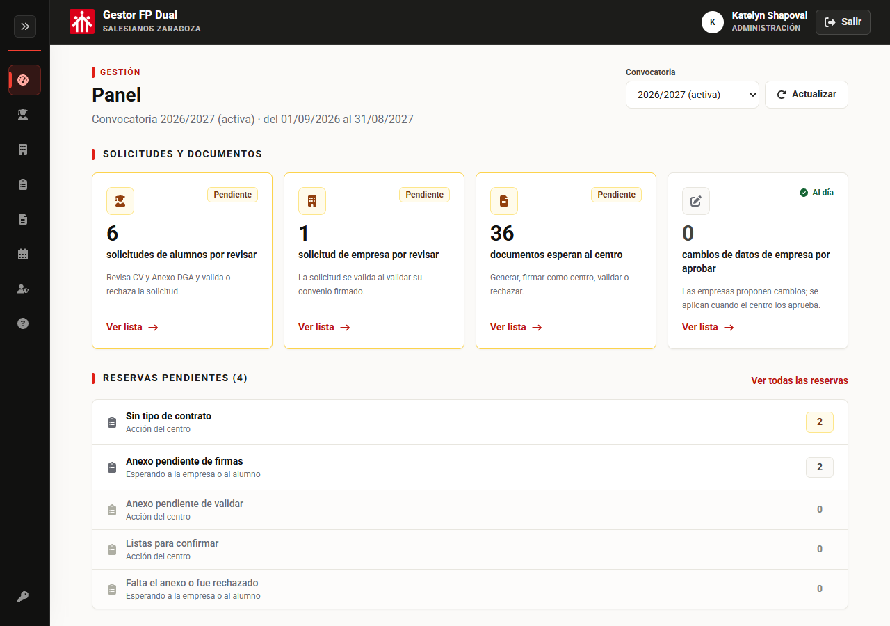
_Vista general para el personal del centro: menú lateral, cabecera con el usuario y el Panel._

### Listas, búsqueda y filtros

Las listas de **Alumnos**, **Empresas**, **Reservas** y **Documentos** funcionan igual:

- **«Buscar»**: escribe un nombre, DNI/NIE, CIF, empresa… No importa si usas mayúsculas o tildes.
- **Desplegables de filtro** (convocatoria, estado, especialidad…). Por defecto se muestra la **convocatoria activa**; elige **«Todas»** o una convocatoria anterior para ver el histórico.
- Debajo de los filtros se indica cuántos resultados hay. **«Quitar filtros»** (o «Limpiar filtros») vuelve a la vista inicial.
- Al final de la lista eliges la página y cuántas **«Filas por página»** quieres ver.
- Los filtros quedan en la dirección de la página: puedes guardar la página en favoritos o usar el botón «Atrás» del navegador sin perderlos.

Las tarjetas de alumnos y empresas se despliegan con el botón de la flecha de la derecha.

### Estados e indicadores

Los estados se muestran con etiquetas de color: **verde** = correcto o terminado, **amarillo** = pendiente, **rojo** = rechazado o problema, **gris** = cancelado o sin datos.

**Solicitudes** (de alumno o de empresa)

| Estado | Significado |
| --- | --- |
| Pendiente de revisión | El centro todavía no la ha revisado. |
| Validada | Aceptada. El alumno ya puede ser reservado o la empresa ya puede reservar. |
| Rechazada | No aceptada. Se muestra el motivo. |
| Dada de baja | Administración la ha retirado del programa. Su cuenta del portal está desactivada ([más información](#baja)). |

**Reservas**

| Estado | Significado |
| --- | --- |
| Reserva pendiente | Una empresa ha reservado al alumno, pero **todavía no es definitivo**. |
| Confirmada | Plaza definitiva. Solo la confirma el centro. |
| Cancelada | Ya no está activa. Se conserva en el historial. |

**Documentos**

| Estado | Significado |
| --- | --- |
| Pendiente de generar | El centro tiene que generar el documento desde su plantilla. |
| Pendiente de subir | Falta el archivo PDF. |
| Pendiente de firma | Falta la firma de alguien. |
| Pendiente de validar | El archivo está y el centro tiene que revisarlo. |
| Validado | Revisado y aceptado. |
| Rechazado | No aceptado; hay que subir uno nuevo. Se muestra el motivo. |
| Completo | Documento sin revisión (como el Calendario) con todas las firmas. |
| Sin tipo de contrato | El anexo aún no existe porque falta el tipo de contrato. |

En cada documento también se indica **quién tiene que actuar** (por ejemplo «Pendiente del alumno: subir Anexo DGA») y, si lleva firmas, el estado de cada una: **Firmado** o **Sin firmar**.

**Iconos de las reservas.** En las listas del personal del centro (Reservas, Alumnos y Empresas), el estado de una reserva se resume con tres iconos redondos:

| Icono | Indica |
| --- | --- |
| 🤝 Apretón de manos | Estado de la reserva |
| 📄 Documento con firma | Estado del Anexo II o III |
| 📅 Calendario | Estado del Calendario |

El color sigue la regla de antes (verde, amarillo, rojo, gris). **Pasa el ratón por encima del icono (o tócalo en el móvil) para ver el texto completo**, por ejemplo «Anexo: falta tipo de contrato».

### Botones y ventanas habituales

- El botón **rojo relleno** es la acción principal de la pantalla (por ejemplo «Enviar solicitud» o «Confirmar reserva»). Los botones con borde rojo son acciones de cada fila (Validar, Firmar, Reservar…).
- **Ventanas de confirmación**: antes de una acción importante se pide confirmación. Pulsa el botón de la acción para seguir o «Cancelar» / «Volver» para no hacer nada.
- **Ventanas con motivo**: para rechazar o cancelar hay que escribir un motivo. Ese motivo lo ve la persona que tiene que corregir algo.
- **Avisos**: tras cada acción aparece un mensaje breve (por ejemplo «Documento validado.»). Si algo falla, el aviso explica el motivo.
- **Visor de documentos**: al pulsar «Ver documento» o «Ver» se abre el PDF dentro de la aplicación, con los botones **«Descargar»** y **«Nueva pestaña»**. En el móvil se recomienda abrirlo en una pestaña nueva.
- **Datos sin enviar**: si sales de un formulario a medias, el navegador te avisa antes de cerrar la página.

---

## 4. Solicitudes públicas (alumnos y empresas nuevos)

Esta parte es para quien todavía no participa: alumnos que presentan su candidatura y empresas que quieren ofrecer plazas. No hace falta tener cuenta: la cuenta se crea al enviar la solicitud.

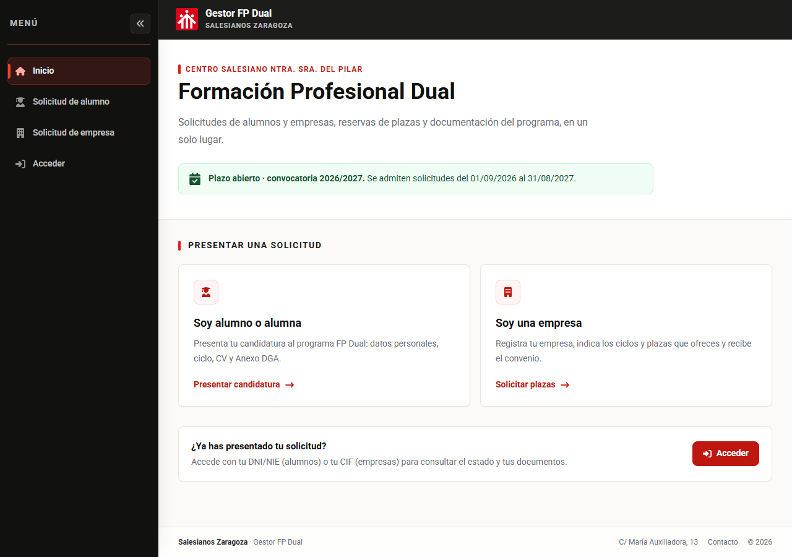
_Página de inicio para visitantes. El recuadro verde indica que el plazo está abierto._

### Comprobar si el plazo está abierto

En la página de inicio y en los dos formularios aparece un aviso:

- **Verde, «Plazo abierto · convocatoria 2026/2027»**, con las fechas en que se admiten solicitudes.
- **«El plazo de solicitudes está cerrado.»**: el formulario no se muestra. Se indica cuándo empieza la próxima convocatoria (o «Todavía no hay fecha para la próxima convocatoria»). Desde ahí puedes ir a **«Acceder al portal»** si ya participas.

Las convocatorias se abren y se cierran solas según sus fechas.

### Solicitud de alumno

**Quién:** alumnos matriculados en un ciclo del centro.
**Antes de empezar:** ten a mano tu **CV** y el **Anexo DGA** firmado, los dos en **PDF** (máximo 10 MB cada uno). Si no tienes el Anexo DGA, pídelo en secretaría. Calcula unos 10 minutos.

1. En la página de inicio pulsa **«Presentar candidatura»** (o «Solicitud de alumno» en el menú).
2. Rellena los seis pasos. Pulsa **«Siguiente →»** para avanzar y **«← Anterior»** para volver sin perder nada:

   | Paso | Qué se pide |
   | --- | --- |
   | 1. Ciclo | **Email del centro** (el que termina en `@zaragoza.salesianos.edu`), tu **ciclo** y, si quieres, hasta tres **preferencias** de tipo de puesto. |
   | 2. Datos personales | **DNI / NIE** (con letra, sin espacios ni guiones; será tu usuario), nombre y apellidos, fecha de nacimiento, nacionalidad y sexo. **Si eres menor de edad**, también el nombre y el DNI/NIE de tu tutor o tutora legal. |
   | 3. Contacto y movilidad | Email personal, teléfono (9 cifras), domicilio, código postal, localidad, si tienes carnet de conducir y vehículo, idiomas y nivel, y el número de la Seguridad Social si ya lo tienes (es opcional). |
   | 4. Documentos | **Currículum (PDF)** y **Anexo DGA (PDF)**. |
   | 5. Cuenta | La **contraseña** con la que entrarás al portal (mínimo 8 caracteres), dos veces. **Si ya tienes cuenta de un curso anterior, escribe aquí tu contraseña actual** ([más información](#faq-alumno-existente)). |
   | 6. Revisión y envío | Un resumen de todo. Cada apartado tiene un botón **«Modificar»** para corregirlo. |

3. Pulsa **«Enviar solicitud»** y espera a que termine: aparece «Enviando la solicitud. No cierres esta página.»

Los campos con **\*** son obligatorios. Si falta algo, al pulsar «Siguiente →» aparece arriba un recuadro rojo con la lista de problemas; pulsa cada uno para ir directamente al campo.

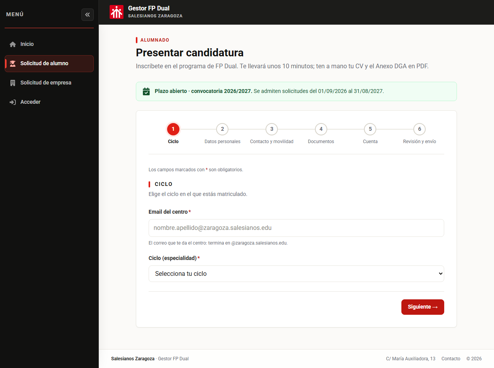
_Paso 1 de la solicitud de alumno. Los círculos de arriba muestran en qué paso estás._

### Solicitud de empresa

**Quién:** empresas que quieren acoger alumnos en FP Dual. Esta solicitud no tiene vinculación legal; el compromiso se formaliza después con el convenio.
**Importante:** si la empresa ya participó en otra convocatoria, **no** uses este formulario: entra en el portal con el CIF y usa [«Participar en la nueva convocatoria»](#empresa-reaplicar).

1. En la página de inicio pulsa **«Solicitar plazas»** (o «Solicitud de empresa» en el menú).
2. Rellena los seis pasos:

   | Paso | Qué se pide |
   | --- | --- |
   | 1. Empresa | Razón social, **CIF** (será el usuario del portal), teléfono (opcional), dirección fiscal, municipio, provincia y código postal. |
   | 2. Responsable legal | La persona que firma el convenio: nombre y apellidos, DNI/NIE, cargo, email y teléfono. |
   | 3. Coordinador | La persona de contacto con el centro: recibe los avisos y el convenio, gestiona el portal y queda como primer tutor de la empresa. Nombre, DNI/NIE, email y teléfono. |
   | 4. Puesto y ciclos | Descripción del puesto (las tareas del alumno); el **lugar de trabajo** (marca «El alumno trabajará en la dirección fiscal de la empresa» o escribe otra dirección); los **ciclos** que os interesan y cuántos alumnos podéis acoger en cada uno; y, si queréis, los medios de transporte para llegar al puesto. |
   | 5. Cuenta | La contraseña del portal (mínimo 8 caracteres), dos veces. |
   | 6. Revisión y envío | Resumen con botones **«Modificar»**. |

3. Pulsa **«Enviar solicitud»**.

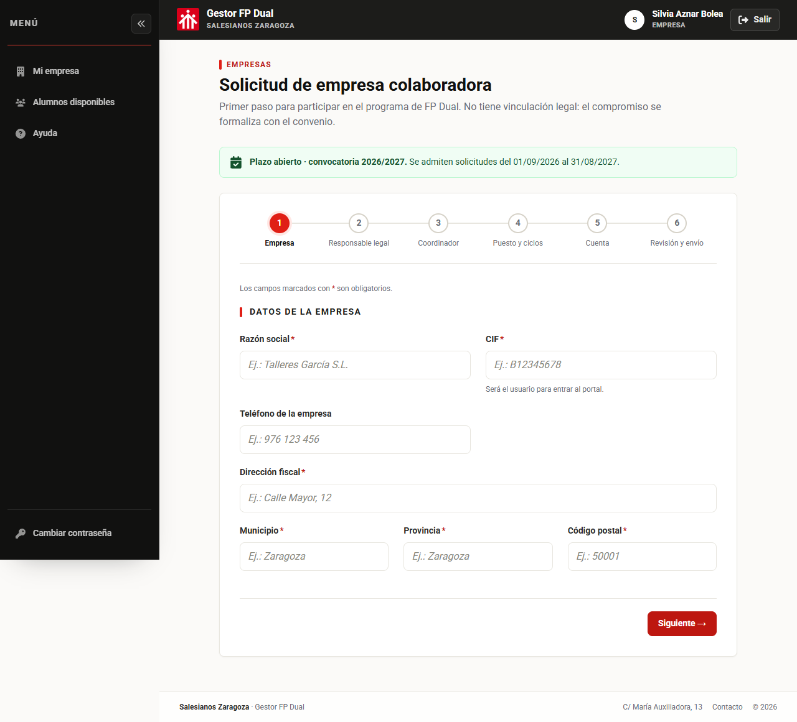
_Paso «Empresa». Los textos en gris son solo ejemplos; el CIF será el usuario para entrar al portal._

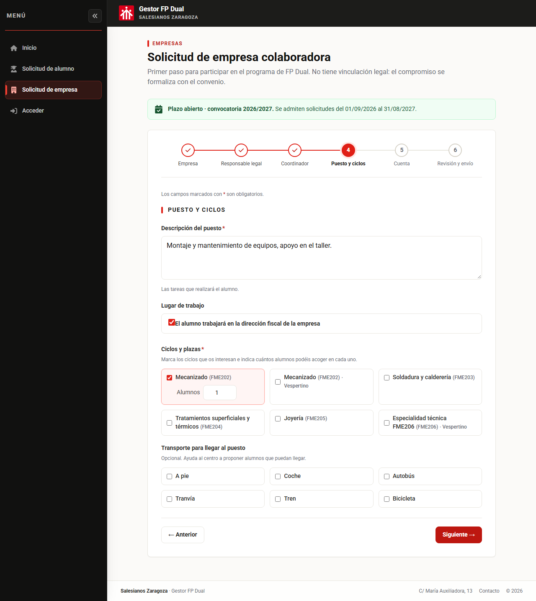
_Paso «Puesto y ciclos». Al marcar un ciclo aparece la casilla «Alumnos» para indicar cuántas plazas ofrecéis._

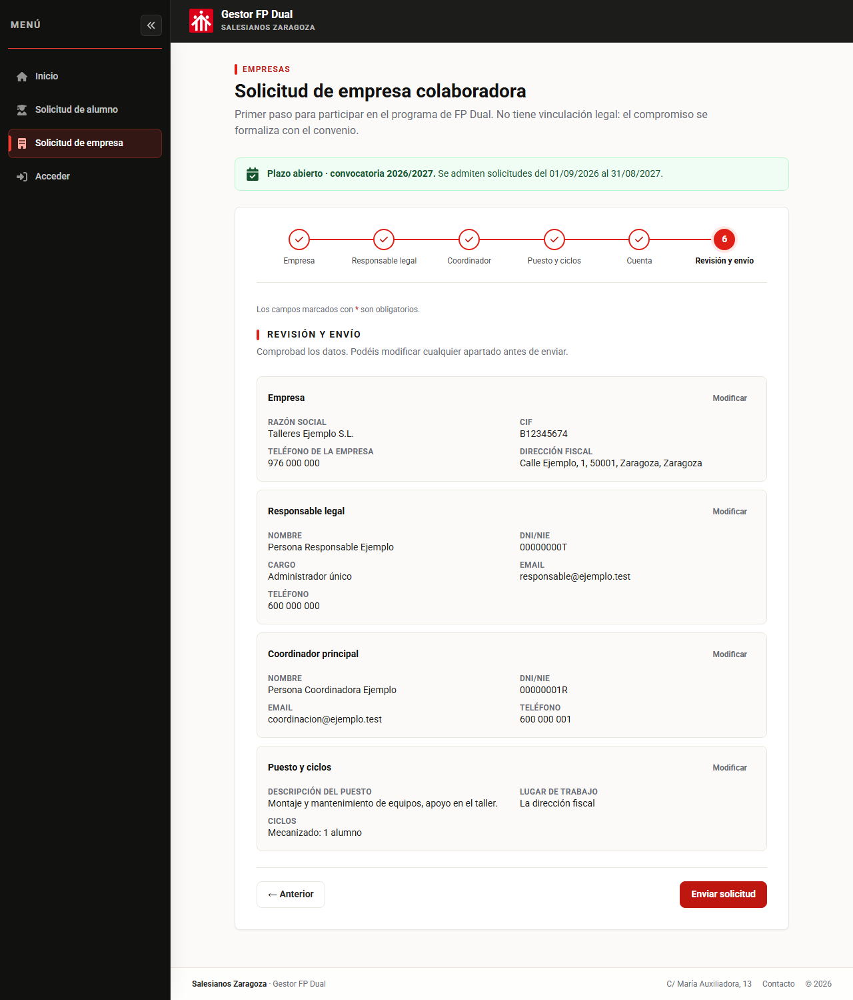
_Paso final. Comprobad los datos y pulsad «Enviar solicitud»._

Los formularios también funcionan en el móvil:

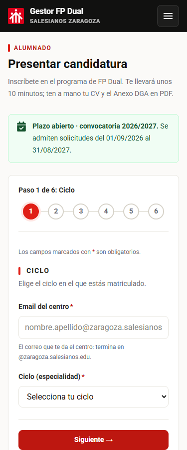
_Solicitud en un móvil._

### Después de enviar

Al terminar aparece el mensaje **«Solicitud enviada»** con un botón **«Acceder al portal»**.

**Alumnos**

- Ya puedes entrar en el portal con tu DNI/NIE y la contraseña (la nueva, o la que ya tenías si eras alumno de otro curso).
- El centro revisa tu CV y tu Anexo DGA. Si todo está bien, **valida tu solicitud** y las empresas ya pueden reservarte. Si hay algún problema, verás el motivo en el portal.
- Sigue tu proceso en el [portal del alumno](#portal-alumno).

**Empresas**

- Entrad en el portal con el **CIF** y la contraseña elegida.
- El centro prepara el **convenio**, que se envía al correo del coordinador y aparece en el portal. Hay que firmarlo y subirlo firmado ([cómo](#empresa-documentos)).
- La solicitud queda **validada cuando el centro valida el convenio firmado**. Hasta entonces no podéis reservar alumnos.

> **Correos.** La aplicación envía avisos por correo electrónico (validaciones, rechazos, reservas, confirmaciones…) cuando el centro tiene activado el envío. Lo que cuenta siempre es lo que aparece en el portal: si esperas un aviso y no llega, consulta el portal.

---

## 5. Manual del administrador

Este capítulo explica el trabajo del **personal del centro**. Casi todo lo pueden hacer tanto **Administración** como **Coordinación**; las tareas exclusivas de Administración están marcadas con **🔒 Solo Administración**. El [capítulo 6](#coordinador) resume las diferencias.

### 5.1 Panel: lo que necesita la atención del centro

Es la primera pantalla al entrar. Arriba eliges la **convocatoria** (por defecto, la activa) y puedes pulsar **«Actualizar»**.

- **Solicitudes y documentos**: cuatro tarjetas con lo que está esperando al centro:
  - solicitudes de alumno por revisar;
  - solicitudes de empresas por revisar;
  - documentos que esperan al centro (generar, firmar como centro, validar o rechazar);
  - cambios de datos de empresa por aprobar.
- **Reservas pendientes**: cuántas reservas hay en cada situación (Anexo pendiente de validar, Listas para confirmar, Sin tipo de contrato, Anexo pendiente de firmas, Falta el anexo o fue rechazado).

Cada tarjeta tiene **«Ver lista»**, que abre la lista correspondiente **ya filtrada**. Una tarjeta con la etiqueta «Al día» no tiene nada pendiente.

### 5.2 Convocatorias

Menú **«Convocatorias»**. Una convocatoria es un periodo (normalmente un curso) en el que se admiten solicitudes. **La convocatoria activa se decide sola por las fechas**: no hay que activarla a mano.

En la lista **«Convocatorias registradas»** cada una aparece como **Activa**, **Próxima** o **Cerrada**.

**Crear una convocatoria** — 🔒 Solo Administración

1. En **«Nueva convocatoria»**, escribe el **Nombre** (por ejemplo «2027/2028»), la **Fecha de inicio** y la **Fecha de fin**.
2. Pulsa **«Crear convocatoria»**.

Las fechas no pueden solaparse con otra convocatoria, y la de inicio no puede ser posterior a la de fin.

**Modificar una convocatoria** — 🔒 Solo Administración

Solo se pueden editar las convocatorias **próximas** (que todavía no han empezado). Pulsa **«Editar»**, cambia los datos y pulsa **«Guardar»**. Una convocatoria activa no se puede editar.

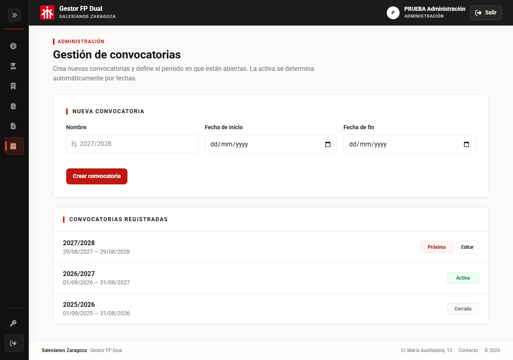
_Vista de Administración. Coordinación ve solo la lista, sin el formulario ni el botón «Editar»._

### 5.3 Alumnos: revisar y validar solicitudes

Menú **«Alumnos»**. Cada tarjeta muestra el nombre, el DNI/NIE, el ciclo, el estado de la solicitud y un resumen de sus reservas. Filtros disponibles: convocatoria, especialidad, estado de la solicitud y situación de la reserva.

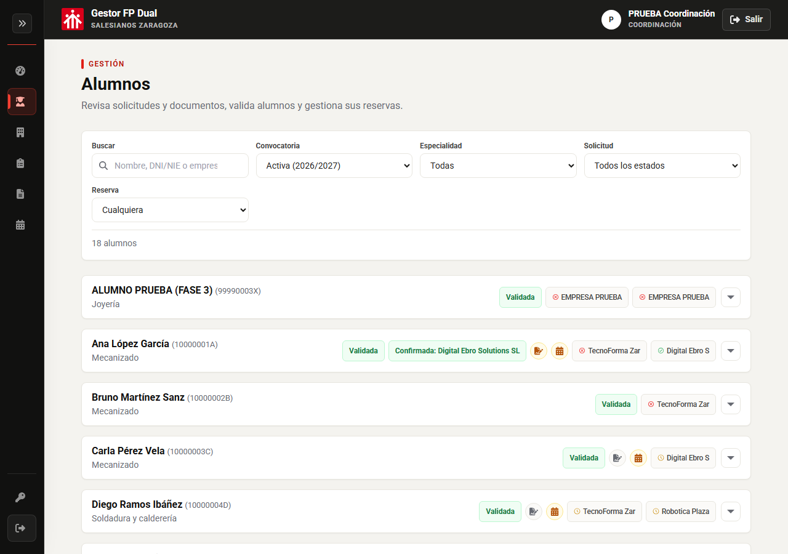
_Lista de alumnos de la convocatoria activa._

Al desplegar una tarjeta hay dos pestañas: **«Información»** y **«Reservas»**.

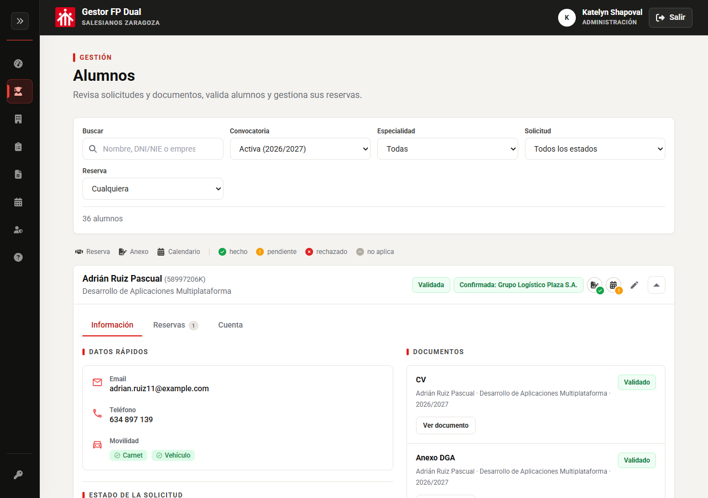
_Pestaña «Información»: datos de contacto, estado de la solicitud y documentos._

#### Revisar los documentos del alumno

Para validar a un alumno hay que validar antes su **CV** y su **Anexo DGA**.

1. Despliega la tarjeta del alumno.
2. En **«Documentos»**, pulsa **«Ver documento»** para abrir el PDF.
3. Si es correcto, pulsa **«Validar»**. Si no, pulsa **«Rechazar»**, escribe el motivo y confirma con **«Rechazar documento»**. El alumno verá el motivo y podrá subir otro archivo.

#### Validar o rechazar la solicitud

En **«Estado de la solicitud»**:

- **«Validar alumno»** solo se activa cuando los dos documentos están validados. Mientras tanto se indica qué falta, por ejemplo «Para validar al alumno, primero valida: Anexo DGA.» Cuando todo está listo aparece la etiqueta **«Documentación completa»**.
- **«Rechazar solicitud»** rechaza la **candidatura entera**, no un documento. Hay que escribir el motivo, que el alumno verá.

Una vez validado, el alumno aparece en «Alumnos disponibles» para las empresas de su ciclo.

#### Cuenta y participación — 🔒 Solo Administración

Debajo del estado, Administración ve el bloque **«Cuenta y participación»**: el usuario del portal (el DNI/NIE) y si la cuenta está activa. Desde aquí puede **«Resetear contraseña»** ([cómo funciona](#cuentas)) y **«Dar de baja»** o **«Reactivar»** al alumno ([cómo funciona](#baja)).

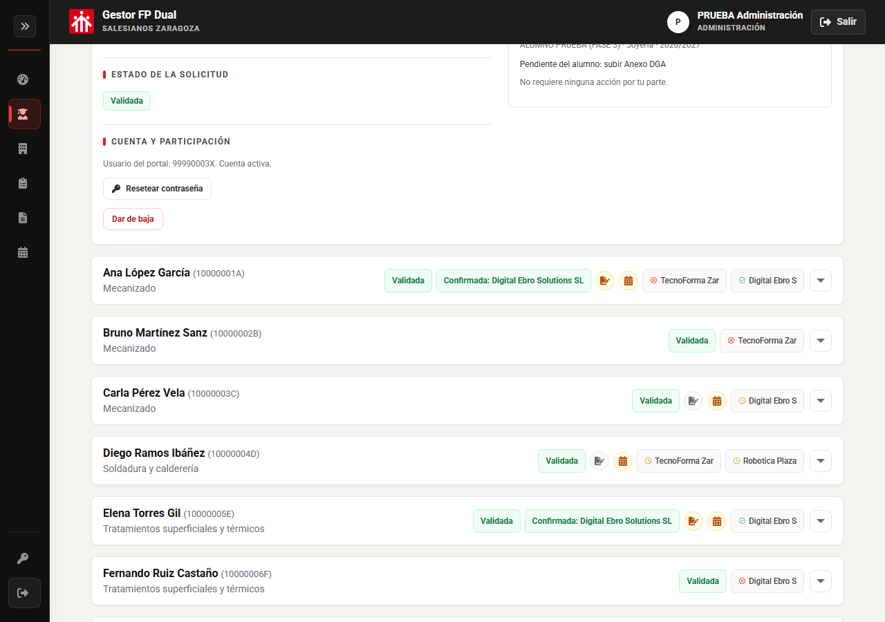
_Bloque «Cuenta y participación», visible solo para Administración._

#### Reabrir una solicitud rechazada

Si una solicitud se rechazó por error o el alumno ha corregido el problema, pulsa **«Reabrir solicitud»**. El motivo es opcional. La solicitud vuelve a **Pendiente de revisión**. Solo se puede reabrir en la **convocatoria activa**.

#### Reservar un alumno desde el centro

En la pestaña **«Reservas»** de la tarjeta:

1. En **«Reservar en empresa»**, elige la oferta (empresa, especialidad y plazas libres).
2. Pulsa **«Reservar»** y confirma con **«Crear reserva»**.

Solo aparecen ofertas de la misma especialidad y convocatoria, de empresas validadas y con plazas libres. Desde esta pestaña también puedes abrir cada reserva con **«Gestionar reserva»** (ver [Reservas](#staff-reservas)).

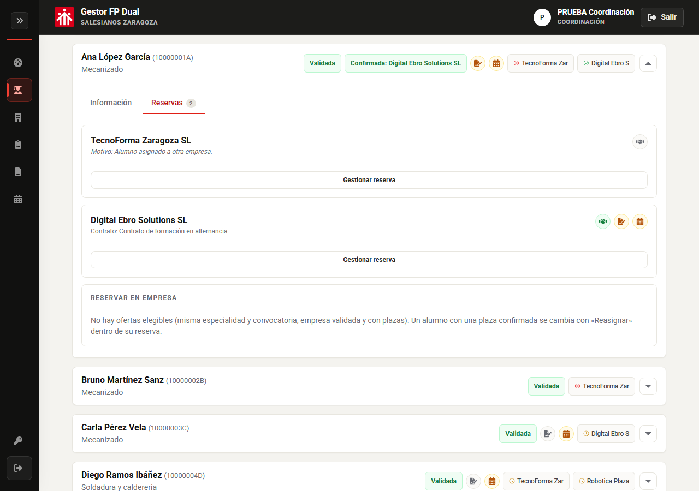
_Pestaña «Reservas» de un alumno. Si no hay ofertas, se explica por qué._

### 5.4 Empresas

Menú **«Empresas»**. Arriba se resume cuántas empresas tienen el convenio validado, pendiente o sin convenio. Filtros: convocatoria, estado de la solicitud, convenio, especialidad, cambios de datos pendientes y orden.

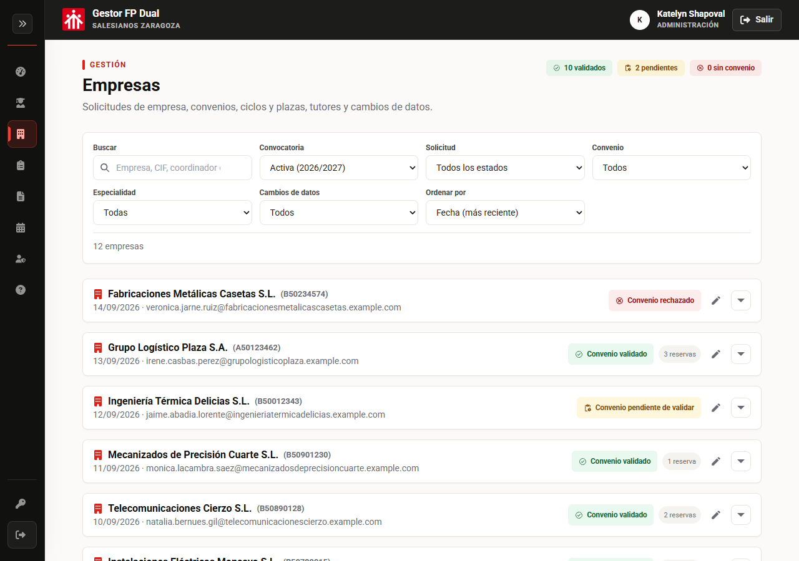
_Lista de empresas._

Cada tarjeta tiene las pestañas **«Información»** y **«Reservas»**.

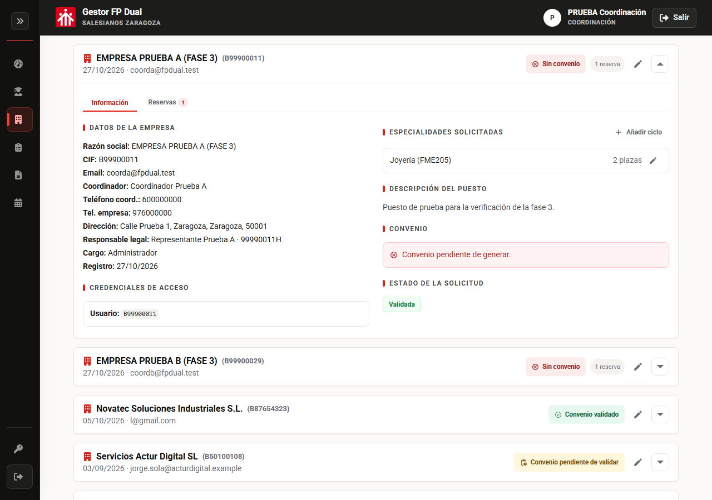
_Pestaña «Información» de una empresa._

#### Validar la empresa: el convenio

La solicitud de una empresa **se valida al validar su convenio firmado**: es el camino normal.

1. Despliega la tarjeta. En **«Convenio»** verás su estado: «Convenio pendiente de generar», «Convenio pendiente de validar» o «Convenio validado».
2. Pulsa **«Ver convenio»** (o **«✓ Validar»**) para abrirlo.
3. Revisa el documento y pulsa **«Validar convenio»**. Si la solicitud estaba pendiente, queda **Validada** y la empresa ya puede reservar alumnos.
4. Si no es correcto, pulsa **«Rechazar convenio»** y escribe el motivo. La empresa tendrá que subir uno nuevo. **La solicitud de la empresa no cambia de estado.**

Si aparece «Convenio pendiente de generar», hay que generarlo desde [Documentos](#staff-documentos) (necesita una [plantilla](#plantillas) activa).

#### Estado de la solicitud: rechazar, reabrir o validar

Debajo del convenio está el bloque **«Estado de la solicitud»**, con la etiqueta del estado:

- **«Rechazar solicitud»** (solicitudes pendientes): rechaza la participación de la empresa en esta convocatoria, no solo el convenio. Hay que escribir un motivo, que la empresa verá en su portal. Una empresa rechazada no puede reservar alumnos.
- **«Reabrir solicitud»** (solicitudes rechazadas, solo en la convocatoria activa): vuelve a «Pendiente de revisión». El motivo es opcional.
- **«Validar solicitud»**: solo aparece si el convenio ya está validado pero la solicitud sigue pendiente.
- 🔒 **Solo Administración**: **«Dar de baja»** o **«Reactivar»** ([cómo funciona](#baja)).

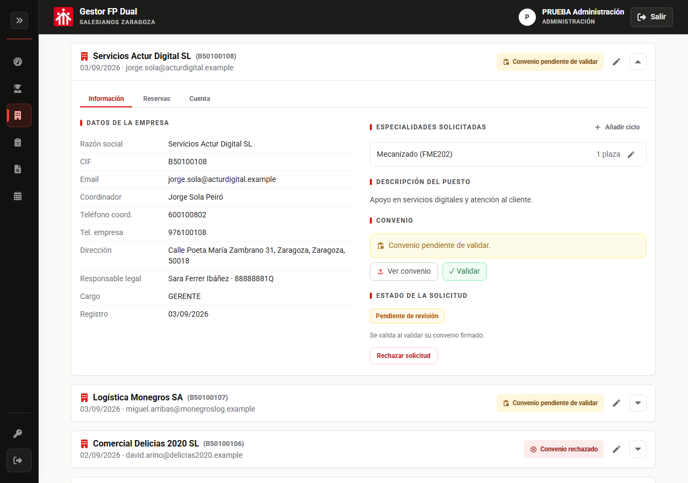
_«Estado de la solicitud» de una empresa, visto por Administración._

#### Editar los datos de una empresa

El centro puede corregir los datos directamente:

1. Pulsa el **icono del lápiz** de la tarjeta («Editar los datos de…»).
2. Cambia lo necesario y pulsa **«Guardar cambios»**.

#### Aprobar o rechazar cambios propuestos por la empresa

Las empresas no cambian sus datos directamente: envían una propuesta. Las empresas con propuestas aparecen con el filtro **«Cambios de datos: Pendientes de revisión»** y en el Panel.

1. Abre la edición de la empresa. Verás una tabla **«Actual → Solicitado»** con cada cambio.
2. Pulsa **«Aprobar»** para aplicarlos o **«Rechazar»** (el motivo es obligatorio).

Si los datos han cambiado desde que la empresa envió la propuesta, la aplicación lo indica («Los datos actuales han cambiado desde que se envió la solicitud.») y señala los campos afectados.

#### Ciclos y plazas

En **«Especialidades solicitadas»** cada ciclo aparece con su número de plazas:

- **Cambiar plazas**: pulsa el lápiz del ciclo, escribe el número y pulsa ✓ (o Enter). La X cancela.
- **Añadir un ciclo**: pulsa **«+ Añadir ciclo»**, elige el ciclo, indica las plazas y pulsa ✓.

Solo se pueden cambiar en la convocatoria activa. Si reduces plazas por debajo de las reservas pendientes, aparece **«Elegir reservas a cancelar»**: marca cuáles se cancelan y pulsa **«Reducir plazas»**. No se puede bajar por debajo de las plazas **confirmadas**: primero hay que cancelar o reasignar esas reservas.

#### Asignar un alumno desde la empresa

En la pestaña **«Reservas»** de la tarjeta, pulsa **«Asignar alumno»**:

1. Elige el **Ciclo** (se indican las plazas disponibles).
2. Busca al alumno por nombre o DNI y selecciónalo.
3. Pulsa **«Asignar alumno»** y confirma. Se crea una reserva pendiente.

Para gestionar una reserva ya creada, usa **«Gestionar reserva»**.

#### Restablecer la contraseña de una empresa — 🔒 Solo Administración

En **«Credenciales de acceso»** de la tarjeta, pulsa **«Resetear contraseña»**. Aparece la nueva contraseña temporal: **cópiala en ese momento**, porque se oculta a los 2 minutos (o antes, con «Ocultar»). Comunícasela a la empresa por un medio seguro. Al entrar, la empresa tendrá que [cambiarla](#contrasena-temporal).

### 5.5 Reservas

Menú **«Reservas»**. Las reservas aparecen **agrupadas por lo que necesitan a continuación**:

1. Pendientes de tipo de contrato
2. Falta el anexo o fue rechazado
3. Anexo pendiente de firmas
4. Anexo pendiente de validar
5. Anexo validado · pendientes de confirmar
6. Confirmadas
7. Canceladas

Puedes buscar por alumno, DNI/NIE, empresa o tutor y filtrar por convocatoria, situación y especialidad. A la derecha de cada fila están los [iconos de estado](#estados) y el botón **«Gestionar reserva»**.

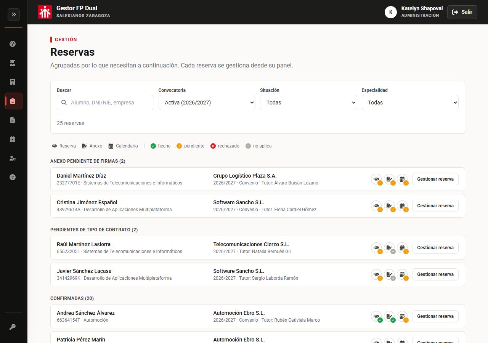
_Lista de reservas. Pasa el ratón por un icono para ver qué significa._

#### El panel de la reserva

**«Gestionar reserva»** abre una ventana con todo lo de esa reserva. Es la misma ventana desde Alumnos, Empresas, Reservas o Documentos.

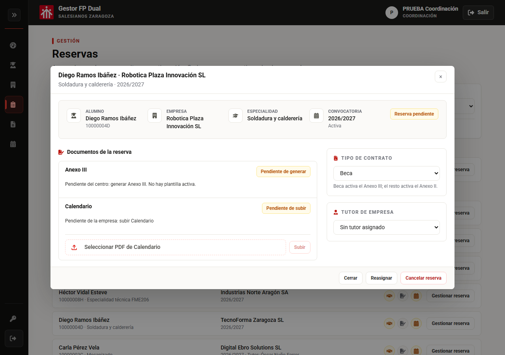
_Panel de una reserva pendiente sin tipo de contrato. Abajo están «Reasignar» y «Cancelar reserva»._

El trabajo normal con una reserva sigue este orden:

**1. Indicar el tipo de contrato**

En **«Tipo de contrato»** elige una opción. Se guarda al elegirla.

| Tipo de contrato | Anexo que hay que preparar |
| --- | --- |
| Beca | **Anexo III** |
| Contrato de formación en alternancia, Convenio u Otro | **Anexo II** |

Al guardarlo aparece el anexo correspondiente en **«Documentos de la reserva»**. Mientras no se indique, se muestra «El Anexo II o III aparece cuando se indica el tipo de contrato.» Ver también [«Tipo de contrato y anexos»](#faq-anexos).

**2. Preparar el anexo**

Hay dos formas:

- **El centro lo genera**: pulsa **«Generar»** (necesita una [plantilla](#plantillas) activa; si no la hay, se indica «No hay plantilla activa para generarlo»).
- **La empresa sube el PDF** desde su portal. Al subirlo, la empresa declara que lleva su firma.

Si hay que rehacer un anexo generado, **«Regenerar»** crea una versión nueva; las firmas de la versión anterior dejan de valer.

**3. Recoger las firmas**

El Anexo II/III lo firman **empresa, alumno y centro**. En el documento se ve el estado de cada firma. Para firmar como centro, pulsa **«Firmar»**. La empresa y el alumno firman desde sus portales.

**4. Validar el anexo**

Cuando están todas las firmas, revisa el documento y pulsa **«Validar»** (o **«Rechazar»** con un motivo). No se puede validar si falta alguna firma: el aviso indica cuál, por ejemplo «Faltan firmas antes de validar: alumno.»

**5. Confirmar la reserva**

En **«Confirmación»** hay una lista que se va marcando:

- Tipo de contrato indicado
- Anexo II/III subido o generado
- Anexo II/III firmado por empresa, centro y alumno
- Anexo II/III validado por el centro

Cuando todo está marcado aparece **«Confirmar reserva»**. Al confirmar, el alumno queda asignado definitivamente a la empresa y **sus otras reservas pendientes se cancelan solas**. Si falta algo, debajo de la lista se explica qué es.

**Calendario y tutor**

- El **Calendario** lo sube la empresa (o el centro) y lo firman los tres desde «Firmar». No lo revisa nadie y **no es necesario para confirmar** la reserva.
- En **«Tutor de empresa»** se elige el tutor de la empresa para esa reserva. Los tutores los da de alta la empresa en su portal.

#### Cancelar una reserva

Pulsa **«Cancelar reserva»**, escribe el motivo y confirma. La reserva y sus documentos quedan en el historial. El centro puede cancelar reservas pendientes y confirmadas.

#### Reasignar a otra empresa

Pulsa **«Reasignar»**, elige la **«Nueva oferta»** (misma especialidad y convocatoria, con plazas libres), escribe el motivo y pulsa **«Reasignar»**.

- La reserva actual se cancela y se crea una **reserva pendiente nueva** en la otra empresa, **sin documentos heredados**: hay que repetir el proceso (tipo de contrato, anexo, firmas, validación y confirmación).
- Funciona también con reservas **confirmadas**.
- Si no hay otras ofertas con plazas, se indica y no se puede reasignar.

En **«Historial de documentos»** se pueden consultar las versiones anteriores que ya no están vigentes.

### 5.6 Documentos: seguimiento

Menú **«Documentos»**, pestaña **«Seguimiento»**. Reúne **todos los documentos** del proceso: CV y Anexo DGA de los alumnos, convenio y Anexo XIV de las empresas, y anexos y calendarios de las reservas.

Arriba hay tres tarjetas con los totales según los filtros: **Documentos** (con la barra de completados), **Pendientes** y **Acción del centro**.

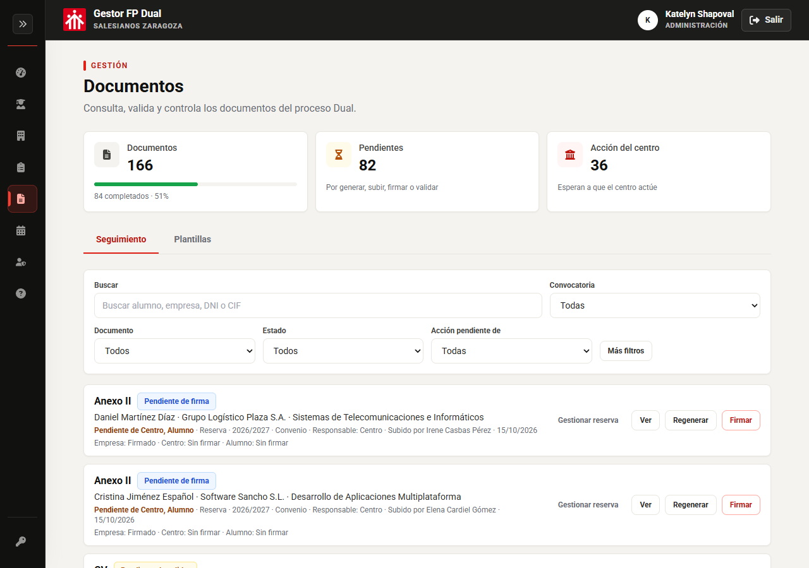
_Seguimiento de documentos._

**Filtros:** Buscar (alumno, empresa, DNI o CIF), Convocatoria, Documento, Estado y **Acción pendiente de** (Centro, Empresa, Alumno o Ninguna). **«Más filtros»** añade Alumno, Empresa, Especialidad y Contexto.

Cada documento muestra el **Responsable**, el **Origen** (subido o generado y por quién) y de quién está **Pendiente**. Los botones dependen del estado: **«Ver»**, **«Generar»**, **«Regenerar»**, **«Firmar»**, **«Validar»** y **«Rechazar»**. Si el documento pertenece a una reserva, **«Gestionar reserva»** abre su panel.

**Tarea habitual: revisar lo que espera al centro**

1. En **«Acción pendiente de»** elige **Centro** (o entra desde la tarjeta del Panel).
2. Abre cada documento con **«Ver»**, compruébalo y pulsa **«Validar»** o **«Rechazar»**.

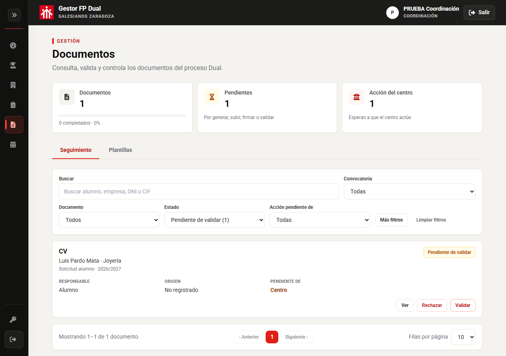
_Un documento pendiente de validar, con sus acciones._

### 5.7 Plantillas de documentos

Pestaña **«Plantillas»** dentro de Documentos. Aquí están las plantillas **DOCX** con las que se generan el **Convenio**, el **Anexo II** y el **Anexo III**. Cada una aparece como «Activa» o «Sin plantilla».

- Cualquier miembro del personal puede **descargar** la plantilla activa.
- 🔒 **Solo Administración** puede subirlas: selecciona un archivo **.docx** y pulsa **«Subir plantilla»** (o **«Reemplazar»** si ya hay una). Se guarda como versión nueva.

Sin plantilla activa, el documento correspondiente no se puede generar.

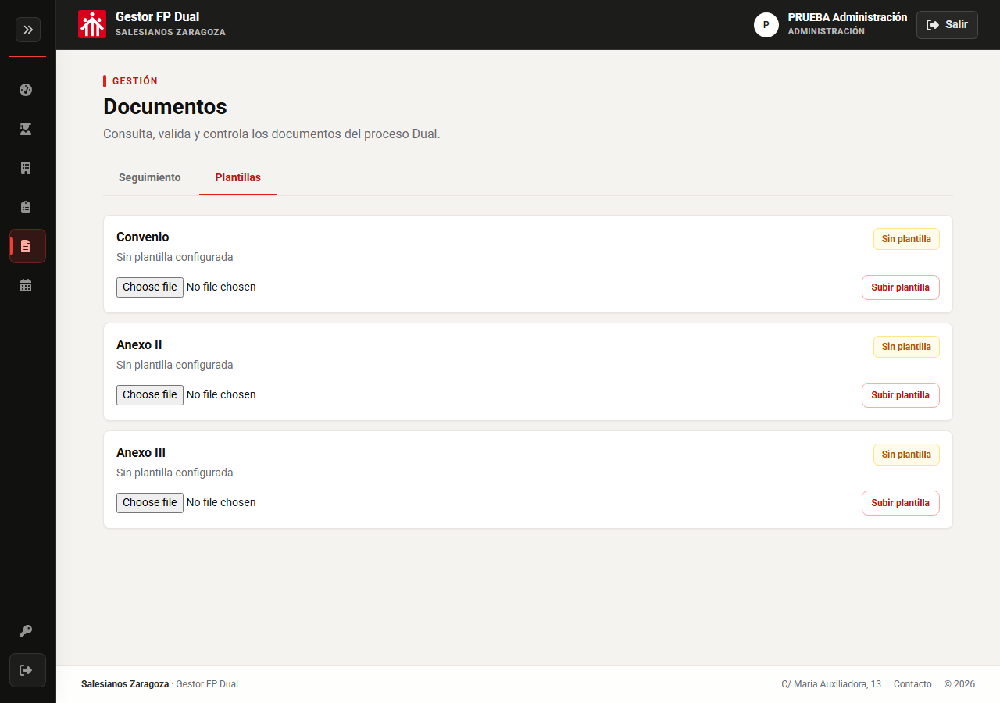
_Plantillas vistas por Administración (en este ejemplo todavía no hay ninguna configurada)._

### 5.8 Cuentas y contraseñas

- Las **cuentas de alumnos y empresas se crean solas** al enviar la solicitud pública. No hay una pantalla para crear cuentas a mano.
- 🔒 **Solo Administración** puede restablecer contraseñas:
  - de una **empresa**, en su tarjeta de Empresas, bloque «Credenciales de acceso» ([cómo](#staff-empresas));
  - de un **alumno**, en su tarjeta de Alumnos, bloque «Cuenta y participación».

  En los dos casos pulsa **«Resetear contraseña»**. La contraseña temporal se muestra **una sola vez y durante 2 minutos**: cópiala y comunícasela a la persona por un medio seguro. Al entrar tendrá que [cambiarla](#contrasena-temporal).
- La aplicación **no tiene** una pantalla para restablecer la contraseña del personal del centro. Si alguien del centro la olvida, consulta con el responsable técnico de la aplicación.
- Cada persona puede [cambiar su propia contraseña](#cambiar-contrasena).

### 5.9 Dar de baja a un alumno o a una empresa — 🔒 Solo Administración

Sirve para **retirar del programa** a un alumno o a una empresa en una convocatoria: por ejemplo, un alumno que abandona el ciclo o una empresa que ya no puede acoger alumnos.

**Qué pasa al dar de baja**

1. La solicitud pasa a **«Dada de baja»**.
2. Su **cuenta del portal se desactiva**: no podrá entrar (si tenía la sesión abierta, se cierra en cuanto haga algo). En una empresa se desactivan todas sus cuentas.
3. **Todas sus reservas activas, pendientes y confirmadas, se cancelan** con el motivo de la baja. Las plazas quedan libres y se avisa por correo a la otra parte: a las empresas, si se da de baja un alumno; a los alumnos, si se da de baja una empresa.

**Cómo se hace**

1. Despliega la tarjeta del alumno (Alumnos › «Cuenta y participación») o de la empresa (Empresas › «Estado de la solicitud»).
2. Pulsa **«Dar de baja»**. La ventana muestra **qué reservas se cancelarán**; las confirmadas se marcan en rojo.
3. Escribe el **«Motivo de la baja»** (obligatorio) y pulsa **«Dar de baja»**.

El aviso final indica cuántas reservas se han cancelado. Si alguna no se ha podido cancelar, el aviso lo dice: cancélala a mano desde su panel ([Cancelar una reserva](#staff-reservas)).

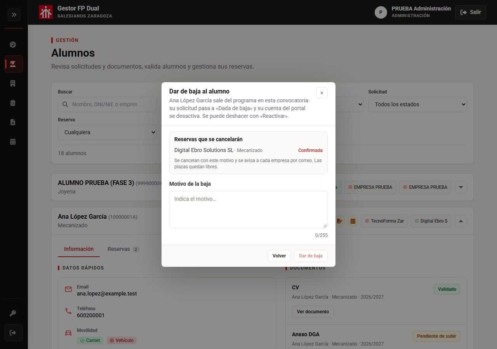
_Antes de confirmar, la ventana muestra las reservas que se van a cancelar._

**Reactivar**

En una solicitud dada de baja se ven la fecha, el motivo y el botón **«Reactivar»**. Al reactivar:

- la solicitud **vuelve al estado que tenía antes de la baja** (pendiente, validada o rechazada);
- la cuenta del portal se vuelve a activar;
- las **reservas canceladas no se recuperan**: si hace falta, hay que crearlas de nuevo.

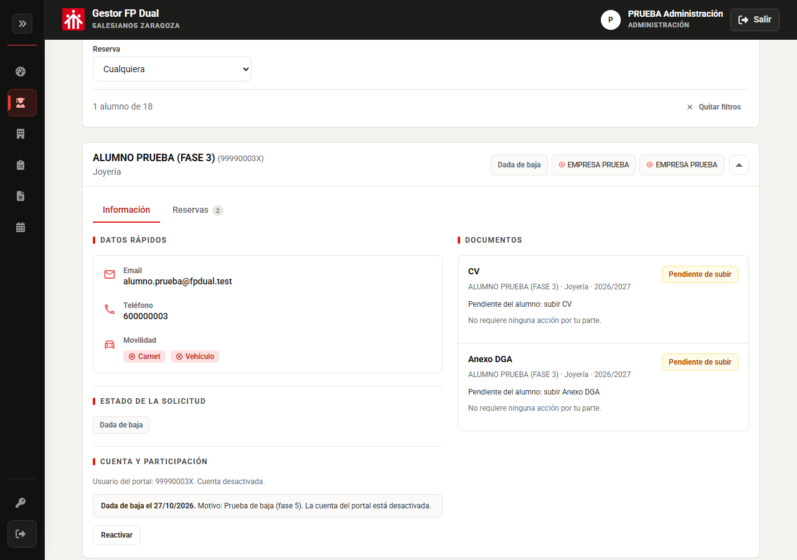
_Una solicitud dada de baja: fecha, motivo, cuenta desactivada y botón «Reactivar»._

Las solicitudes dadas de baja se encuentran con el filtro **«Solicitud: Dada de baja»** en Alumnos y en Empresas.

---

## 6. Manual del coordinador

El perfil de Coordinación hace **el mismo trabajo diario** que Administración: todo lo descrito en el [capítulo 5](#administrador) le sirve, salvo las tareas marcadas con 🔒.

| Tarea | Administración | Coordinación |
| --- | :---: | :---: |
| Panel, Alumnos, Empresas, Reservas y Documentos | ✅ | ✅ |
| Validar y rechazar documentos y solicitudes; reabrir solicitudes | ✅ | ✅ |
| Gestionar reservas: tipo de contrato, firmas, confirmar, cancelar, reasignar | ✅ | ✅ |
| Editar datos de empresas, aprobar o rechazar cambios, cambiar plazas | ✅ | ✅ |
| Rechazar y reabrir solicitudes de empresa | ✅ | ✅ |
| Consultar convocatorias | ✅ | ✅ |
| **Crear y editar convocatorias** | ✅ | ❌ |
| Consultar y descargar plantillas | ✅ | ✅ |
| **Subir o reemplazar plantillas** | ✅ | ❌ |
| **Restablecer contraseñas de empresas y alumnos** | ✅ | ❌ |
| **Dar de baja y reactivar alumnos y empresas** | ✅ | ❌ |

En la práctica, el coordinador:

- En **Convocatorias** solo ve la lista, sin el formulario «Nueva convocatoria» ni el botón «Editar».
- En **Documentos › Plantillas** no tiene el botón «Subir plantilla».
- En las tarjetas de **Empresas** no tiene «Resetear contraseña» ni «Dar de baja».
- En las tarjetas de **Alumnos** no ve el bloque «Cuenta y participación».

Si necesitas una de estas acciones, pídesela a Administración.

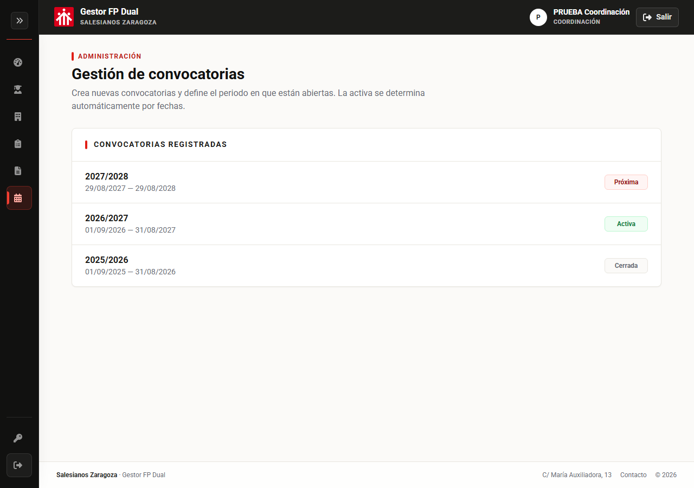
_Convocatorias vistas por Coordinación._

---

## 7. Manual de empresa

Este capítulo es para las empresas que ya han enviado su solicitud. Si todavía no lo habéis hecho, empezad por la [solicitud de empresa](#solicitud-empresa).

### 7.1 El portal de la empresa

Entrad con el **CIF** y vuestra contraseña. Se abre **«Mi empresa»**:

- Arriba, el nombre de la empresa, el CIF y la convocatoria.
- **«Qué tienes pendiente»**: lo que tenéis que hacer ahora (subir un documento, firmar un anexo…), con un botón que lleva al sitio exacto. También aparecen avisos informativos, como «Vuestra solicitud está validada: ya podéis reservar alumnos.»
- Cuatro pestañas: **«Datos de la empresa»**, **«Tutores»**, **«Reservas»** y **«Documentos»**. Los números junto a las pestañas indican reservas activas o documentos pendientes.

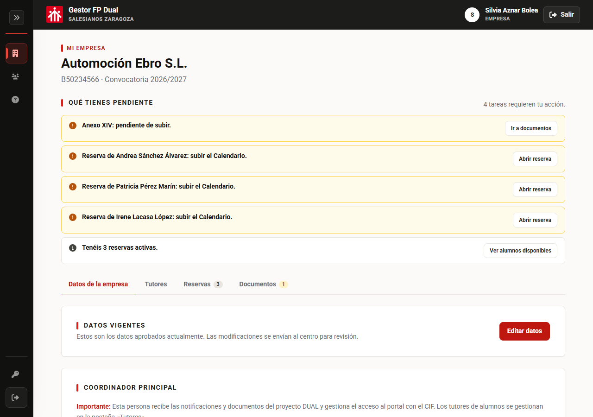
_Portal de la empresa._

**Estado de vuestra solicitud.** «Qué tienes pendiente» os dice en qué punto estáis:

| Aviso | Qué significa |
| --- | --- |
| «El centro validará vuestra solicitud cuando el convenio esté firmado.» | Pendiente: firmad y subid el convenio. Todavía no podéis reservar. |
| «Vuestra solicitud está validada: ya podéis reservar alumnos.» | Validada. |
| «Vuestra solicitud ha sido rechazada.» | Se muestra el motivo. Contactad con el centro. |
| «Participad en la convocatoria…» | Vuestra última solicitud es de una convocatoria anterior ([qué hacer](#empresa-reaplicar)). |

### 7.2 Datos de la empresa y solicitud de cambios

En **«Datos de la empresa»** están los **datos vigentes** (los aprobados): coordinador principal, datos de la empresa, responsable legal, puesto de trabajo, ciclos y transportes.

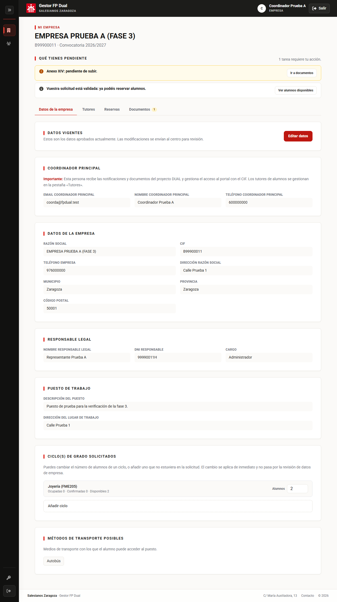
_Pestaña «Datos de la empresa»._

Los cambios de datos **los revisa el centro antes de aplicarse**:

1. Pulsa **«Editar datos»**.
2. Cambia lo necesario y pulsa **«Enviar para revisión»**.
3. Aparece el recuadro **«Cambios enviados para revisión»** con lo que has pedido. Mientras tanto, se siguen mostrando los datos aprobados.
4. Si quieres corregir la propuesta, pulsa **«Modificar solicitud pendiente»** y luego **«Actualizar solicitud de cambios»**.

Si el centro la rechaza, verás **«Solicitud de cambios rechazada»** con el motivo.

- El **CIF no se puede cambiar**: es el identificador de acceso.
- Solo se pueden pedir cambios sobre la convocatoria activa.
- Para cambiar al **coordinador principal** se usa también «Editar datos».

### 7.3 Ciclos y plazas

En **«Ciclo(s) de Grado solicitados»** veis, para cada ciclo, cuántas plazas tenéis y cuántas están **Ocupadas**, **Confirmadas** y **Disponibles**. **Esto sí lo podéis cambiar directamente**, sin esperar al centro (solo en la convocatoria activa):

- **Cambiar el número de plazas**: escribe el número nuevo y pulsa **«Guardar»**.
- **Añadir un ciclo**: elige el ciclo, indica cuántos alumnos y guárdalo.

Al reducir plazas:

- No se puede bajar por debajo de los alumnos **confirmados**. Para eso hay que hablar con el centro.
- Si bajas por debajo de las reservas **pendientes**, la aplicación te pide **elegir qué reservas cancelar** («Elegir reservas a cancelar» → «Reducir plazas»). Esos alumnos reciben un aviso.

### 7.4 Tutores

En la pestaña **«Tutores»** gestionáis a las personas que tutelan a los alumnos en la empresa.

- **Añadir**: pulsa **«Añadir tutor»**, rellena nombre, email y teléfono (obligatorios), DNI/NIE y cargo, y pulsa **«Guardar»**.
- **Modificar**: pulsa **«Editar»** en el tutor y luego **«Guardar»**.
- **Dar de baja**: pulsa **«Desactivar»**. El tutor deja de estar disponible, pero sigue apareciendo en las reservas antiguas.

El **coordinador principal** aparece marcado y no se edita aquí: sus datos se cambian con «Editar datos» en «Datos de la empresa», y el centro revisa el cambio. El acceso al portal sigue siendo con el CIF.

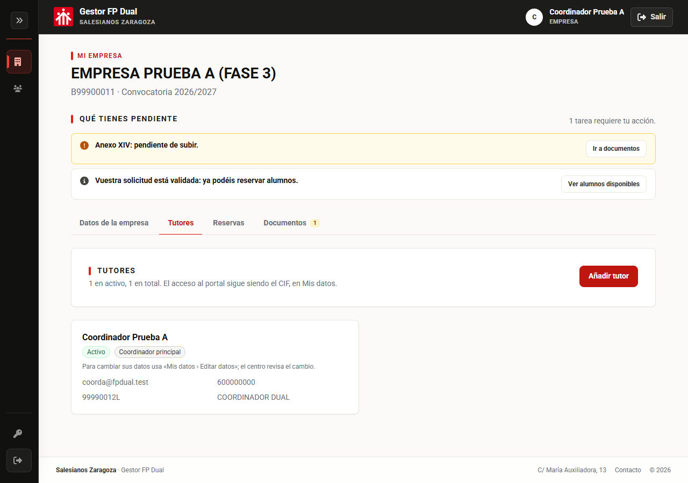
_Pestaña «Tutores»._

### 7.5 Alumnos disponibles y reservas

**Requisito:** vuestra solicitud tiene que estar **validada**. Si no lo está, la página «Alumnos disponibles» os explica por qué no podéis reservar todavía.

**Reservar a un alumno**

1. En el menú, pulsa **«Alumnos disponibles»**. Aparecen los alumnos validados de vuestros ciclos en la convocatoria activa. Podéis buscar por nombre o DNI/NIE y filtrar por especialidad.
2. Despliega la tarjeta para ver los datos de contacto, la movilidad y el CV.
3. Pulsa **«Reservar alumno»**.

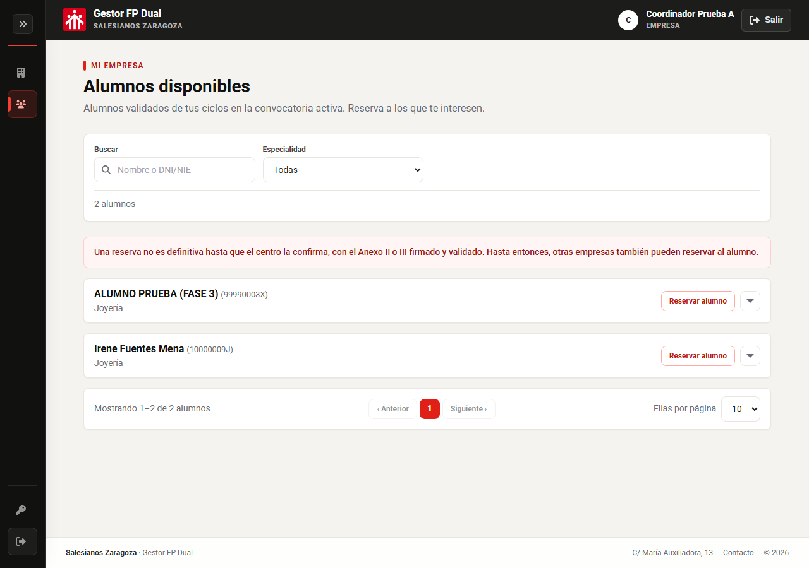
_Alumnos disponibles para la empresa._

> **Una reserva no es definitiva** hasta que el centro la confirma, con el Anexo II o III firmado y validado. Hasta entonces, otras empresas también pueden reservar al mismo alumno.

En lugar de «Reservar alumno» puedes ver:

- **«Cancelar reserva»**: ya lo habéis reservado vosotros.
- **«Sin plazas disponibles»**: no os quedan plazas libres en ese ciclo ([qué hacer](#faq-plazas)).
- **«Plaza confirmada en otra empresa»**: el alumno ya tiene plaza definitiva.

**Gestionar vuestras reservas**

En la pestaña **«Reservas»** del portal aparecen todas, con su estado. Pulsa **«Ver y gestionar»** para abrir el panel de la reserva, donde podéis:

- subir y firmar el **Anexo II o III** y el **Calendario** ([cómo](#empresa-documentos));
- elegir el **«Tutor de empresa»**;
- **cancelar** la reserva mientras esté pendiente («Cancelar reserva», con un motivo).

Lo que **solo hace el centro**: indicar el tipo de contrato, validar el anexo, confirmar la reserva, cancelar una reserva ya confirmada y reasignar al alumno.

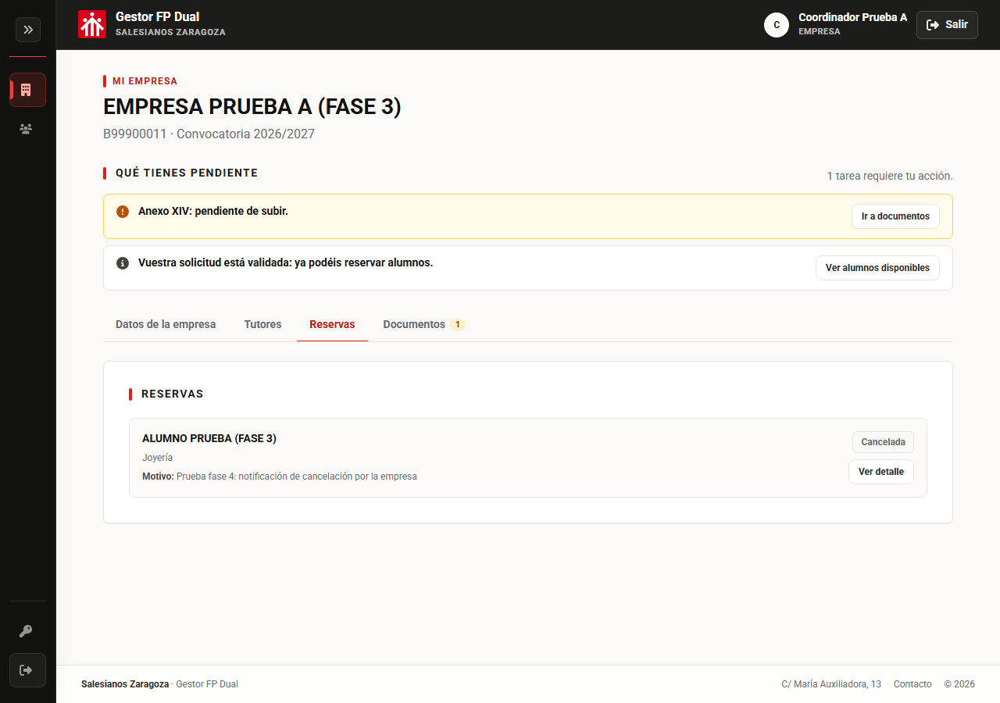
_Pestaña «Reservas». Las canceladas se muestran con su motivo y el botón «Ver detalle»._

### 7.6 Documentos y firmas

En la pestaña **«Documentos»** («Mis documentos») están los documentos de la empresa: **Convenio** y **Anexo XIV**. Los de cada reserva (Anexo II o III y Calendario) están dentro del panel de la reserva.

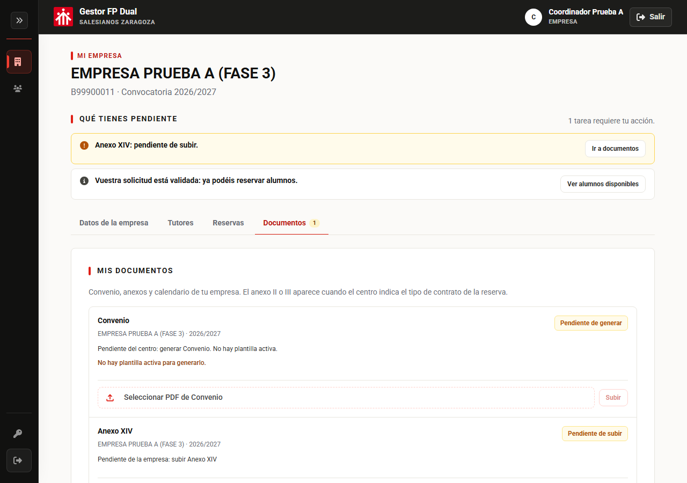
_Documentos de la empresa. Cada uno indica quién tiene que actuar._

**Subir un documento firmado**

1. Si el documento ya existe, ábrelo con **«Ver documento»** y usa **«Descargar»** para guardarlo.
2. Fírmalo y guárdalo en **PDF** (máximo 10 MB).
3. Pulsa **«Seleccionar PDF de…»**, elige el archivo y pulsa **«Subir»** (o **«Reemplazar»** si ya había uno).

Al subir un documento que lleva vuestra firma, **declaráis que el archivo está firmado por la empresa**. El centro lo revisa después.

| Documento | Qué hacer |
| --- | --- |
| **Convenio** | Lo genera el centro y os llega por correo y al portal. Firmadlo y subidlo. Cuando el centro lo valida, vuestra solicitud queda validada. |
| **Anexo XIV** | Subidlo firmado. El centro lo revisa. |
| **Anexo II o III** (en cada reserva) | Aparece cuando el centro indica el tipo de contrato. Si el centro lo ha generado, descargadlo, firmadlo y subidlo; también podéis subirlo vosotros. Después firman el alumno y el centro. |
| **Calendario** (en cada reserva) | Subidlo y firmadlo. Firman los tres. |

**Firmar en la aplicación.** Cuando un documento ya está subido y solo falta vuestra firma, aparece el botón **«Firmar»**. Al pulsarlo queda registrada la firma de la empresa.

**Si el centro rechaza un documento**, veréis el estado **Rechazado** con el **Motivo**. Corregidlo y subid el archivo nuevo con «Reemplazar». Ver [«Documentos rechazados o ya validados»](#faq-documentos).

### 7.7 Participar en una nueva convocatoria

Si vuestra empresa ya participó en una convocatoria anterior, **no tenéis que registraros otra vez**:

1. Entrad en el portal con el **CIF**.
2. Veréis el aviso «Tu empresa todavía no participa en la convocatoria…» y, al final de «Datos de la empresa», el bloque **«Participar en la nueva convocatoria»**. Desplegadlo.
3. Revisad los datos del **coordinador principal**, la **descripción del puesto**, los **ciclos y plazas** y los **transportes**. Vienen rellenados con vuestra última solicitud.
4. Pulsad **«Enviar reaplicación»**.

La nueva solicitud queda **pendiente** y, como la primera vez, se valida cuando el centro valida el **nuevo convenio** firmado. Este bloque solo aparece cuando hay una convocatoria abierta en la que todavía no participáis.

---

## 8. Manual del alumno

Si todavía no has presentado tu candidatura, empieza por la [solicitud de alumno](#solicitud-alumno).

### 8.1 El portal del alumno

Entra con tu **DNI/NIE** y tu contraseña. Se abre **«Mi proceso Dual»**:

- **«Qué tienes pendiente»**: lo que tienes que hacer (marcado con «Te toca») y lo que está en espera. Cada aviso tiene un botón que lleva al sitio exacto.
- Tres pestañas: **«Mi solicitud»**, **«Mis reservas»** y **«Mis documentos»**.

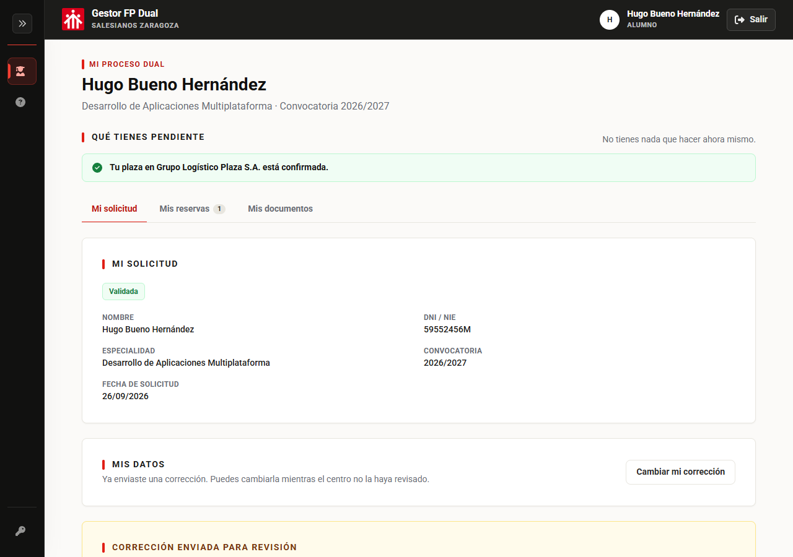
_Portal del alumno. En este ejemplo de prueba faltan documentos por subir._

**¿En qué punto está mi solicitud?**

| Aviso | Qué significa |
| --- | --- |
| «El centro está revisando tu solicitud.» | Pendiente de revisión. Te avisarán por correo. |
| «Tu solicitud está validada.» | Las empresas ya pueden reservarte. |
| «Tu solicitud ha sido rechazada.» | Se muestra el motivo. Ponte en contacto con el centro. |
| «Tienes una reserva pendiente de confirmación.» | Una empresa te ha reservado, pero todavía no es definitivo. |
| «Tu plaza en … está confirmada.» | Ya tienes plaza definitiva. |

En **«Mi solicitud»** ves tus datos (nombre, DNI/NIE, especialidad, convocatoria y fecha) y el estado.

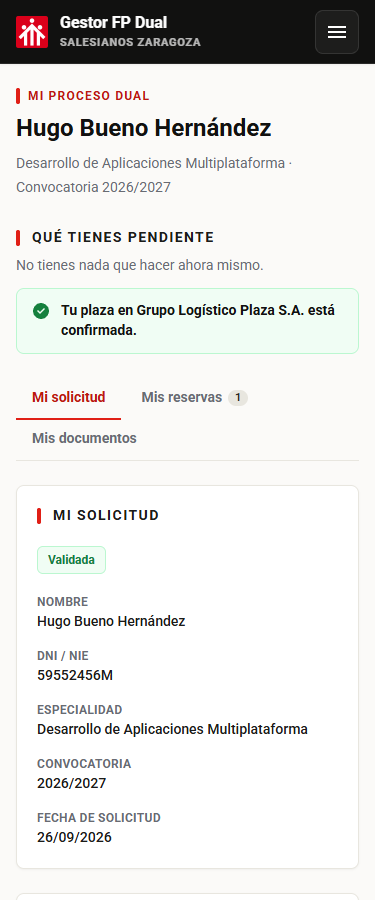
_El portal también se puede usar desde el móvil._

### 8.2 Mis documentos

En **«Mis documentos»** están tu **CV** y tu **Anexo DGA**, con su estado.

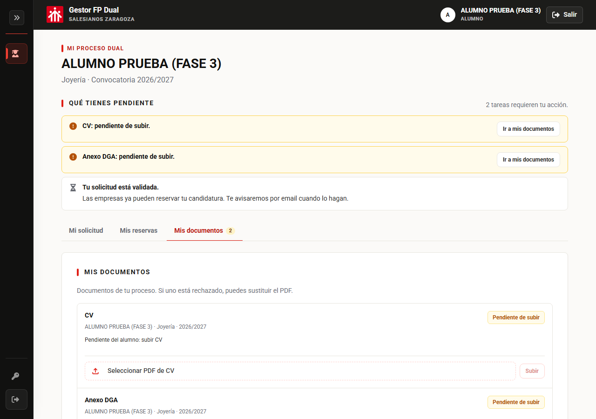
_Tus documentos de solicitud._

**Subir o sustituir un documento**

1. Pulsa **«Seleccionar PDF de…»** y elige el archivo (solo **PDF**, máximo 10 MB).
2. Pulsa **«Subir»** (o **«Reemplazar»** si ya había uno).

Puedes sustituir un documento mientras está **pendiente de validar** o si ha sido **rechazado**. Una vez **validado**, ya no se puede cambiar ([por qué](#faq-documentos)).

**Si te rechazan un documento**, verás el estado **Rechazado** y el **Motivo**. Corrige lo que se indica y sube el archivo nuevo con «Reemplazar». Recibirás un aviso por correo cuando el centro rechace un documento.

### 8.3 Mis reservas y firma del anexo

En **«Mis reservas»** aparecen las empresas que te han reservado. **Tú no eliges empresa**: las empresas eligen candidatos y aquí aparecen sus reservas.

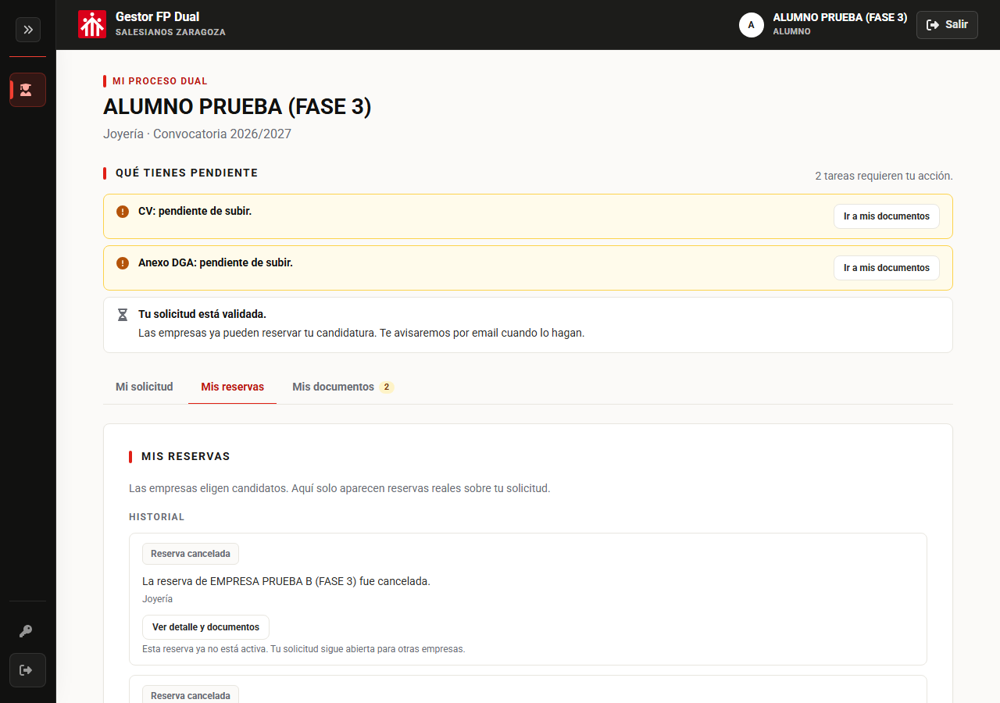
_«Mis reservas». Las reservas que ya no están activas se agrupan en «Historial»._

| Estado | Qué significa para ti |
| --- | --- |
| **Reserva pendiente** | Una empresa te ha reservado. **Esta reserva no es la plaza definitiva**: hace falta el anexo firmado y validado, y la confirmación del centro. Puedes tener varias a la vez. |
| **Plaza confirmada** | Es tu plaza definitiva. Tus otras reservas pendientes se cancelan solas. |
| **Reserva cancelada** | Ya no está activa. Si no tienes plaza confirmada, tu solicitud sigue abierta para otras empresas. |

**Firmar el Anexo II o III**

Cuando el anexo de una reserva está listo, en «Qué tienes pendiente» aparece «Firma el Anexo… de [empresa]. Ábrelo, revísalo y pulsa Firmar.»

1. Pulsa **«Abrir reserva»** (o, en «Mis reservas», **«Ver detalle y documentos»**).
2. En **«Documentos de la reserva»**, abre el anexo con **«Ver documento»** y léelo.
3. Pulsa **«Firmar»**. Aparecerá «Firma registrada.»

El **Calendario** se firma igual, con «Firmar». En el panel también ves el tutor que te ha asignado la empresa.

### 8.4 Corregir datos personales

Tus datos del portal son **de solo lectura**. Si alguno es incorrecto, **comunícaselo al centro** para que lo corrija. Si es un error en tu CV o en el Anexo DGA y el documento todavía no está validado, puedes [sustituirlo tú](#alumno-documentos).

---

## 9. Situaciones especiales y preguntas frecuentes

### Ya tengo cuenta de otro curso y quiero presentarme de nuevo (alumnos)

Usa el mismo formulario de [solicitud de alumno](#solicitud-alumno). La diferencia está en el paso **«Cuenta»**: **escribe tu contraseña actual del portal**, no una nueva.

- Si la contraseña no coincide, aparece: «Ya existe una cuenta con este DNI/NIE. Para volver a presentar la candidatura, escribe en «Contraseña» tu contraseña actual del portal. Si no la recuerdas, contacta con el centro.» Así se evita que otra persona pueda presentar una solicitud con tu DNI.
- Al enviar con la contraseña correcta, tus datos se actualizan con los del formulario y sigues entrando con la misma contraseña.
- Los intentos fallidos cuentan igual que en el inicio de sesión: tras varios fallos tendrás que esperar unos minutos.
- Si tu cuenta está desactivada, no podrás presentar la solicitud hasta que el centro la reactive.
- Si el centro ya tenía tus datos pero **nunca habías tenido cuenta**, se conservan los datos que ya tenía y el formulario solo completa los que faltaban. Si algo no está bien, avisa al centro.

### Ya presenté la solicitud en esta convocatoria

Solo se admite **una solicitud por convocatoria**.

- **Alumnos**: verás «Ya tienes una solicitud registrada para la convocatoria activa. Si necesitas corregir documentación, contacta con el centro.» Entra en el portal y sustituye ahí los documentos si todavía no están validados.
- **Empresas**: el formulario público indica «Esta empresa ya está registrada. Inicia sesión con el CIF para gestionar su participación.» Desde el portal, si ya tenéis solicitud en la convocatoria activa, aparece «Ya existe una solicitud para la convocatoria activa.»

### Somos una empresa que ya participó otros años

No uséis el formulario público: el CIF ya está registrado. Entrad en el portal y usad [«Participar en la nueva convocatoria»](#empresa-reaplicar). Todo el historial queda en la misma cuenta.

### No puedo presentar la solicitud: el plazo está cerrado

Las solicitudes solo se admiten mientras hay una **convocatoria activa**, y eso depende de sus fechas. Con el plazo cerrado el formulario no se muestra y se indica cuándo empieza la próxima. Si ya participas, puedes entrar en el portal para consultar tu situación. Las empresas tampoco pueden pedir cambios de datos ni cambiar plazas fuera de la convocatoria activa.

### Documentos rechazados o ya validados

| Situación | ¿Se puede subir otro? | Qué hacer |
| --- | --- | --- |
| Sin archivo | Sí: «Subir» | Sube el PDF. |
| Pendiente de validar | Sí: «Reemplazar» | Si te has equivocado, sustitúyelo. Las firmas registradas sobre el archivo anterior se pierden. |
| **Rechazado** | Sí: «Reemplazar» | Lee el **Motivo**, corrige y sube el nuevo. Un documento rechazado no se puede firmar ni validar hasta que se sustituya. |
| **Validado** | **No** (salvo el Calendario) | Ya está revisado y aceptado. Si hay que corregir algo, habla con el centro. |

**¿Por qué no puedo cambiar un documento validado?** Porque el centro ya lo ha dado por bueno y otras partes del proceso dependen de él. Para cambiarlo hace falta la intervención del centro.

**¿Por qué un documento rechazado ya no aparece en una reserva?** Si el centro cambia el tipo de contrato y el anexo anterior estaba rechazado, ese anexo pasa al historial y aparece el nuevo.

### Reservas y plazas

- **Reserva pendiente**: la empresa está interesada, pero **no es definitivo**. Un alumno puede tener varias a la vez, de distintas empresas.
- **Reserva confirmada**: plaza definitiva. Solo la confirma el centro, cuando el anexo está firmado por los tres y validado. Al confirmarla, las demás reservas pendientes del alumno se cancelan.
- **¿Por qué no puedo reservar a un alumno?** Puede ser porque vuestra solicitud aún no está validada, porque no os quedan plazas en ese ciclo («Sin plazas disponibles») o porque el alumno ya tiene una «Plaza confirmada en otra empresa».

- **«Sin plazas disponibles»**: todas las plazas del ciclo están ocupadas por reservas. Podéis subir el número de plazas en [Ciclos y plazas](#empresa-plazas) o cancelar alguna reserva pendiente.
- **¿Quién puede cancelar?** La empresa puede cancelar sus reservas **pendientes**. Una reserva **confirmada** solo la puede cancelar el centro.
- **¿Se puede cambiar de empresa?** Sí, pero solo lo hace el centro, con «Reasignar». La reserva nueva empieza **desde cero**, sin los documentos de la anterior, y hay que confirmarla de nuevo.
- **El alumno no ve el motivo de cancelación** que escribe la empresa o el centro; ve un texto general: «Esta reserva ya no está activa…».

### Tipo de contrato y anexos

- **¿Quién elige el tipo de contrato?** Solo el **centro**, en el panel de la reserva. La empresa y el alumno ven «El centro indicará el tipo de contrato; entonces aparecerá el Anexo II o III.»
- **¿Qué anexo toca?** **Beca → Anexo III.** Contrato de formación en alternancia, Convenio u Otro → **Anexo II.**
- **¿Por qué no aparece el anexo?** Porque todavía no se ha indicado el tipo de contrato. También puede estar «Pendiente de generar» si el centro tiene que generarlo y aún no lo ha hecho (o no hay plantilla).
- **¿Se puede cambiar el tipo de contrato?** Entre tipos del mismo anexo, sí. Para pasar de Anexo II a Anexo III (o al revés), **no**, cuando el anexo actual ya está subido pendiente de revisión o validado; la aplicación lo indica. En una reserva **confirmada** el tipo ya no se puede cambiar.
- **¿Por qué no se puede confirmar la reserva?** Porque falta algo de la lista de «Confirmación»: el tipo de contrato, el anexo, alguna firma o la validación. La lista dice qué falta y de quién («Falta: Alumno»). El Calendario no es necesario para confirmar.

### Subido, firmado y validado no son lo mismo

Son tres pasos distintos:

| Paso | Qué quiere decir | Quién |
| --- | --- | --- |
| **Subido** (o generado) | El archivo PDF está en la aplicación. | Quien corresponda (alumno, empresa o centro). |
| **Firmado** | Cada persona que tiene que firmar lo ha hecho: subiendo el archivo con su firma o pulsando «Firmar» en la aplicación. | Empresa, alumno y centro, según el documento. |
| **Validado** | El centro lo ha revisado y lo acepta. | Solo el centro. |

Un documento puede estar subido y sin firmar, o firmado y pendiente de validar. **El centro no puede validar un documento al que le falta alguna firma.** Por eso, en el Anexo II/III el orden es: subir → firmar los tres → validar → confirmar la reserva.

Las firmas de la aplicación son una **declaración**: «Firmar» deja constancia de que esa persona ha aceptado el documento. El centro revisa igualmente el archivo.

### No puedo ver o cambiar algo

Cada perfil solo ve y cambia lo que le corresponde. Si no ves un botón o te aparece un aviso como «Solo el centro confirma la reserva.» o «No tienes acceso a esta reserva.», es que **esa acción solo puede realizarla el personal autorizado del centro** (o, en algunos casos, solo Administración). Algunos ejemplos:

- Las empresas no ven las reservas de otras empresas ni el Anexo DGA de los alumnos.
- Los alumnos no pueden modificar sus datos personales.
- Coordinación no puede crear convocatorias, subir plantillas, restablecer contraseñas ni dar de baja.

### Me han dado de baja / ya no puedo entrar

Si el centro te ha **dado de baja** del programa, tu cuenta del portal está desactivada y al entrar verás «La cuenta está desactivada. Contacte con el administrador.» Tus reservas activas se han cancelado. Si crees que es un error, ponte en contacto con el centro: Administración puede **reactivar** tu solicitud, pero las reservas canceladas no vuelven solas.

**¿Qué pasa con las reservas de una empresa dada de baja?** Se cancelan todas. Si eres un alumno afectado, recibirás un aviso y **tu solicitud sigue abierta** para otras empresas.

### He olvidado la contraseña

No hay recuperación automática por correo.

- **Empresas**: pedid al centro que Administración restablezca la contraseña. Os dará una contraseña temporal que tendréis que [cambiar al entrar](#contrasena-temporal).
- **Alumnos**: pide al centro que Administración te restablezca la contraseña. Te dará una temporal que tendrás que cambiar al entrar.
- **Personal del centro**: la aplicación no tiene una pantalla para restablecer vuestras contraseñas; consulta con el responsable técnico.

### Otras dudas habituales

- **¿Puedo usar la aplicación en el móvil?** Sí. Para leer PDFs en el móvil es mejor abrirlos en una pestaña nueva.
- **Solo se admiten PDF** en los documentos (máximo 10 MB). Las plantillas son DOCX.
- **Mi solicitud de empresa sigue pendiente aunque he subido el convenio.** Se valida cuando el centro **valida** el convenio, no al subirlo. Si el centro lo rechaza, veréis el motivo y tendréis que subir uno nuevo.
- **El alumno es menor de edad.** El formulario pide los datos del tutor o tutora legal en el paso «Datos personales».
- **Han regenerado un anexo que ya había firmado.** Al regenerarlo se crea una versión nueva y hay que volver a firmarla.
- **¿Una solicitud rechazada se puede recuperar?** Sí: el centro puede reabrirla durante la convocatoria activa, tanto la de un alumno como la de una empresa. Si es tu caso, contacta con el centro.
