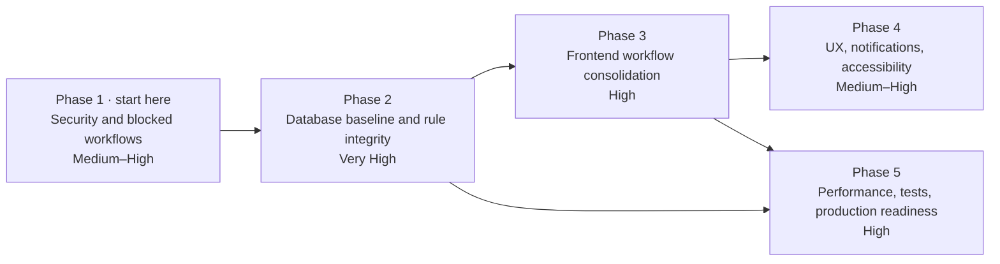

# FP Dual — Development Roadmap

_FP Dual · generated 2026-10-27 from a read-only review of the repository and the MySQL Workbench model. Companion document: [AUDIT.md](AUDIT.md), which defines the finding IDs (SEC, WF, V, PM) used here._

## E. Development roadmap

Five phases. Each ends with the application deployable and usable; later phases assume the earlier ones. Phases 1–2 change behaviour that users rely on, so they need your sign-off on the business rules listed under each.

| Phase | Objective | Complexity | Depends on |
| --- | --- | --- | --- |
| 1. Critical security and blocked workflows — **in progress** (see [PHASE_1_REPORT.md](PHASE_1_REPORT.md)) | Close account-takeover paths and make every core workflow completable | Medium–High | — |
| 2. Database baseline and business-rule integrity — **implemented, migrations applied on dev; verification open** (see [PHASE_2_REPORT.md](PHASE_2_REPORT.md)) | One reproducible schema; state rules enforced in the backend | Very High | 1 |
| 3. Frontend workflow consolidation — **implemented; authenticated browser checks pending** (see [PHASE_3_REPORT.md](PHASE_3_REPORT.md)) | One place per task, shared components, honest states | High | 1, 2 (rules) |
| 4. UX, navigation, notifications and accessibility | Role-centred navigation, dashboards, emails, WCAG basics | Medium–High | 3 (shared components) |
| 5. Performance, testing and production readiness | Scale to several years of data; automated regression; deployment hygiene | High | 2, 3 |

Phases 1–4 run in sequence; Phase 5 needs the rules from Phase 2 and the screens from Phase 3.

### Phase 1 — Critical security and blocked workflows

> **Update (Phase 2 Batch A, read-only DB checks):** V-1 confirmed (fix in migration 012, pending approval); V-2 tables exist on the dev DB. 
>
> **Status (2026-10-27, branch `phase-1-security-workflows`):** implemented and tested without a database — SEC-1, SEC-2, SEC-8, login limiter, SEC-3, SEC-4, SEC-5, SEC-6, WF-1, WF-2, WF-3, V-5, WF-10, WF-13, `.env.example`, written test script. **Blocked:** V-1 and V-2 (need the read-only DB checks; draft `011_preferencias_alumno.sql` not applied). **Open acceptance checks on a real DB:** reservation to “Confirmada”, company re-application, student validation (V-1), date switch. Decisions taken: SEC-3 = returning students prove identity with their portal password; activation = automatic by dates. Details, test results and the manual script: [PHASE_1_REPORT.md](PHASE_1_REPORT.md). Phase 1 is **not** complete.

- **Objective:** no forged or stolen session can escalate; a student, a company and a reservation can each go from start to finish through the UI.
- **Included:** SEC-1 (mandatory `JWT_SECRET`, rotation), SEC-2 (current password, server-side forced change), SEC-8 (check `activo`/`must_change_password` per request), SEC-3 (public form no longer overwrites existing students), SEC-4 (protect the principal coordinator), SEC-5 (one upload guard for all endpoints), SEC-6 (template upload ADMINISTRADOR-only), a simple login attempt limiter (part of SEC-7, no new dependency); WF-1 (contract-type control on reservation rows), WF-2 (re-apply reachable), WF-3 (reliable activation via `sp_activar_convocatoria` or date-derived reads); V-1 and V-2 verified and fixed; V-5 (track `mail/config.js`); quick fixes WF-10 and the WF-13 submit lock.
- **Areas:** `middleware/auth.js`, `authService`, `solicitudesAlumnoService.create`, `empresaTutoresService`, `documentosService` uploads, `documentosRoute`, `convocatoriasService`, `getMia`; `Login.js`, `ReservasAdmin`, `EmpresaControl`, `CompanyView`, `CompanyCard`, `AddDualStudent`; procedure `sp_validar_solicitud_alumno`.
- **Why together:** small, local changes with the highest risk reduction; none changes the data model.
- **Decisions needed:** what a returning student may change on re-application (SEC-3); whether activation is date-driven or manual.
- **Deliverables:** patched endpoints and screens; `.env.example`; a written test script covering each item.
- **Done when:** the server refuses to start without a secret; a token signed with the old fallback is rejected; password change without the current one returns 400/401; a deactivated user is rejected within one request; a new reservation reaches “Confirmada” via the UI; a returning company re-applies; a new student is validated; convocatorias switch on the start date without visiting the page.

### Phase 2 — Database baseline and business-rule integrity

> **Status (2026-10-27, branch `phase-2-db-integrity`):** implemented in code with migrations 012–015 + rollbacks, `000_baseline.sql`, a migration runner and state tables ([STATE_TRANSITIONS.md](STATE_TRANSITIONS.md)); 53/53 mock tests pass, DB integration tests written. **Progress:** baseline recorded and 012–015 applied to the dev DB; 6/6 DB tests pass; read-only backend smoke test OK. **Open:** manual end-to-end checks with real logins, baseline rebuild on an empty schema, decision D6. Decisions: D1, D2, D4, D5, D7, D8 taken; **D3 deferred** (quota rights unchanged); **D6 open** (proposal in the report). Carry-overs from Phase 1: V-1 confirmed, fix in 012 (not applied); V-2 tables already present. Phase 2 is **not** complete.

- **Objective:** the repository rebuilds your database exactly, and every state rule is enforced by the backend, not by a screen.
- **Included:** V-4 (schema dump as `000_baseline.sql`, retire `after_schema_patch.sql`, `schema_migrations` table and runner); procedures and triggers resolve types and states by name (PM-4); WF-4 (reactivation retires old documents and tutor); WF-5 (lock contract family once an annex exists; confirm with stored type; backend checks annex validated and signed); WF-6/WF-7 (sign-then-validate rule in `documentosService.validar`; convenio rejection reverts company validation; reject in the convenio viewer); WF-11 (coordinator copy-on-write); PM-6 (transactional `saveByClave`); V-3 (date handling); V-6 (DNI lookup and uniqueness); audit columns for validation, rejection, confirmation and signature (PM-5); WF-18 (reopen application).
- **Areas:** `db/migrations/`, all `sp_*`/triggers, `reservasService`, `documentosService`, `documentosStore`, `documentCatalogue`, `empresaDatos`, `db/pool.js`.
- **Why together:** they share one migration effort and the same state machine; doing them separately would mean several risky schema changes.
- **Decisions needed:** sign before validate?; must confirmation require a validated and signed annex?; may companies raise quotas or add ciclos without staff approval?; are transports per company or per application?; new columns and unique keys (your approval required by the project rules).
- **Deliverables:** baseline plus numbered migrations; a state-transition table per entity (solicitud, reserva, documento) in the project docs; API smoke tests for the changed rules.
- **Done when:** a clean database built from the repo matches a dump of production (`mysqldump --no-data` diff empty); each illegal transition returns 400 through the API; cancel-and-rebook shows no inherited annex.

### Phase 3 — Frontend workflow consolidation

> **Status (2026-10-27, branch `phase-3-frontend-consolidation`):** implemented and committed. Done: `ReservaDetalle` panel + `GET /reservas/:id/detalle` used from Enlazar, Empresas colaboradoras, Seguimiento and both portals; shared `Modal`, `MotivoDialog`, `PdfViewer`, `utils/labels.js`; API/session handling (WF-16/17); WF-8, WF-9, WF-12, WF-14, WF-15; dead code removed. Tests: backend 63/63, frontend 17/17, ESLint 0, build OK; read-only checks on the dev DB; browser-verified session expiry and the registration form (desktop and 375 px). **Open:** authenticated browser run per role (test accounts and data created with `scripts/seedPruebas.js`; the run itself has not been done), the two quota editors not merged (PM-7 leftover). Phase 3 is **not** complete.

- **Objective:** each task has one obvious place, built from shared components, showing truthful states.
- **Included:** one `ReservaDetalle` panel (contract type, annex, signatures, tutor, confirm/cancel/reassign) used from Enlazar, Empresas and Seguimiento; shared `Modal`, `MotivoDialog`, `PdfViewer` (replacing the 12 ad-hoc modals and 3 viewers, PM-7); `utils/labels.js` for every state (D.2, WF-15); `api.js` 401 handling and stable error codes (WF-16, WF-17); WF-8, WF-9, WF-12, WF-14; loading/error/empty states on every list (Seguimiento pattern); remove dead code and unused routes (PM-8); consistent field names on the endpoints touched (PM-9).
- **Areas:** `LinkStudents/*`, `AdminCompanyView/*`, `CompanyView/*`, `StudentMain/*`, `components/*`, `utils/*`; small response-shape changes in `reservasService`, `solicitudesEmpresaService`.
- **Why together:** the shared components only pay off when the screens that use them are migrated at the same time.
- **Deliverables:** shared components with usage notes; migrated screens; no duplicate modal or viewer left.
- **Done when:** a full reservation can be handled from one panel; every state label comes from `labels.js`; an expired session redirects to login with a message; ESLint stays at 0 warnings.

### Phase 4 — UX, navigation, notifications and accessibility

- **Objective:** each role sees what needs doing, gets told when something changes, and can use the app with a keyboard and screen reader.
- **Included:** staff menu and labels (D.1); staff dashboard with pending-work counters; search and active-convocatoria defaults; public forms in steps with inline errors and an “abierto / cerrado” banner; portal improvements for companies and students (D.3); email notifications for validation, rejection, reservation, cancellation and confirmation (WF-19); data-minimisation rules (SEC-11); accessibility fixes (D.4); responsive pass and new screenshots at 360/768/1280 px (D.5); sidebar behaviour.
- **Areas:** `Header.js`, `Home.js`, new `Panel` page, forms, portals, `styles/*`, a backend notification helper and one dashboard summary endpoint.
- **Why together:** they all build on the Phase 3 components and labels; doing UI polish earlier would be redone.
- **Deliverables:** updated navigation, dashboard, notification templates (Spanish), accessibility checklist results, screenshot set.
- **Done when:** every interactive element is reachable and labelled (axe or Lighthouse accessibility ≥ 90 on the main pages); each listed transition sends one email; staff can reach any pending item from the dashboard in two clicks.

### Phase 5 — Performance, testing and production readiness

- **Objective:** the system stays fast with several years of data and changes can be shipped with confidence.
- **Included:** server-side filtering, search and pagination for students, companies and reservations (PM-1); tutor N+1 (PM-2); shared Chromium and generation after response (PM-3); rate limits on public forms and anti-automation (rest of SEC-7); PDF signature check and download headers (SEC-9); escaping (SEC-10); automated tests (API tests for auth, reservations, documents; component tests for the shared components); CI running lint and tests; remove unused dependencies; deployment guide, `.env.example`, backups, log levels.
- **Areas:** list endpoints and their screens, `documentGenerationService`, routes, `package.json` files, CI config.
- **Why together:** performance work changes contracts that tests must lock down, and tests need the Phase 2 rules to be stable.
- **Decisions needed:** new dev dependencies for API testing (e.g. `supertest`) and a rate-limit package, or hand-written equivalents.
- **Deliverables:** paginated endpoints; test suite and CI; deployment documentation.
- **Done when:** list endpoints respond in under 500 ms with a year's data (measure with your real counts); CI is green on every merge; a fresh environment can be set up from the README alone.

## F. Recommended starting point and strategy

Start Phase 1 with three checks against your database and server (about ten minutes), then the authentication fixes, then the reservation deadlock. The checks decide whether V-1 and V-2 are real emergencies and how SEC-1 must be rolled out.

**Order of work inside Phase 1**

1. **Verify (read-only):** `SHOW CREATE PROCEDURE sp_validar_solicitud_alumno; SELECT * FROM dual_tipos_documento; SHOW TABLES LIKE 'dual_%preferencias';` and confirm whether production sets `JWT_SECRET`.
2. **Authentication:** SEC-1, SEC-2, SEC-8 and the login limiter together — they touch the same two files and are easy to test.
3. **Unblock workflows:** WF-1, then V-1/V-2 if confirmed, then WF-2 and WF-3.
4. **Authorization gaps:** SEC-3, SEC-4, SEC-5, SEC-6.
5. **Quick fixes:** V-5, WF-10, WF-13.

**What must come before what**

- The Phase 2 business decisions (sign-then-validate, confirmation prerequisites, company quota rights) must be settled before Phase 3 builds the reservation panel, or the panel will encode the wrong rules.
- The schema baseline (V-4) must exist before any further migration; otherwise each change risks diverging further from production.
- Shared components (Phase 3) before UI polish (Phase 4), so styling is done once.

**Highest value for effort:** WF-1 (unblocks the core process), SEC-1/SEC-2 (small diffs, large risk removed), the staff dashboard in Phase 4 (uses data Seguimiento already computes), and server-side pagination for *Enlazar* (PM-1).

**Changes that need special care**

- Any edit to `sp_reservar_alumno`, `sp_reasignar_reserva`, `sp_confirmar_reserva` or the `dual_reservas` triggers: test concurrent reservations against the same last place.
- Rotating the JWT secret logs everyone out; announce it.
- Changing the student public form (SEC-3) affects returning students mid-convocatoria; decide the rule first.
- `dateStrings` on the pool (V-3) changes every `DATE` value the API returns; test all screens that show dates.
- Unique keys on `gf_alumnosfct.dni` or reservation rows require cleaning existing duplicates first.

**Refactor before adding features?** Only where a feature lands: extract the reservation panel and shared modal when doing WF-1/WF-5, and the upload guard when doing SEC-5. A broad rewrite is not justified; the architecture (Express routes → services → SQL/procedures, React pages + `api.js`) is sound.

**Preserve as they are:** the reservation procedures' locking strategy and triggers; quota reduction with explicit selection; company change requests with snapshot conflicts and copy-on-write; the document catalogue and `deriveDocumentState` concept; versioned templates; Seguimiento's query, pagination and state handling; `ToastProvider`/`ConfirmDialog`; `api.js`; parameterised SQL throughout.
