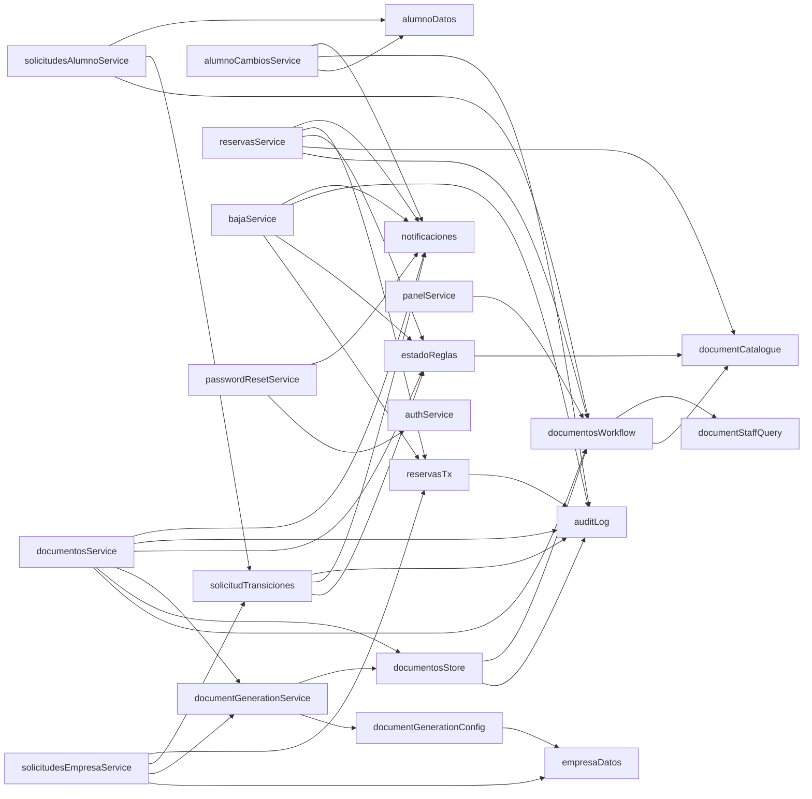

# Componentes

> Parte de la [documentación técnica](../README.md). Rutas relativas a la raíz del repositorio.

## 1. Backend

### 1.1 Arranque y transversales

| Fichero | Responsabilidad |
| --- | --- |
| [`src/index.js`](../../../backend/src/index.js) | Carga `.env`, **aborta el proceso** si `JWT_SECRET` falta, tiene menos de 32 caracteres o es el secreto revocado (`assertJwtConfig`). Quita `X-Powered-By`, aplica `trust proxy` según `TRUST_PROXY`, añade las cabeceras de seguridad (`nosniff`, `X-Frame-Options: DENY`, `Referrer-Policy: no-referrer`, CSP `default-src 'none'`, HSTS si HTTPS), registra Morgan (`dev`, o sin *query* en producción), `express.urlencoded` y `express.json` con límite de 100 kB, y las rutas. Al escuchar arranca `startConvocatoriaScheduler()`. |
| [`src/routes/index.js`](../../../backend/src/routes/index.js) | Monta los 11 routers y el **manejador global de errores**: cualquier excepción no capturada → `500 {"error":"Error interno del servidor."}` (sin `code`). |
| [`src/middleware/asyncHandler.js`](../../../backend/src/middleware/asyncHandler.js) | Envuelve los handlers `async` para que un `reject` llegue al manejador global. |
| [`src/middleware/auth.js`](../../../backend/src/middleware/auth.js) | `signToken` (JWT HS256 de 8 h con la huella `pwd` del hash), `passwordFingerprint`, `requireAuth` (verifica firma **y** relee `activo`, `must_change_password`, el hash y el rol de BD en cada petición), `requireAuthAllowPasswordChange`, `requireRole(...)`. |
| [`src/middleware/loginRateLimit.js`](../../../backend/src/middleware/loginRateLimit.js) | Limitador en memoria de fallos (ventana deslizante de 15 min): 5 por IP+identificador, 30 por IP. Fábrica `createLoginRateLimiter` reutilizada por la recuperación de contraseña (3/20). `signupRateLimit`: altas públicas (10 por IP y hora, 300 al día). |
| [`src/middleware/pdfUpload.js`](../../../backend/src/middleware/pdfUpload.js) | `multer` común para PDF (memoria, 10 MB, MIME `application/pdf`) y `requirePdfSignature` (contenido que empieza por `%PDF-`). |
| [`src/db/transaction.js`](../../../backend/src/db/transaction.js) | `inTransaction(fn)`: una conexión, `autocommit = 0`, READ COMMITTED, un `COMMIT`; deshace ante cualquier error y repite toda la función tras un interbloqueo (máx. 2). `HttpError` para las negativas de negocio. |
| [`src/helpers/dbHelpers.js`](../../../backend/src/helpers/dbHelpers.js) | `normalizeCif`/`normalizeDni` (trim + mayúsculas), `cifValido`, `dniNieValido`, `getActiveConvocatoria` (lee el indicador `activa`, **sin** sincronizar fechas), `getStudentIdFromUser`, `getCompanyIdFromUser`, `callProcedure`, `callProcedureWithResult`, **`mapSqlError`**. |
| [`src/db/pool.js`](../../../backend/src/db/pool.js) | Pool `mysql2/promise`: 10 conexiones, `utf8mb4`, `dateStrings: ['DATE']` (las columnas `DATE` llegan como `'AAAA-MM-DD'`; las `DATETIME` siguen siendo objetos `Date`), TLS opcional (`DBSSL`, `DBSSL_CA`). |
| [`src/mail/config.js`](../../../backend/src/mail/config.js) | Objeto `transporter` único: modo `log` (no envía, registra destinatario enmascarado) o `smtp` (Gmail), con redirección opcional `MAIL_REDIRECT_TO`. |
| [`src/services/auditLog.js`](../../../backend/src/services/auditLog.js) | `recordEvent(conn, …)` siempre dentro de la transacción del llamante: si falla, se deshace el cambio. Entidades admitidas: `SOLICITUD_ALUMNO`, `SOLICITUD_EMPRESA`, `RESERVA`, `DOCUMENTO`, `OFERTA`, `TUTOR`, `USUARIO`. |
| [`src/services/notificaciones.js`](../../../backend/src/services/notificaciones.js) | Plantillas de correo por evento; nunca lanzan excepción; releen los datos tras el *commit*. |

### 1.2 Módulos de dominio

| Router | Servicio(s) | Dominio | Documento |
| --- | --- | --- | --- |
| `authRoute` | `authService`, `passwordResetService`, `personalService` | Login, `/auth/me`, cambio y recuperación de contraseña, `/usuarios`, personal del centro | [autenticación](../logica-de-negocio/autenticacion-y-cuentas.md) |
| `convocatoriasRoute` | `convocatoriasService` | Convocatorias y su activación por fechas | [convocatorias](../logica-de-negocio/convocatorias.md) |
| `especialidadesRoute`, `transportesRoute` | `especialidadesService`, `transportesService` | Catálogos públicos de solo lectura | [API](../api-e-integraciones/referencia-endpoints.md#catálogos-públicos) |
| `solicitudesAlumnoRoute` | `solicitudesAlumnoService`, `alumnoDatos`, `alumnoCambiosService`, `solicitudTransiciones`, `bajaService` | Solicitud de alumno, revisión, corrección de datos (directa y por petición), baja | [solicitudes de alumno](../logica-de-negocio/solicitudes-alumno.md) |
| `solicitudesEmpresaRoute` | `solicitudesEmpresaService`, `empresaDatos`, `solicitudTransiciones`, `bajaService` | Solicitud de empresa, reaplicación, datos, cambios, ofertas y cupos | [solicitudes de empresa](../logica-de-negocio/solicitudes-empresa.md) |
| `reservasRoute` | `reservasService`, `reservasTx` | Reservas, tipo de contrato, confirmación, reasignación, intentos relacionados | [reservas](../logica-de-negocio/reservas.md) |
| `empresaTutoresRoute` | `empresaTutoresService` | Tutores de empresa y su asignación a reservas | [tutores](../logica-de-negocio/tutores-empresa.md) |
| `documentosRoute` | `documentosService`, `documentosStore`, `documentosWorkflow`, `documentCatalogue`, `documentStaffQuery`, `documentGenerationService`, `documentGenerationConfig`, `plantillasService` | Documentos, firmas, revisión, generación, plantillas, seguimiento | [documentos y firmas](../logica-de-negocio/documentos-y-firmas.md) |
| `panelRoute` | `panelService` | Contadores del panel del personal | [panel](../logica-de-negocio/panel-y-seguimiento.md) |
| `ayudaRoute` | — | Manual de usuario (Markdown) y sus capturas, públicos | [componentes § 2.3](#23-componentes-compartidos-relevantes) |

### 1.3 Grafo de dependencias entre servicios

Puntos delicados de acoplamiento:

- **`documentCatalogue.js` es la fuente única** de qué documentos existen, a qué padre pertenecen, quién sube, firma o revisa y si se generan. Lo consumen reglas, listados, subidas, firmas y el panel. Pero **los triggers `trg_dd_bi_reglas` / `trg_dd_bu_reglas` duplican la lista «tipo → padre»** y `sp_confirmar_reserva` duplica la regla de familia de anexo (`'%beca%'`). Cambiar el catálogo exige revisar esas tres piezas ([decisiones técnicas](../decisiones-tecnicas.md#catálogo-de-documentos-en-código-duplicado-en-bd)).
- **`documentosWorkflow.projectItem`** proyecta cada documento para un rol (estado operativo, acción pendiente, `puede_*`). Todas las pantallas (portales, Seguimiento, panel, ficha de reserva) usan esta proyección, de modo que muestran los mismos estados.
- **`empresaDatos.js`** concentra la lectura y escritura de los datos de empresa (tablas protegidas `ge_*`) y la lógica de copia en escritura; la usan la edición directa, la aprobación de cambios, la reaplicación y la generación del convenio.
- **`alumnoDatos.js`** hace lo mismo con los datos del alumno: campos editables, validación, reglas (convocatoria activa, sin baja, DNI fijo, ciclo sin reservas activas) y escritura. Lo usan la edición directa del personal y la aprobación de las peticiones del alumno.
- **`reservasTx.js`** es el único módulo que llama a los procedimientos de reservas, siempre con la conexión de `inTransaction`, y escribe su evento en la misma transacción. Lo usan `reservasService`, la baja y la reducción de cupo.

### 1.4 Patrones de código recurrentes

- **Handlers como funciones `exports.xxx = async (req, res)`**: el servicio recibe `req`/`res` directamente (no hay capa de controlador separada). Las pruebas los ejercitan con `mockReq`/`mockRes` del arnés.
- **Transacción manual**: `pool.getConnection()` → `beginTransaction()` → `SELECT … FOR UPDATE` → regla → cambios → `recordEvent(conn)` → `commit()`; en `catch`, `rollback()` y `sendSqlError`. Ejemplos: [`solicitudTransiciones.aplicarTransicion`](../../../backend/src/services/solicitudTransiciones.js), `documentosService.validar`, `reservasService.setTipoContrato`.
- **`inTransaction(fn)`** (reservas, baja, reducción de cupo): `fn(conn)` hace todo en esa conexión (procedimientos vía `reservasTx`, eventos) y devuelve el cuerpo de la respuesta; las negativas se lanzan como `HttpError`; los correos se envían **después**, fuera de `fn`, porque `fn` puede repetirse tras un interbloqueo (ver [integridad y transacciones](../base-de-datos/integridad-y-transacciones.md#5-transacciones)).
- **Respuesta de denegación** `{ status, error, code }`: las reglas puras devuelven `null` (permitido) o este objeto, que el servicio traduce a HTTP.
- **SQL parametrizado** en todo el código; los nombres de tabla/columna interpolados provienen siempre de constantes internas (`cfg.table`, `cfg.pk`).

## 2. Frontend

### 2.1 Estructura

| Elemento | Responsabilidad |
| --- | --- |
| [`App.js`](../../../frontend/src/App.js) | Rutas. Las privadas se envuelven en `RequireRole` (solo redirige; la seguridad real está en el backend). Redirecciones de rutas antiguas (`/linkStudents` → `/alumnos`, `/companiesView` → `/empresas`, `/documentsView` → `/documentos`). |
| [`navigation.js`](../../../frontend/src/navigation.js) | Menú y página de inicio por rol (`homeForRole`), títulos de página. |
| [`context/UserContext.js`](../../../frontend/src/context/UserContext.js) | Sesión en `localStorage["user"] = { data, expires }`; `expires` = `exp` del JWT. Cierra la sesión al caducar, ante el evento `fpdual:session-expired` y sincroniza entre pestañas. |
| [`utils/api.js`](../../../frontend/src/utils/api.js) | `getJSON`, `postJSON`, `putJSON`, `patchJSON`, `postForm`, `getBlob`, `publicJSON`. Todo error lanza `Error` con `status`, `code` y `body`; un 401 con token (salvo `/auth/login` y `/auth/changePassword`) dispara el evento de sesión caducada. |
| `utils/labels.js`, `utils/reservaEstados.js`, `utils/documentos.js`, `utils/cupos.js` | Etiquetas en español y variantes de insignia de cada valor del backend. |
| `hooks/useUrlFilters.js` | Filtros persistidos en la URL (listas de Alumnos, Empresas, Reservas, Seguimiento). |

### 2.2 Pantallas

| Ruta | Página | Roles | Endpoints principales |
| --- | --- | --- | --- |
| `/` | `Home` | Todos | `/convocatorias/estado` |
| `/login`, `/recuperar-contrasena`, `/restablecer-contrasena`, `/cambiarPassword` | `Login`, `RecuperarPassword`, `CambiarPassword` | Público / autenticado | `/auth/*` |
| `/addDualStudent` | `AddDualStudent` (formulario en 6 pasos) | Público | `POST /solicitudes/alumno` (multipart), `/especialidades` |
| `/addCompanyRequest` | `AddCompanyRequest` (6 pasos) | Público | `POST /solicitudes/empresa`, `/especialidades`, `/transportes` |
| `/panel` | `Panel` | Personal | `/panel/resumen` |
| `/alumnos` | `LinkStudents` | Personal y EMPRESA | Personal: `/solicitudes/alumno?include=full`, validar/rechazar/reabrir, `/reservas/ofertas-elegibles`, `/reservas/admin`; Administración además `…/datos` y `…/cambios`. Empresa: `/alumnos/disponibles`, `/cupos/empresa`, `POST /reservas` |
| `/empresas` | `AdminCompanyView` | Personal | `/solicitudes/empresa/todas`, datos, cambios, cupos, convenio, tutores, baja |
| `/reservas` | `Reservas` | Personal | `GET /reservas`; cada fila abre `ReservaDetalle` |
| `/documentos` | `AdminDocumentsView` (Seguimiento + Plantillas) | Personal | `/documentos/seguimiento`, `/documentos/plantillas` |
| `/convocatorias` | `Convocatorias` | Personal (crear/editar: ADMINISTRADOR en backend) | `/convocatorias` |
| `/personal` | `Personal` | ADMINISTRADOR | `/usuarios/personal`, `/usuarios/:id/resetPassword` |
| `/companyMain` | `CompanyView` (Datos, Reservas, Documentos, Tutores) | EMPRESA | `/solicitudes/empresa/mia?incluir_anteriores=1`, `reapply`, `cambios`, cupos, `/reservas/empresa`, `/documentos/empresa`, `/tutores/empresa` |
| `/studentMain` | `StudentMain` (Mi solicitud con «Mis datos», Reservas, Documentos) | ALUMNO | `/solicitudes/alumno/mia`, `/solicitudes/alumno/mia/datos`, `/solicitudes/alumno/mia/cambios`, `/reservas/alumno`, `/documentos/alumno/mios` |
| `/ayuda` | `Ayuda` (buscador, guías por perfil, preguntas frecuentes, manual por capítulos) | Todos, también sin sesión | `/ayuda/manual`, `/ayuda/imagenes/:file` |

### 2.3 Componentes compartidos relevantes

- [`components/reservas/ReservaDetalle.jsx`](../../../frontend/src/components/reservas/ReservaDetalle.jsx): ciclo de vida completo de una reserva en un panel (tipo de contrato, anexo y calendario, tutor, cancelar, reasignar, confirmar, e «Intentos relacionados» con un botón «Ver» que abre cada intento en el mismo panel). Todo lo que muestra sale de `GET /reservas/:id/detalle`, que ya proyecta las acciones permitidas para el rol.
- [`components/forms/EditDialog.jsx`](../../../frontend/src/components/forms/EditDialog.jsx): ventana común de edición de datos de empresa y de alumno. Chips de sección arriba, tarjetas de sección en dos columnas, «Guardar» y «Cancelar» siempre en el pie con el número de campos cambiados (`countChanges`), y confirmación antes de descartar cambios sin guardar. Modo `direct` (personal, guarda al momento) o `review` (empresa y alumno, envía para revisión). Los formularios son [`CompanyEditForm.jsx`](../../../frontend/src/pages/CompanyView/CompanyEditForm.jsx) y [`AlumnoEditForm.jsx`](../../../frontend/src/pages/StudentMain/AlumnoEditForm.jsx); `CambioDiff.jsx` pinta la tabla «Actual → Solicitado».
- `components/DocumentoItem.jsx`, `components/ui/PdfViewer.jsx`: visualización, subida, firma y revisión de un documento proyectado.
- `components/ui/Modal.jsx`, `MotivoDialog.jsx`: diálogos accesibles; `MotivoDialog` exige motivo cuando la acción lo requiere.
- `components/BajaControls.jsx`: «Dar de baja» / «Reactivar» (solo se muestra a ADMINISTRADOR).
- `components/CupoReductionDialog.jsx`: selección de las reservas pendientes a cancelar al reducir plazas (responde al `409 requires_selection` del backend).
- `components/portal/Pendientes.jsx`: bloque «Qué tienes pendiente» de los portales, construido con datos que ya da el backend.
- `pages/Ayuda/`: [`manual.js`](../../../frontend/src/pages/Ayuda/manual.js) divide el Markdown del manual en capítulos (cada `##` precedido de `<a id>`; el título, la versión y el «Índice» se quedan fuera), guarda qué anclas tiene cada capítulo, lo pasa a HTML con `marked`, lo sanea con DOMPurify y busca en sus apartados sin tildes ni mayúsculas. [`faq.js`](../../../frontend/src/pages/Ayuda/faq.js) tiene las preguntas frecuentes y las tarjetas de perfil, que enlazan a anclas del manual. [`Ayuda.jsx`](../../../frontend/src/pages/Ayuda/Ayuda.jsx) muestra un capítulo cada vez: cualquier enlace `#ancla` (tarjetas, preguntas, resultados, enlaces del propio manual o la URL) abre el capítulo que la contiene, guarda la ancla en el historial y vuelve a desplazarse cuando cargan las capturas que hay encima. `#indice` lleva a la lista de capítulos.

El frontend **no decide reglas de negocio**: los botones se habilitan según `puede_*`, `acciones.*.permitido` o el estado recibido, y el backend vuelve a comprobarlo todo. Excepción conocida: la validación de formato del NSS solo existe en el formulario; la del DNI/NIE del alumno se repite en el backend desde SEC-001 ([comportamientos especiales](../comportamientos-especiales/solicitudes.md#dni-del-alumno-en-el-backend)).
