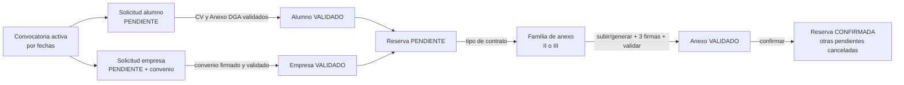
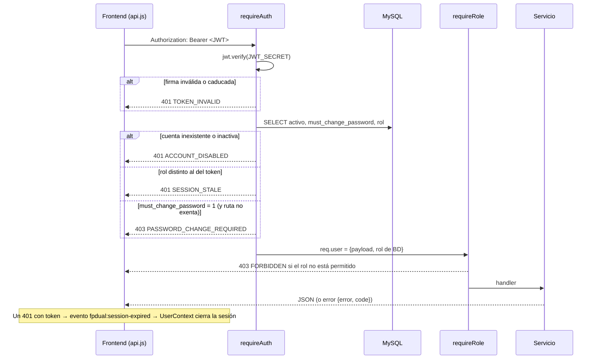

# Flujos de datos y arquitectura de ejecución

> Parte de la [documentación técnica](../README.md). Cada flujo se detalla regla a regla en [lógica de negocio](../logica-de-negocio/README.md); aquí se muestra el recorrido de los datos entre componentes.

## 1. Ciclo de vida completo de una convocatoria



## 2. Petición autenticada (todas las rutas privadas)



## 3. Solicitud pública de alumno

```mermaid
sequenceDiagram
  participant F as Formulario /addDualStudent
  participant M as multer (memoria, PDF ≤10 MB)
  participant S as solicitudesAlumnoService.create
  participant DB as MySQL
  participant MAIL as transporter
  F->>M: multipart (datos + cv + anexoDga + password)
  M->>S: req.files, req.body
  Note over M: signupRateLimit (429) y firma %PDF- de cada fichero
  S->>S: campos obligatorios, DNI/NIE válido, contraseña ≥ 8
  S->>DB: getActiveConvocatoria (activa = 1)
  S->>DB: BEGIN; SELECT gf_alumnosfct WHERE dni = ? FOR UPDATE
  alt DNI existente con cuenta
    S->>S: bcrypt.compare(password, hash) + limitador
    S->>DB: UPDATE gf_alumnosfct (todos los datos)
  else DNI existente sin cuenta
    S->>DB: ROLLBACK
    S-->>F: 401 IDENTIDAD_NO_VERIFICADA (no se escribe nada)
  else DNI nuevo
    S->>DB: INSERT gf_alumnosfct
  end
  S->>DB: INSERT dual_solicitudes_alumno (id_especialidad del formulario)
  Note over DB: trg_dsa_bi_reglas: especialidad obligatoria, convocatoria activa
  S->>DB: CALL sp_guardar_documento × 2 (CV, ANEXO_DGA)
  S->>DB: INSERT dual_usuarios ALUMNO (si no existía)
  S->>DB: UPDATE dual_documentos (origen SUBIDA, usuario, registrado_en)
  S->>DB: COMMIT
  S-)MAIL: «Solicitud Dual recibida» (sin esperar)
  S-->>F: 201 {id_solicitud_alumno, cuenta_existente}
```

## 4. Solicitud pública de empresa y convenio

```mermaid
sequenceDiagram
  participant F as /addCompanyRequest
  participant S as solicitudesEmpresaService.create
  participant DB as MySQL
  participant G as documentGenerationService
  participant CH as Chromium
  F->>S: JSON (empresa, domicilios, representante, coordinador, ofertas, transportes, contraseña)
  S->>S: obligatorios, cifValido, dniNieValido ×2, contraseña ≥ 8
  S->>DB: BEGIN; SELECT ge_empresas WHERE cif = ? FOR UPDATE
  alt CIF ya existe
    S-->>F: 409 «Esta empresa ya está registrada…»
  end
  S->>DB: INSERT ge_empresas, ge_domicilios (1 o 2), ge_contactos ×2
  S->>DB: INSERT dual_solicitudes_empresa (trg_dse_bi_reglas)
  S->>DB: INSERT ofertas, transportes, dual_usuarios EMPRESA, dual_empresa_tutores (coordinador)
  S->>DB: COMMIT
  S->>G: generateDocument(CONVENIO)
  alt hay plantilla activa
    G->>DB: lee plantilla DOCX + datos
    G->>CH: DOCX → HTML (mammoth) → PDF (puppeteer)
    G->>DB: saveByClave (transacción propia, evento GENERAR)
    S-)S: correo con el PDF adjunto
  else sin plantilla
    Note over S: aviso en consola; NO se envía ningún correo
  end
  S-->>F: 201 {id_solicitud_empresa}
```

Un fallo de la generación **no** deshace la solicitud (ya confirmada): se registra en consola y la respuesta sigue siendo 201.

## 5. De la reserva a la confirmación

```mermaid
sequenceDiagram
  actor E as Empresa
  actor C as Centro
  actor A as Alumno
  participant RS as reservasService
  participant DS as documentosService
  participant DB as MySQL
  E->>RS: POST /reservas {id_solicitud_alumno, id_oferta}
  RS->>DB: comprobaciones (oferta propia, activa, VALIDADO)
  RS->>DB: inTransaction: CALL sp_reservar_alumno (bloqueos) + evento RESERVAR · COMMIT
  RS-)A: correo «Una empresa ha reservado tu candidatura» (tras el commit)
  C->>RS: POST /reservas/:id/tipo-contrato
  RS->>DB: BEGIN … UPDATE id_tipo_contrato + evento TIPO_CONTRATO … COMMIT
  alt subida
    E->>DS: POST /documentos/reserva/:id/anexo (PDF)
    Note over DS: firma EMPRESA = SUBIDA_FIRMADA (declarada al subir)
  else generación
    C->>DS: POST /documentos/generar {clave: ANEXO_II|ANEXO_III}
    Note over DS: sin firmas
  end
  C->>DS: POST /documentos/:id/firmar (GESTOR)
  A->>DS: POST /documentos/:id/firmar (ALUMNO)
  C->>DS: POST /documentos/:id/validar (exige todas las firmas)
  C->>RS: POST /reservas/:id/confirmar
  RS->>DB: inTransaction: bloqueos, firmas y anexo comprobados, CALL sp_confirmar_reserva → CONFIRMADA; otras PENDIENTE del alumno → CANCELADA; eventos CONFIRMAR + CANCELAR · COMMIT
  RS-)A: «Tu plaza está confirmada»
  RS-)E: «Reserva confirmada» (y aviso a cada empresa que perdió al alumno)
```

## 6. Guardado de un documento (`documentosStore.saveByClave`)

```mermaid
sequenceDiagram
  participant SV as documentosService / generación
  participant ST as saveByClave
  participant DB as MySQL
  SV->>ST: clave, padres, buffer, procedencia
  ST->>DB: BEGIN
  ST->>DB: SELECT <padre> FOR UPDATE   (serializa subidas concurrentes)
  ST->>DB: CALL sp_guardar_documento
  Note over DB: si hay documento actual: copia a dual_documento_versiones y lo reemplaza (PENDIENTE, motivo NULL)<br/>si no: INSERT (uq_dd_actual impide duplicados)
  ST->>DB: UPDATE procedencia, registrado_en, firmas_exentas_legacy = 0
  ST->>DB: firmas: el que sube y firma → FIRMADO (SUBIDA_FIRMADA); el resto → SIN_FIRMAR
  ST->>DB: INSERT dual_eventos (SUBIR | GENERAR)
  ST->>DB: COMMIT
```

## 7. Baja de una solicitud

```mermaid
sequenceDiagram
  actor AD as Administrador
  participant BJ as bajaService.darDeBaja
  participant DB as MySQL
  AD->>BJ: POST /solicitudes/{alumno|empresa}/:id/baja {motivo}
  BJ->>DB: inTransaction; SELECT … FOR UPDATE
  BJ->>DB: estado = BAJA, motivo = NULL
  BJ->>DB: dual_usuarios.activo = 0 (alumno o todos los usuarios EMPRESA de la empresa)
  BJ->>DB: evento BAJA (estado anterior, cuentas, reservas a cancelar)
  loop cada reserva PENDIENTE/CONFIRMADA
    BJ->>DB: CALL sp_cancelar_reserva_admin + evento CANCELAR
  end
  BJ->>DB: COMMIT (todo o nada)
  BJ-)BJ: aviso a la otra parte de cada reserva cancelada
  BJ-->>AD: {canceladas, pendientes: []}
```

## 8. Procesos síncronos y asíncronos

| Proceso | Tipo | Disparador | Efecto si falla |
| --- | --- | --- | --- |
| Sincronización de convocatoria activa | Asíncrono (temporizador 15 min) + síncrono en `GET /convocatorias*` y al crear/editar | Arranque, intervalo, lecturas | Se registra en consola; el indicador `activa` queda como estaba |
| Correos de notificación | Asíncrono, no esperado | Tras cada *commit* relevante | Se registra; no hay reintento ni cola |
| Generación de PDF | Síncrono dentro de la petición (o tras el *commit* del alta de empresa) | `POST /documentos/generar`, alta y reaplicación de empresa | Petición de generación: error HTTP. Alta de empresa: solo consola |
| Auditoría | Síncrona, dentro de la misma transacción que el cambio | Toda transición auditada | Se deshace el cambio y la petición responde con error |

Detalle de cada proceso en [procesos](../procesos/README.md).
