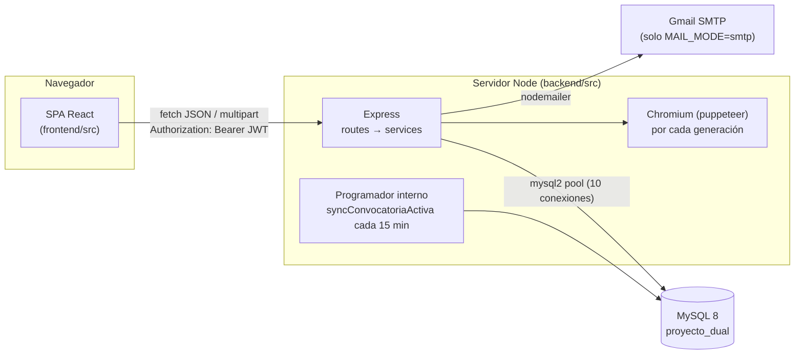
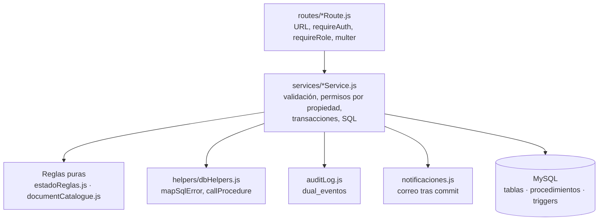

# Visión general de la arquitectura

> Parte de la [documentación técnica](../README.md). Convenciones de certeza: ver [README § Cómo leer esta documentación](../README.md#cómo-leer-esta-documentación).

## 1. Qué es el sistema

FP Dual es el portal que gestiona el programa de Formación Profesional Dual de un centro educativo (los textos de los correos firman como «Salesianos Zaragoza — Departamento FP Dual»). Cubre, por **convocatoria** (curso académico):

1. La **solicitud del alumno** (formulario público con CV y Anexo DGA) y su revisión por el centro.
2. La **solicitud de la empresa** (formulario público o reaplicación desde el portal), sus **ofertas** (ciclo + número de plazas) y el **convenio**.
3. Las **reservas**: una empresa (o el centro) reserva a un alumno validado en una oferta; el centro indica el **tipo de contrato**, se completa el **Anexo II o III** (subida/generación, firmas y validación) y el centro **confirma** la plaza.
4. Los **documentos** de cada fase, con firmas por rol, revisión, versiones e historial.
5. La **auditoría** de transiciones, las **notificaciones** por correo, los **tutores de empresa**, las **bajas** del programa y la gestión de cuentas.

## 2. Tecnologías

| Capa | Tecnología | Evidencia |
| --- | --- | --- |
| Frontend | React 18 (Create React App, `react-scripts` 5), React Router 6, Tailwind CSS 3, `react-icons`, `marked` (manual en la página Ayuda) | [`frontend/package.json`](../../../frontend/package.json) |
| Backend | Node.js + Express 4 (CommonJS), `mysql2/promise`, `jsonwebtoken`, `bcrypt`, `multer`, `nodemailer`, `morgan` | [`backend/package.json`](../../../backend/package.json) |
| Generación documental | `docx-templates` (rellena DOCX), `mammoth` (DOCX → HTML), `puppeteer` (HTML → PDF con Chromium) | [`documentGenerationService.js`](../../../backend/src/services/documentGenerationService.js) |
| Base de datos | MySQL 8 (InnoDB, `utf8mb4_0900_ai_ci`), procedimientos almacenados y triggers | [`db/000_baseline.sql`](../../../db/000_baseline.sql), [`db/migrations/`](../../../db/migrations) |
| Pruebas | `node:test` con un arnés propio de *stubs* (backend); Jest + Testing Library (frontend) | [`backend/test/helpers/harness.js`](../../../backend/test/helpers/harness.js) |

Dependencias declaradas pero **no usadas** por el código actual: `google-auth-library`, `soffice`, `crypto-browserify`, `body-parser` (backend) y `@react-oauth/google` (frontend). Ningún fichero de `src/`, `scripts/` ni `test/` las importa. El motivo de su presencia no consta 🔶 (probablemente restos de versiones anteriores).

## 3. Topología de ejecución



- **Un solo proceso Node** sirve la API en `PORT` (3001 por defecto). No sirve el frontend compilado ni configura CORS: en desarrollo el *proxy* de CRA (`"proxy": "http://localhost:3001"` en `frontend/package.json`) reenvía las llamadas; en un despliegue real hace falta un proxy inverso que publique `frontend/build` y la API bajo el mismo origen 🔶 (no hay guía de despliegue en el repositorio).
- **Sin colas ni workers.** Lo asíncrono se limita a: el programador de convocatorias (`setInterval`), el envío de correos «disparar y olvidar» tras el *commit* y la generación de PDF dentro de la propia petición. Ver [procesos](../procesos/README.md).
- **Estado en memoria del proceso:** el limitador de intentos de login y de recuperación de contraseña ([`loginRateLimit.js`](../../../backend/src/middleware/loginRateLimit.js)). Se pierde al reiniciar y no se comparte entre procesos.
- **No existe entorno de producción** a fecha de esta documentación. Todo lo verificado contra datos se hizo en la base de desarrollo local `proyecto_dual`.

## 4. Organización del repositorio

```
backend/
  src/
    index.js                 arranque: comprobación de JWT_SECRET, Express, programador
    routes/                  un fichero por dominio; solo enrutado, roles y multer
    middleware/              auth (JWT + estado de cuenta), asyncHandler, limitador de login
    services/                lógica de negocio y SQL (sin capa de repositorio)
    helpers/dbHelpers.js     normalización CIF/DNI, mapeo de errores SQL, llamadas a procedimientos
    db/pool.js               pool mysql2
    mail/config.js           transporte de correo (modo log/smtp, redirección)
    constants/               nombres de estados de reserva
  scripts/                   migraciones, esquema, copias de seguridad, BD de verificación, datos de prueba
  test/                      pruebas node:test (con BD simulada) y test/db (contra BD real *_verify)
  required_documents/        plantillas DOCX de referencia (no las lee el código)
frontend/src/
  App.js, navigation.js      rutas y menús por rol
  context/UserContext.js     sesión (localStorage) y caducidad
  utils/api.js               cliente HTTP con gestión de errores y 401
  pages/                     una carpeta por pantalla
  components/                componentes compartidos (ReservaDetalle, Modal, PdfViewer…)
db/
  000_baseline.sql           esquema base (estructura + tablas de catálogo)
  migrations/NNN_*.sql       cambios posteriores (012–017)
  rollback/NNN_*.down.sql    reversión manual de cada migración
  legacy_migrations/         scripts retirados (002–011): solo historia, no ejecutar
docs/                        manual de usuario y esta documentación
```

## 5. Arquitectura lógica

Se trata de un **monolito en capas** clásico:



Las reglas de negocio se aplican **en tres niveles a la vez**:

1. **Node** (servicios + funciones puras de [`estadoReglas.js`](../../../backend/src/services/estadoReglas.js) y el catálogo [`documentCatalogue.js`](../../../backend/src/services/documentCatalogue.js)): devuelven errores legibles con `code` estable.
2. **Procedimientos almacenados** (`sp_reservar_alumno`, `sp_confirmar_reserva`…): repiten las comprobaciones críticas bajo bloqueo de filas.
3. **Triggers** (`trg_dr_bi_reglas`, `trg_dd_bi_reglas`…): invariantes que se cumplen sea quien sea el que escribe.

Consecuencia práctica: una misma regla puede rechazarse con mensajes distintos según el nivel que la detecte primero (por ejemplo, «No quedan plazas disponibles…» puede venir del procedimiento o del trigger). Ver [decisiones técnicas](../decisiones-tecnicas.md#reglas-en-tres-niveles).

## 6. Actores y roles

| Rol (`dual_roles.nombre`) | Identificador de acceso | Ámbito |
| --- | --- | --- |
| `ADMINISTRADOR` | email (`dual_usuarios.email`) | Todo lo de coordinación + plantillas, bajas/reactivaciones, gestión de contraseñas, `/usuarios`, crear/editar convocatorias |
| `COORDINADOR` | email | Revisión de solicitudes y documentos, reservas, datos de empresa, seguimiento, panel |
| `EMPRESA` | CIF de la empresa | Su solicitud, ofertas y cupos, tutores, reservas propias, documentos propios, alumnos disponibles |
| `ALUMNO` | DNI/NIE | Su solicitud más reciente, sus reservas y documentos (solo consulta y firma) |

En el catálogo de documentos los dos roles de personal actúan como un único firmante/revisor llamado **`GESTOR`** («Centro»). Detalle en [seguridad y permisos](../seguridad-y-permisos.md).

## 7. Documentos relacionados

- [Componentes](componentes.md): módulos del backend y del frontend y sus dependencias.
- [Flujos de datos](flujos-de-datos.md): diagramas de secuencia de los procesos principales.
- [Base de datos](../base-de-datos/vision-general.md).
