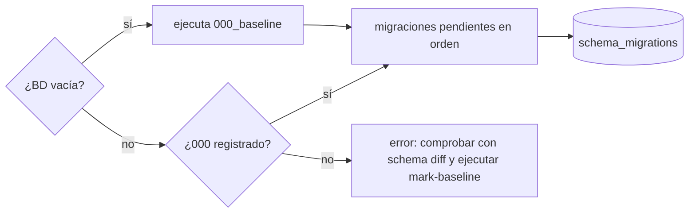

# Migraciones y compatibilidad con datos existentes

> Parte de la [base de datos](vision-general.md). Instrucciones operativas completas en [`db/README.md`](../../../db/README.md) (en inglés); aquí se explica el sistema y el efecto de cada migración.

## 1. Sistema

- **Baseline** [`db/000_baseline.sql`](../../../db/000_baseline.sql): esquema completo tras los scripts retirados 002–011, generado con `scripts/schema.js baseline`. Solo estructura y filas de catálogo, sin datos personales ni `DEFINER`.
- **Migraciones numeradas** `db/migrations/NNN_*.sql`, aplicadas en orden por [`scripts/migrate.js`](../../../backend/scripts/migrate.js). Cada fichero se divide en sentencias respetando `DELIMITER` ([`scripts/lib/sqlScript.js`](../../../backend/scripts/lib/sqlScript.js)) y se registra en `schema_migrations` con su **checksum SHA-256**. `status` avisa si un fichero cambió tras aplicarse: **nunca se edita una migración aplicada**, se añade otra.
- **Reversiones** `db/rollback/NNN_*.down.sql`: manuales (MySQL Workbench), con advertencias de pérdida de datos al principio. Después hay que borrar la fila de `schema_migrations`.
- **Scripts retirados** `db/legacy_migrations/` (002–011 y `after_schema_patch.sql`): solo historia. **No ejecutar**: `after_schema_patch.sql` siembra nombres de estado antiguos y rompe las reservas.

### 1.1 Fallos a mitad de fichero

MySQL confirma el DDL sentencia a sentencia, así que un fichero que falla puede quedar **aplicado a medias**. El ejecutor se detiene, muestra la sentencia y **no registra** el fichero. Hay que aplicar la reversión (o solo sus pasos para los objetos creados), corregir y volver a lanzar `up`.

Las migraciones 015 y 017 empiezan con un **procedimiento guarda** (`sp_015_comprobar_dni`, `sp_017_comprobar`) que verifica los datos y se detiene **antes de cambiar nada** si una regla nueva ya se incumple. Si la guarda detiene la ejecución, solo queda creado ese procedimiento: se borra, se corrigen los datos con las consultas de auditoría del final del fichero y se repite.

## 2. Historia de las migraciones

| Versión | Fichero | Qué cambia | Datos existentes | Reversión |
| --- | --- | --- | --- | --- |
| 000 | `000_baseline.sql` | Esquema base | En una BD existente se **marca** sin ejecutar (`mark-baseline`) | — |
| 012 | `012_reglas_por_nombre_y_reservas` | Funciones `fn_id_*`; procedimientos y triggers resuelven estados y tipos **por nombre**; `sp_validar_solicitud_alumno` exige CV + **ANEXO_DGA** (antes pedía el tipo heredado `ANEXO_2` y ninguna solicitud nueva podía validarse, V-1); reactivación limpia de reservas (WF-4); confirmación con el tipo **guardado** y anexo validado (WF-5); triggers de documentos con el catálogo actual | Sin cambio de filas | Restaura las definiciones anteriores |
| 013 | `013_auditoria_y_firmas` | Tabla `dual_eventos` inmutable; `dual_documento_firmas.firmado_por` y `metodo`; `dual_documentos.firmas_exentas_legacy` | Marca como exentos **solo** los documentos `LEGACY`, ya `VALIDADO`, de tipo con firmantes (CONVENIO, ANEXO_II, ANEXO_III, CALENDARIO) y sin ninguna fila de firma; registra cada exención como evento `EXENCION_FIRMA_LEGACY`. En desarrollo: 6 convenios | **Borra la auditoría** (exportar antes); requiere el backend anterior |
| 014 | `014_transportes_por_solicitud` | Tabla `dual_solicitud_empresa_transportes`; `transportes_conocidos` | Copia los transportes de la empresa solo a su solicitud **más reciente** (`fecha_solicitud DESC, id DESC`); las anteriores quedan con `transportes_conocidos = 0` («No registrado»), porque sus valores originales se habían sobrescrito y no se inventan | Requiere el backend anterior |
| 015 | `015_dni_unico` | `gf_alumnosfct.dni` pasa a **único** (tabla protegida: excepción aceptada, D1 del plan de BD) | **Se detiene** si hay DNI duplicados (según la colación, ignorando mayúsculas y acentos) o sin normalizar; nunca fusiona ni borra alumnos | Vuelve al índice simple |
| 016 | `016_estado_baja` | Fila `BAJA` en `dual_estados_validacion` (id 4 en desarrollo) | Idempotente | Borra la fila; **se detiene sin cambiar nada** mientras alguna solicitud o documento esté en BAJA. Requiere el backend anterior. Los eventos `BAJA`/`REACTIVAR` se conservan |
| 017 | `017_integridad_especialidad_documentos_cupos` | `dual_solicitudes_alumno.id_especialidad` NN + FK (DB-01); triggers `trg_dsa_bi/bu_reglas`, `trg_dr_bi_reglas` y vista `vw_alumnos_disponibles` la leen; `padre_actual` + `uq_dd_actual` (DB-03); `sp_guardar_documento` con lectura bloqueante; trigger `trg_dsee_bu_cupo` (DB-10) | **Copia** el ciclo de `gf_alumnosfct.id_especialidad_dual` a cada solicitud. **Se detiene** si: un alumno tiene varias solicitudes (el valor guardado solo es el último ciclo); una solicitud no tiene ciclo; una reserva está en una oferta de otro ciclo; hay documentos actuales duplicados; una oferta tiene más reservas activas que plazas | **Pierde** `id_especialidad` (si un alumno cambió de ciclo entre convocatorias, ese dato desaparece); requiere el backend anterior; reaplicarla luego puede detenerse en su guarda |

## 3. Orden de despliegue y compatibilidad backend ↔ esquema

- El backend de la fase 2 lee `dual_eventos`, `firmas_exentas_legacy`, `firmado_por`/`metodo`, `dual_solicitud_empresa_transportes` y `transportes_conocidos`: **012–015 deben aplicarse antes** de arrancarlo.
- El backend de la etapa 1 inserta `dual_solicitudes_alumno.id_especialidad`: **017 y ese backend van juntos**. Con el backend nuevo sobre un esquema anterior a 017 cualquier alta de alumno falla (columna inexistente); con el backend anterior sobre 017, el `INSERT` sin `id_especialidad` lo rechaza `trg_dsa_bi_reglas`.
- La baja (`bajaService`) comprueba si existe el estado `BAJA` y, si no, responde **503 `MIGRACION_PENDIENTE`** sin cambiar nada.
- `solicitudesAlumnoService.create` lanza «El catálogo de documentos no está actualizado. Ejecuta la migración 008.» si faltan los tipos `CV` o `ANEXO_DGA` (→ 500).

## 4. Estado conocido (desarrollo)

Según [`docs/DATABASE_STAGE_1_REPORT.md`](../../DATABASE_STAGE_1_REPORT.md): `schema_migrations` contiene 000 (MARK), 012–016 (27/10/2026) y 017 (28/10/2026, 10:32). La BD de desarrollo es idéntica a una instalación limpia del repositorio en 017 (`schema.js diff` sin diferencias). Las etapas 2–4 del plan (migraciones 018–020) **no existen todavía**.

## 5. Verificación

- `node scripts/verifyDb.js create --to NNN` construye `<DBNAME>_verify` solo desde el repositorio; `npm run db:schema -- diff <DBNAME>_verify` compara.
- `DB_INTEGRATION=1 node --test test/db/stage1.db.test.js` reconstruye la BD de verificación, prueba guardas, reglas, reversión y reaplicación de 017, y la borra (`KEEP_VERIFY=1` la conserva). `test/db/phase2.db.test.js` requiere 017 aplicada.
- Antes de toda migración: `npm run db:backup` y `npm run db:backup -- verify <fichero>`.
