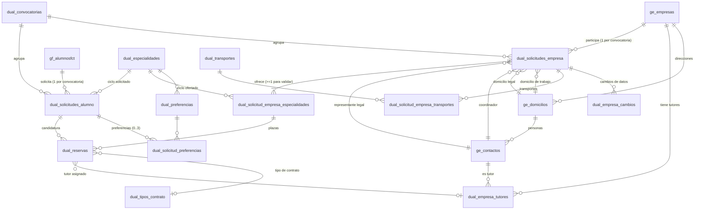
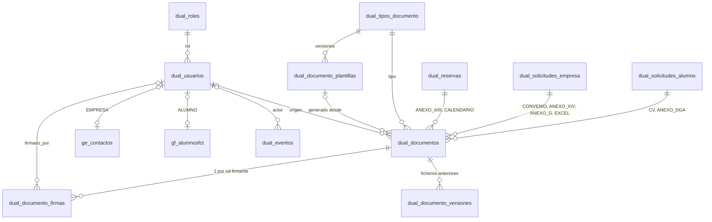

# Relaciones entre entidades

> Parte de la [base de datos](vision-general.md). Campos detallados en el [modelo de datos](modelo-de-datos.md).

## 1. Diagrama entidad-relación (núcleo del proceso)

## 2. Documentos, firmas y cuentas

`dual_eventos` no tiene FK hacia la entidad auditada: `(entidad, id_entidad)` es una **referencia polimórfica** sin integridad referencial.

## 3. Cardinalidades y reglas que las sostienen

| Relación | Cardinalidad | Mecanismo |
| --- | --- | --- |
| Alumno → solicitudes | 1 : N (una por convocatoria) | `uq_dual_solicitudes_alumno (id_alumno, id_convocatoria)` |
| Empresa → solicitudes | 1 : N (una por convocatoria) | `uq_dual_solicitudes_empresa (id_empresa, id_convocatoria)` |
| Solicitud de empresa → ofertas | 1 : N, una por especialidad; ≥ 1 para validar | `uq_dsee_solicitud_especialidad`; `sp_validar_solicitud_empresa` |
| Solicitud de alumno ↔ oferta | N : M a través de `dual_reservas`; **una fila por par** | `uq_dual_reservas_alumno_oferta` |
| Solicitud de alumno → reservas confirmadas | 0..1 | `uq_dual_reservas_confirmada_alumno` sobre columna generada |
| Oferta → reservas activas | ≤ `cantidad_alumnos` | Procedimientos con `FOR UPDATE`, `trg_dr_bi/bu_reglas`, `trg_dsee_bu_cupo` |
| Padre → documento actual por tipo | 0..1 | `uq_dd_actual` (017) |
| Documento → padre | exactamente 1 de 3 | `chk_dd_un_padre` + `trg_dd_bi/bu_reglas` |
| Documento → firmas | 0..3 (una por rol) | `uq_dual_documento_firmas_doc_rol` |
| Tipo → plantilla activa | 0..1 | `uq_plantilla_activa` |
| Solicitud de empresa → cambio pendiente | 0..1 | `uq_dec_solicitud_pendiente` |
| Usuario ↔ contacto / alumno | 1 : 1 opcional | `uq_dual_usuarios_contacto`, `uq_dual_usuarios_alumno` + triggers de rol |
| Empresa → tutor por contacto | único | `uq_dual_empresa_tutores_empresa_contacto` |

## 4. Relaciones implícitas

Relaciones que la aplicación da por hechas pero **no están declaradas** como FK directa:

| Relación | Cómo se resuelve | Qué la garantiza |
| --- | --- | --- |
| Contacto → empresa | `ge_contactos.iddomicilio → ge_domicilios.idempresa` | Nada en el contacto. Los triggers `trg_dse_bi/bu_reglas` comprueban que representante, coordinador y domicilios de una solicitud son de su empresa |
| Usuario EMPRESA → empresa | `dual_usuarios.id_contacto → ge_contactos → ge_domicilios.idempresa` ([`getCompanyIdFromUser`](../../../backend/src/helpers/dbHelpers.js)) | Toda comprobación de propiedad de una empresa depende de esta cadena |
| Login de empresa por CIF | `ge_empresas.cif` → cualquier `dual_usuarios` EMPRESA de esa empresa (`LIMIT 1`) | Si una empresa tuviera varios usuarios EMPRESA, el elegido no es determinista 🔶 (el código solo crea uno por empresa) |
| Tutor de la reserva ∈ empresa de la reserva | `dual_empresa_tutores.id_empresa = solicitud_empresa.id_empresa` | Solo Node (`empresaTutoresService.assignToReserva`); sin comprobación en BD |
| Alumno y oferta de la misma convocatoria y ciclo | `sa.id_convocatoria = se.id_convocatoria`, `sa.id_especialidad = ee.id_especialidad` | `trg_dr_bi_reglas` al insertar; **no** se recomprueba al reactivar una fila cancelada |
| Coordinador principal ↔ tutor | El mismo `id_contacto` en `dual_solicitudes_empresa.id_coordinador_empresa` y en `dual_empresa_tutores` | Alta de empresa y reaplicación; `es_coordinador` se calcula con `EXISTS` |
| Evento → entidad auditada | `(entidad, id_entidad)` | `CHECK` sobre `entidad`; sin FK |
| Familia de anexo ↔ tipo de contrato | Nombre del tipo de contrato contiene «beca» | Código (Node + `sp_confirmar_reserva`), no hay columna |
| Tipo de documento ↔ padre permitido | Lista en `documentCatalogue.js` (`ambito`) | Duplicada en `trg_dd_bi/bu_reglas` |

## 5. Dependencias entre datos y efectos de las operaciones

### 5.1 Qué se crea junto

- **Alta pública de empresa**: `ge_empresas` → 1 o 2 `ge_domicilios` → 2 `ge_contactos` (representante en el domicilio legal; coordinador en el de trabajo) → `dual_solicitudes_empresa` → ofertas → transportes → `dual_usuarios` (EMPRESA, ligado al coordinador) → `dual_empresa_tutores` (coordinador). Todo en una transacción; el convenio se genera después.
- **Alta pública de alumno**: `gf_alumnosfct` (nuevo o actualizado) → `dual_solicitudes_alumno` → 2 `dual_documentos` (CV, ANEXO_DGA) → preferencias → `dual_usuarios` (ALUMNO, si no existía).

### 5.2 Qué se comparte entre convocatorias y cómo se protege

| Dato | Compartido | Protección del histórico |
| --- | --- | --- |
| Domicilios de la empresa | Sí: la reaplicación reutiliza los ids de la solicitud anterior | **Copia en escritura**: si otra solicitud apunta al domicilio, se clona antes de editar ([`empresaDatos.ensureExclusiveDomicilio`](../../../backend/src/services/empresaDatos.js)) |
| Representante legal | Sí | Copia en escritura (clon en el domicilio legal) |
| Coordinador principal | Sí | **Copia inversa**: las otras solicitudes pasan a un clon congelado y el contacto original se edita en el sitio, para no romper el usuario EMPRESA ni la fila de tutor (`freezeCoordinadorForOtherSolicitudes`) |
| `ge_empresas` (razón social, CIF, web, teléfono) | Sí | **Ninguna**: se edita en el sitio |
| Tutores | Sí (por empresa) | **Ninguna**: `PATCH /tutores/:id` edita el contacto en el sitio; reservas de años anteriores muestran los datos nuevos |
| Datos personales del alumno | Sí | Ninguna (una ficha por persona); los PDF ya generados conservan los datos del día |
| Ciclo del alumno | Antes de 017 sí; ahora por solicitud | `dual_solicitudes_alumno.id_especialidad` |
| Transportes | Por solicitud desde 014 | Solicitudes anteriores a 014 con `transportes_conocidos = 0` |

### 5.3 Estrategia de borrado y actualización

- **Todas las FK son `ON DELETE RESTRICT ON UPDATE RESTRICT`**, salvo `fk_dp_especialidad`, `fk_dsp_preferencia` y `fk_dsp_solicitud` (`CASCADE`).
- La aplicación **no borra** filas de negocio: el único `DELETE` del backend es el de `dual_solicitud_empresa_transportes` al reescribir los transportes de una solicitud. No hay endpoints de borrado de alumnos, empresas, solicitudes, reservas, documentos, usuarios ni convocatorias.
- `dual_eventos` es inmutable, y como tiene FK a `dual_usuarios`, **un usuario con eventos no puede borrarse** ni siquiera manualmente.
- La «eliminación» funcional se expresa con estados: reserva `CANCELADA`, solicitud `RECHAZADO`/`BAJA`, documento `es_actual = 0`, tutor/usuario `activo = 0`.
- No existe procedimiento de retención ni anonimización.

### 5.4 Impacto de los cambios más comunes

| Operación | Afecta a |
| --- | --- |
| Cambiar fechas de una convocatoria | Qué convocatoria está activa → qué solicitudes pueden crearse, editarse, reabrirse, qué alumnos ve una empresa, qué ofertas puede usar |
| Validar el convenio de una empresa PENDIENTE | Valida también la solicitud de empresa (misma transacción) → sus ofertas pasan a ser reservables |
| Dar de baja una solicitud | Desactiva cuentas, cancela reservas activas, impide nuevas reservas (exigen VALIDADO) |
| Cambiar el tipo de contrato de una reserva | Familia de anexo exigida; retira el anexo rechazado de la familia anterior; cambia qué documentos se listan |
| Confirmar una reserva | Cancela las demás reservas PENDIENTE del alumno; avisa a sus empresas |
| Subir un fichero nuevo | Reinicia revisión y firmas de ese documento; archiva el anterior |
| Reducir plazas | Cancela las reservas pendientes elegidas (sin evento de auditoría) |
| Editar un tutor | Cambia lo que muestran todas las reservas (de cualquier año) con ese tutor |
