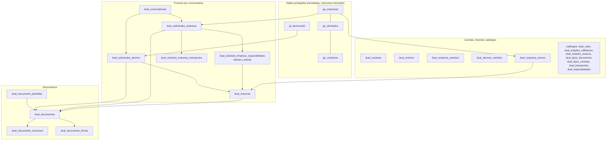

# Base de datos: visión general

> Parte de la [documentación técnica](../README.md). Documentos de esta sección: [modelo de datos](modelo-de-datos.md) · [relaciones](relaciones.md) · [integridad y transacciones](integridad-y-transacciones.md) · [migraciones](migraciones.md).

## 1. Motor y configuración

| Elemento | Valor | Fuente |
| --- | --- | --- |
| Motor | MySQL 8.0 (8.0.44 en desarrollo), InnoDB en todas las tablas | `000_baseline.sql` |
| Juego de caracteres | `utf8mb4` / `utf8mb4_0900_ai_ci` (comparaciones **insensibles a mayúsculas y acentos**) | `000_baseline.sql` |
| Aislamiento | `REPEATABLE READ` (valor por defecto de InnoDB; verificado en desarrollo). Las transacciones de `inTransaction` usan `READ COMMITTED` | Auditoría § 2, [`db/transaction.js`](../../../backend/src/db/transaction.js) |
| `sql_mode` | Incluye `STRICT_TRANS_TABLES` y `ONLY_FULL_GROUP_BY` (verificado en desarrollo) | Auditoría § 2 |
| Zona horaria | `SYSTEM` del servidor. `CURDATE()` decide qué convocatoria está activa | `convocatoriasService.syncConvocatoriaActiva` |
| Conexión de la aplicación | Pool `mysql2` de 10 conexiones, `dateStrings: ['DATE']` | [`backend/src/db/pool.js`](../../../backend/src/db/pool.js) |
| Cuenta usada | `root@localhost` en desarrollo (de la auditoría) ❓ en cualquier otro entorno | Auditoría § 10 |

`dateStrings: ['DATE']` hace que las columnas `DATE` (fechas de convocatoria, `fechaNacimiento`, `fechaconvenio`) lleguen al backend como texto `'AAAA-MM-DD'`, evitando el desplazamiento de un día al serializar a JSON en UTC. Las columnas `DATETIME` (`fecha_solicitud`, `creado_en`, `registrado_en`…) siguen llegando como `Date` de JavaScript y se serializan en ISO UTC.

## 2. Capas del modelo

### 2.1 Tablas protegidas

`ge_empresas`, `ge_domicilios`, `ge_contactos` y `gf_alumnosfct` proceden de un sistema anterior del centro (gestión de FCT) y **su estructura no debe modificarse** (regla del proyecto recogida en la auditoría y en el plan de mejora). El portal sí **lee y escribe filas** en ellas. Consecuencias de diseño:

- `ge_contactos` **no tiene columna de empresa**: la empresa de un contacto se deduce por `ge_contactos.iddomicilio → ge_domicilios.idempresa`. Los triggers `trg_dse_*` y la tabla `dual_empresa_tutores` compensan esta carencia ([relaciones](relaciones.md#4-relaciones-implícitas)).
- Columnas heredadas de FCT en `gf_alumnosfct` (`idempresa`, `iddomicilio`, `idrepresentante`, `idtutorempresa`, `mesFCT`) no las usa el portal.
- **Excepción aceptada**: la migración 015 cambió un índice de `gf_alumnosfct` (índice simple de `dni` → clave única `uq_gf_alumnosfct_dni`). Se mantiene porque el backend depende de ella.

### 2.2 Separación identidad / participación

- **Identidad estable**: la empresa (`ge_empresas`) y el alumno (`gf_alumnosfct`) existen una vez, sin convocatoria.
- **Participación por convocatoria**: `dual_solicitudes_empresa` y `dual_solicitudes_alumno`, con unicidad `(empresa|alumno, convocatoria)`. Todo lo que depende del año (ofertas, plazas, transportes, documentos, reservas, ciclo del alumno desde 017) cuelga de la solicitud.

### 2.3 Dónde viven los estados

| Entidad | Columna | Catálogo | Valores |
| --- | --- | --- | --- |
| Solicitud de alumno / de empresa | `id_estado_validacion` | `dual_estados_validacion` | `PENDIENTE` (1), `VALIDADO` (2), `RECHAZADO` (3), `BAJA` (4, migración 016) |
| Documento (revisión) | `dual_documentos.id_estado_validacion` | `dual_estados_validacion` | `PENDIENTE`, `VALIDADO`, `RECHAZADO` (BAJA no se usa en documentos) |
| Reserva | `id_estado_reserva` | `dual_estados_reserva` | `PENDIENTE` (1), `CONFIRMADA` (2), `CANCELADA` (3) |
| Firma | `dual_documento_firmas.estado` | `CHECK` | `SIN_FIRMAR`, `FIRMADO` |
| Solicitud de cambio de datos | `dual_empresa_cambios.estado`, `dual_alumno_cambios.estado` (020) | `CHECK` | `PENDIENTE`, `APROBADO`, `RECHAZADO` |
| Convocatoria | `dual_convocatorias.activa` | `CHECK` 0/1 | derivado de fechas por el backend |
| Tutor, usuario, especialidad | `activo` / `activa` | `CHECK` 0/1 | — |

El código resuelve los estados **por nombre** (funciones `fn_id_estado_*` en BD y subconsultas `WHERE nombre = …` en Node) desde la migración 012. Quedan identificadores numéricos fijos en: las columnas generadas `dual_reservas.id_solicitud_alumno_confirmada` (`= 2`) e `id_alumno_activo` (`IN (1, 2)`, 018), dos consultas de `reservasTx.bloquearParaConfirmar` y `bajaService`, las tres vistas (no usadas) y los `INSERT … id_estado_validacion = 1` de las altas de solicitud. Las filas de catálogo se cargan con ids fijos en el baseline, por lo que **no deben renumerarse** ([decisiones técnicas](../decisiones-tecnicas.md#ids-fijos-de-catálogo)).

## 3. Inventario de objetos

| Tipo | Cantidad | Detalle |
| --- | --- | --- |
| Tablas | 29 (incluida `schema_migrations`), tras añadir `dual_alumno_cambios` (020) y quitar las dos de preferencias (021) | [modelo de datos](modelo-de-datos.md) |
| Vistas | 3: `vw_alumnos_disponibles`, `vw_cupos_empresa_disponibles`, `vw_reservas_detalle` | **Ninguna se usa** desde el backend, pruebas o scripts. Usan ids fijos (`= 2`). Pendientes de eliminar. |
| Funciones | `fn_id_estado_reserva`, `fn_id_estado_validacion`, `fn_id_tipo_documento` (nombre → id, error si no existe); `fn_reservas_activas`, `fn_cupos_disponibles` | [integridad](integridad-y-transacciones.md#2-funciones) |
| Procedimientos | 14 en uso o heredados | [integridad](integridad-y-transacciones.md#3-procedimientos-almacenados) |
| Triggers | 15 (14 de la auditoría + `trg_dsee_bu_cupo` de la 017) | [integridad](integridad-y-transacciones.md#4-triggers) |
| Claves foráneas | 55 (todas `RESTRICT` desde la 021) | [relaciones](relaciones.md) |

Objetos obsoletos que siguen en el esquema: tabla `calendario` (2 filas con fichero en desarrollo), tabla `dual_empresa_transportes` (sustituida por la 014), procedimientos `sp_activar_convocatoria` y `sp_asignar_transporte_empresa`, y las tres vistas. Ninguno lo usa la aplicación ([limitaciones](../limitaciones-y-pendientes.md)).

## 4. Datos de catálogo y datos de entorno

- El baseline carga con **ids fijos**: roles (1–4), estados de validación (1–3), estados de reserva (1–3), 13 tipos de documento, 4 tipos de contrato y 6 transportes. La migración 016 añade `BAJA`.
- **`dual_especialidades` no está en el baseline**: son datos del centro y deben cargarse en cada entorno. Sin ellas, ninguna solicitud de alumno ni de empresa puede crearse ([`db/README.md`](../../../db/README.md)).
- Las preferencias del alumno se han quitado: la migración 021 elimina `dual_preferencias` y `dual_solicitud_preferencias` (nunca tuvieron filas).
- `dual_documento_plantillas` puede estar vacía: sin plantilla activa no se generan convenios ni anexos (los documentos deben subirse).

## 5. Cómo usa la aplicación la base de datos

- **Acceso directo con SQL parametrizado** desde los servicios; no hay ORM ni repositorios.
- **Lecturas de listados**: consultas con muchos `JOIN` sobre claves primarias/foráneas (los planes revisados en la auditoría son `eq_ref`/`ref`). Los listados del personal **no filtran por convocatoria en SQL** (`GET /reservas`, Seguimiento, `/solicitudes/empresa/todas`): cargan todos los años y, en Seguimiento, filtran y paginan en memoria ([limitaciones](../limitaciones-y-pendientes.md#2-rendimiento)).
- **Ficheros**: PDF y DOCX se guardan como `LONGBLOB` en `dual_documentos.archivo`, `dual_documento_versiones.archivo` y `dual_documento_plantillas.archivo`. Los listados nunca seleccionan `archivo`; calculan `archivo IS NULL` como `tiene_archivo`.
- **Escrituras críticas** dentro de transacciones del backend. Desde la 018 ningún procedimiento abre su propia transacción: las reservas se hacen con `inTransaction` ([integridad y transacciones](integridad-y-transacciones.md)).
- **Auditoría** en `dual_eventos` (solo ids y estados, sin datos personales).

## 6. Herramientas

| Comando (desde `backend/`) | Qué hace | Escribe |
| --- | --- | --- |
| `npm run db:migrate -- status` | Lista migraciones aplicadas/pendientes y avisa si un fichero cambió tras aplicarse (checksum) | No |
| `npm run db:migrate -- up --yes [--to NNN]` | Aplica pendientes; en BD vacía ejecuta antes el baseline | Sí |
| `npm run db:migrate -- mark-baseline --yes` | Marca el baseline como aplicado en una BD existente | Sí |
| `npm run db:schema -- dump|diff|baseline` | Volcado normalizado, comparación entre esquemas, regeneración del baseline (solo catálogos como datos) | No (sobre la BD) |
| `npm run db:backup [-- verify <fichero>]` | `mysqldump` completo a `backups/`; `verify` restaura en `<DBNAME>_backupcheck` y compara esquema, recuentos y `CHECKSUM TABLE` | Solo en la BD temporal |
| `node scripts/verifyDb.js create|migrate|rollback|drop` | BD aislada `<DBNAME>_verify` construida solo desde el repositorio | Solo en `*_verify` |
| `node scripts/seedPruebas.js --yes` | Cuentas y datos de prueba «PRUEBA» en desarrollo; contraseñas aleatorias en `backend/.pruebas.local.json` | Sí (desarrollo) |
| `node scripts/seedDemo.js --dry-run|--yes` | **Borra** los datos y carga un conjunto de demostración ficticio; contraseñas aleatorias en `backend/.demo.local.json` | Sí (desarrollo, destructivo) |

Todos los comandos que escriben exigen `--yes` y se niegan a ejecutarse con `NODE_ENV=production` sin `--allow-production`. Detalle en [migraciones](migraciones.md) y [procesos](../procesos/README.md).
