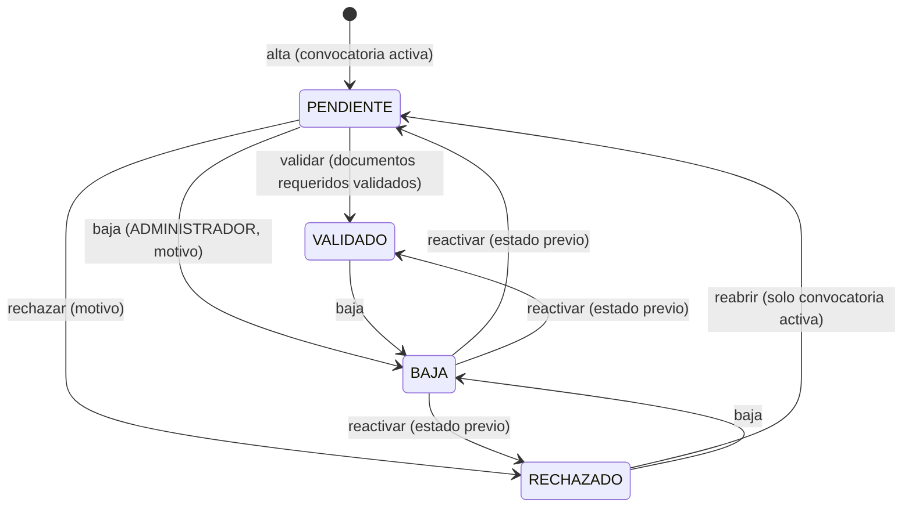
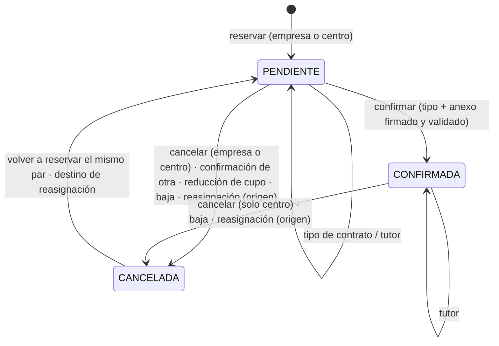
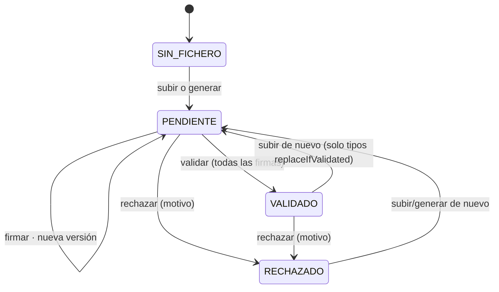

# Lógica de negocio

> Parte de la [documentación técnica](../README.md). Cada documento describe, para cada flujo: **qué hace**, **desde dónde se ejecuta**, **condiciones**, **datos que lee y escribe**, **decisiones**, **resultado**, **qué pasa si no puede completarse** y **qué más se ve afectado**. Los casos límite de solicitudes, empresas, reservas, documentos y fallos están en [comportamientos especiales](../comportamientos-especiales/README.md).

## Dominios

| Documento | Contenido |
| --- | --- |
| [Autenticación y cuentas](autenticacion-y-cuentas.md) | Login por rol, sesión JWT, cambio forzado y recuperación de contraseña, contraseñas temporales, alta y baja de personal del centro |
| [Convocatorias](convocatorias.md) | Activación automática por fechas, creación y edición |
| [Solicitudes de alumno](solicitudes-alumno.md) | Formulario público, alumnos que repiten, revisión (validar, rechazar, reabrir) |
| [Solicitudes de empresa](solicitudes-empresa.md) | Alta pública, reaplicación, revisión, datos y cambios, ofertas y cupos |
| [Tutores de empresa](tutores-empresa.md) | Alta, edición, desactivación y asignación a reservas |
| [Reservas](reservas.md) | Reservar, cancelar, reasignar, tipo de contrato, confirmar, ficha de reserva |
| [Documentos y firmas](documentos-y-firmas.md) | Catálogo, subida, generación, firmas, validación, rechazo, descarga, plantillas |
| [Baja y reactivación](baja-y-reactivacion.md) | Retirada del programa por Administración |
| [Panel y seguimiento](panel-y-seguimiento.md) | Contadores del panel y listado de seguimiento documental |
| [Notificaciones](../api-e-integraciones/correo-electronico.md) | Qué correo se envía en cada evento (en API e integraciones) |

## Máquinas de estado

La fuente de las reglas es [`estadoReglas.js`](../../../backend/src/services/estadoReglas.js), reforzada por los procedimientos y triggers. Cualquier otra transición devuelve 400 o 409.

### Solicitud (alumno y empresa)

No existe transición desde VALIDADO a RECHAZADO ni a PENDIENTE (solo a BAJA).

### Reserva

### Documento (revisión)

Las firmas son independientes del estado de revisión: cada fichero nuevo las reinicia. El **estado operativo** que ven los usuarios combina fichero, revisión y firmas ([documentos y firmas](documentos-y-firmas.md#2-estado-operativo)).

## Reglas transversales

1. **Convocatoria activa como frontera de edición.** Crear solicitudes (trigger), reaplicar, reabrir, editar datos de empresa, pedir cambios, añadir ciclos, cambiar cupos y que una empresa reserve exigen la convocatoria activa. **No** lo exigen: validar o rechazar solicitudes y documentos, las reservas hechas por el personal, cancelar, reasignar, confirmar, firmar, subir documentos, aprobar cambios, baja y reactivación.
2. **Motivo obligatorio** en todo rechazo, cancelación, reasignación y baja. El motivo de reabrir y reactivar es opcional y solo queda en `dual_eventos`.
3. **Los estudiantes no ven motivos libres de cancelación**: `GET /reservas/alumno` devuelve `motivo = NULL` y la ficha de reserva lo oculta al rol ALUMNO. Los motivos de rechazo sí se envían a quien debe corregir.
4. **Personal = un actor «Centro» (GESTOR)** a efectos de firmas y revisión: cualquier ADMINISTRADOR o COORDINADOR firma por el centro.
5. **Auditoría**: cada transición de solicitudes, reservas y documentos escribe en `dual_eventos` (en la transacción o justo después). Ver [integridad y transacciones § 5](../base-de-datos/integridad-y-transacciones.md#5-transacciones).
6. **Notificaciones después del commit**, sin bloquear ni alterar la respuesta.

## Decisiones de negocio vigentes

- **Firmas**: se exigen todas las aplicables antes de validar. Subir el fichero cuenta como firma declarada de quien sube. Solo están exentas las filas marcadas por la migración 013.
- **Tipo de contrato**: confirmar usa el tipo guardado y exige su anexo firmado y validado. El tipo se puede corregir mientras no haya anexo en revisión o validado.
- **Transportes**: se guardan por solicitud.
- **Auditoría**: `dual_eventos` es de solo inserción.
- **Reapertura**: una solicitud rechazada solo se reabre en la convocatoria activa.
- **Cupos**: las empresas pueden subir plazas y añadir ciclos sin aprobación del centro.
- **Pendiente de decidir**: qué pasa con una empresa ya validada cuyo convenio se rechaza (hoy sigue VALIDADO).
