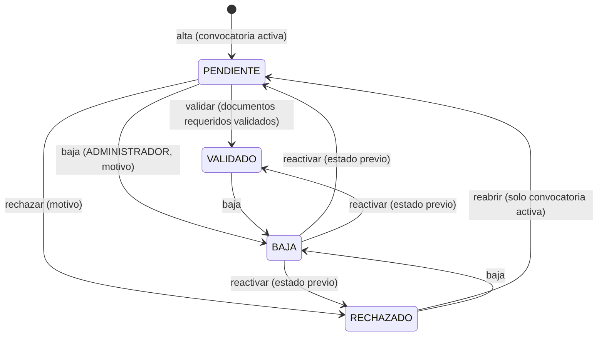
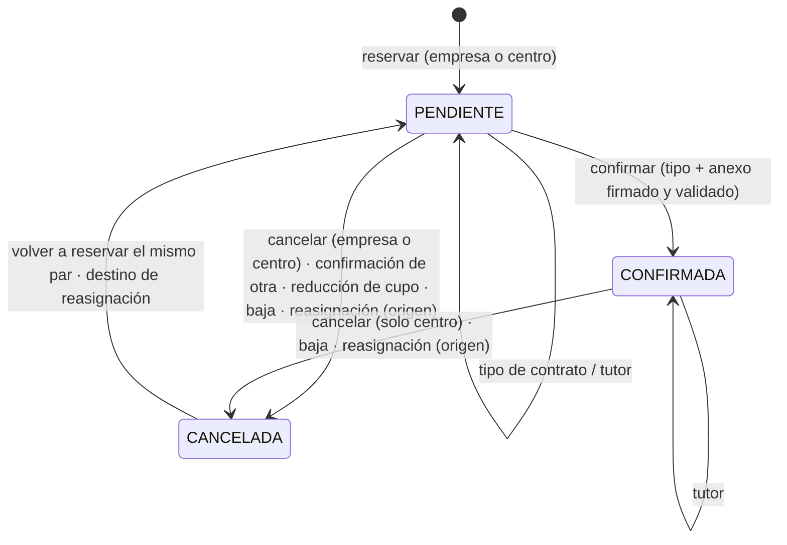
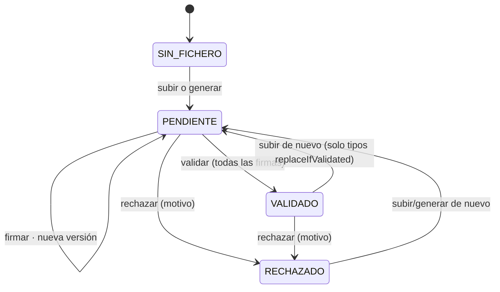

# Lógica de negocio

> Parte de la [documentación técnica](../README.md). Cada documento describe, para cada flujo: **qué hace**, **desde dónde se ejecuta**, **condiciones**, **datos que lee y escribe**, **decisiones**, **resultado**, **qué pasa si no puede completarse** y **qué más se ve afectado**. Los casos límite se recogen en [comportamientos especiales](../comportamientos-especiales/README.md).

## Dominios

| Documento | Contenido |
| --- | --- |
| [Autenticación y cuentas](autenticacion-y-cuentas.md) | Login por rol, sesión JWT, cambio forzado y recuperación de contraseña, contraseñas temporales |
| [Convocatorias](convocatorias.md) | Activación automática por fechas, creación y edición |
| [Solicitudes de alumno](solicitudes-alumno.md) | Formulario público, alumnos que repiten, revisión (validar, rechazar, reabrir) |
| [Solicitudes de empresa](solicitudes-empresa.md) | Alta pública, reaplicación, revisión, datos y cambios, ofertas y cupos |
| [Tutores de empresa](tutores-empresa.md) | Alta, edición, desactivación y asignación a reservas |
| [Reservas](reservas.md) | Reservar, cancelar, reasignar, tipo de contrato, confirmar, ficha de reserva |
| [Documentos y firmas](documentos-y-firmas.md) | Catálogo, subida, generación, firmas, validación, rechazo, descarga, plantillas |
| [Baja y reactivación](baja-y-reactivacion.md) | Retirada del programa por Administración |
| [Panel y seguimiento](panel-y-seguimiento.md) | Contadores del panel y listado de seguimiento documental |
| [Notificaciones](../api-e-integraciones/correo-electronico.md) | Qué correo se envía en cada evento (en API e integraciones) |

## Máquinas de estado

Las tablas detalladas, con condiciones y quién puede actuar, están en [`docs/STATE_TRANSITIONS.md`](../../STATE_TRANSITIONS.md) (en inglés, coherente con el código a fecha de 017). Resumen:

### Solicitud (alumno y empresa)

No existe transición desde VALIDADO a RECHAZADO ni a PENDIENTE (solo a BAJA).

### Reserva

### Documento (revisión)

Las firmas son independientes del estado de revisión: cada fichero nuevo las reinicia. El **estado operativo** que ven los usuarios combina fichero, revisión y firmas ([documentos y firmas](documentos-y-firmas.md#2-estado-operativo)).

## Reglas transversales

1. **Convocatoria activa como frontera de edición.** Crear solicitudes (trigger), reaplicar, reabrir, editar datos de empresa, pedir cambios, añadir ciclos, cambiar cupos y que una empresa reserve exigen la convocatoria activa. **No** lo exigen: validar o rechazar solicitudes y documentos, las reservas hechas por el personal, cancelar, reasignar, confirmar, firmar, subir documentos, aprobar cambios, baja y reactivación.
2. **Motivo obligatorio** en todo rechazo, cancelación, reasignación y baja. El motivo de reabrir y reactivar es opcional y solo queda en `dual_eventos`.
3. **Los estudiantes no ven motivos libres de cancelación** (SEC-11): `GET /reservas/alumno` devuelve `motivo = NULL` y la ficha de reserva lo oculta al rol ALUMNO. Los motivos de rechazo sí se envían a quien debe corregir.
4. **Personal = un actor «Centro» (GESTOR)** a efectos de firmas y revisión: cualquier ADMINISTRADOR o COORDINADOR firma por el centro.
5. **Auditoría**: cada transición de solicitudes, reservas y documentos escribe en `dual_eventos` (en la transacción o justo después). Ver [integridad y transacciones § 5](../base-de-datos/integridad-y-transacciones.md#5-transacciones).
6. **Notificaciones después del commit**, sin bloquear ni alterar la respuesta.

## Decisiones de negocio vigentes

Los informes de fase usan identificadores **D1–D8 (fase 2)** y el plan de BD otros **D1–D9 (plan de BD)**. Los que condicionan el comportamiento actual:

| Id | Decisión | Estado |
| --- | --- | --- |
| D1 (fase 2) | Todas las firmas aplicables antes de validar; subir el fichero cuenta como firma declarada del que sube; exención solo para filas marcadas por 013 | Implementada |
| D2 (fase 2) | Confirmar con el tipo de contrato guardado y su anexo firmado y validado; el tipo se puede corregir mientras no haya anexo en revisión o validado | Implementada |
| D3 (fase 2) | Las empresas pueden subir cupos y añadir ciclos sin aprobación del centro | **Aplazada**: comportamiento sin cambios |
| D4 (fase 2) | Transportes por solicitud, sin inventar historia | Implementada (014) |
| D5 (fase 2) | Auditoría solo de inserción | Implementada (013) |
| D6 (fase 2) | Efecto del rechazo del convenio de una empresa ya validada | **Abierta**: la empresa sigue VALIDADO |
| D7 (fase 2) | Reabrir solicitudes rechazadas solo en la convocatoria activa | Implementada |
| D1–D9 (plan de BD) | Índice único de DNI, una fila por intento de reserva, copia en escritura de tutores, limpieza de objetos, tipo de contrato en canceladas, transacciones del backend, retención, BD de verificación, preferencias | Ver [`docs/DATABASE_IMPROVEMENT_PLAN.md`](../../DATABASE_IMPROVEMENT_PLAN.md) § 11; solo la etapa 1 está aplicada |
