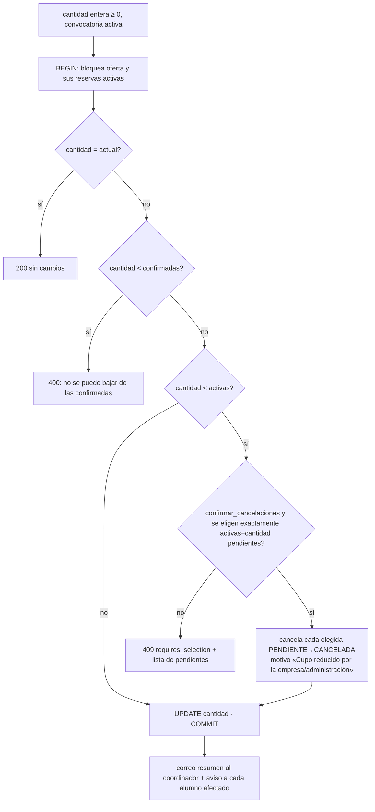

# Solicitudes de empresa

> Código: [`solicitudesEmpresaService.js`](../../../backend/src/services/solicitudesEmpresaService.js), [`empresaDatos.js`](../../../backend/src/services/empresaDatos.js), [`solicitudTransiciones.js`](../../../backend/src/services/solicitudTransiciones.js), `sp_validar_solicitud_empresa`, `trg_dse_*`, `trg_dsee_bu_cupo`. Frontend: [`AddCompanyRequest`](../../../frontend/src/pages/AddCompanyRequest/index.js), [`CompanyView`](../../../frontend/src/pages/CompanyView/index.js), [`AdminCompanyView`](../../../frontend/src/pages/AdminCompanyView/AdminCompanyView.jsx). Pruebas: `phase2.test.js`, `phase3.test.js`, `stage1.test.js`.

## 1. Alta pública — `POST /solicitudes/empresa`

**Qué hace**: registra una empresa **nueva** con su primera solicitud, ofertas, transportes, cuenta de portal y primer tutor, y genera el convenio.

**Desde dónde**: `/addCompanyRequest` (JSON).

| Paso | Detalle |
| --- | --- |
| Obligatorios | Empresa (`cif`, `empresa`, domicilio legal completo), representante (`dni, nombre, email, telefono`), coordinador (ídem), `descripcion_puesto`, `especialidades[]` no vacío, `passwordCoordinador` → 400 |
| Formatos | `cifValido` (letra + 7 dígitos + control) → 400 `CIF_INVALIDO`; `dniNieValido` de representante y coordinador → 400 `DNI_INVALIDO`; contraseña ≥ 8 → 400 `PASSWORD_CORTA` |
| Convocatoria | Debe haber una activa → si no, 409 |
| CIF existente | `SELECT … WHERE cif = ? FOR UPDATE` (índice único) → **409** «Esta empresa ya está registrada. Inicia sesión con el CIF…». El alta pública nunca actualiza una empresa existente |
| Inserciones | `ge_empresas` (CIF normalizado) → domicilio legal → domicilio de trabajo (o el mismo id si `mismoLugarTrabajo`; si no, sus campos son obligatorios → 400) → representante (en el domicilio legal) → coordinador (en el de trabajo) → `dual_solicitudes_empresa` PENDIENTE → ofertas (cada una con id válido y `cantidadAlumnos ≥ 1`, si no 400) → transportes → usuario EMPRESA (contraseña elegida, `must_change_password = 0`) → `dual_empresa_tutores` (coordinador, activo) |
| Después del commit | `generateDocument(CONVENIO)`; si hay plantilla activa, se guarda el PDF (evento `GENERAR` sin usuario) y se envía al email del coordinador con el PDF adjunto. **Si no hay plantilla o falla la generación, no se envía ningún correo** y solo se registra en consola |
| Resultado | 201 `{ id_solicitud_empresa }` |

Los DNI de representante y coordinador se validan pero **se guardan tal como llegan** (sin normalizar) en el alta; las ediciones posteriores sí los normalizan.

## 2. Reaplicación — `POST /solicitudes/empresa/reapply` (EMPRESA)

**Qué hace**: crea la solicitud de la empresa para la convocatoria activa reutilizando sus datos base.

**Desde dónde**: portal de empresa; `GET /solicitudes/empresa/mia?incluir_anteriores=1` devuelve la última solicitud y `puede_reaplicar = hay convocatoria activa && la última no es de la activa`.

| Paso | Detalle |
| --- | --- |
| Condiciones | Convocatoria activa (si no, 409 `SIN_CONVOCATORIA`); `especialidades[]` no vacío; ninguna solicitud de la empresa en la activa (409 `SOLICITUD_EXISTENTE`); existe una solicitud anterior (si no, 404) |
| Datos copiados | De la solicitud anterior **más reciente por `fecha_solicitud`**: representante, domicilios y coordinador (mismos ids) |
| Coordinador | Si `nombreCoordinador`, `emailCoordinador` o `telefonoCoordinador` difieren de los actuales: primero se **congela una copia** para las solicitudes anteriores (`freezeCoordinadorForOtherSolicitudes`), luego se actualiza el contacto original (y el `nombre_mostrar` del usuario). El DNI y el cargo no se pueden cambiar aquí |
| Inserciones | Solicitud PENDIENTE (`descripcion_puesto` puede ser `''`), tutor del coordinador con `INSERT IGNORE`, ofertas, transportes de la nueva solicitud |
| Después | Genera y envía el convenio como en el alta |

La razón social, CIF, domicilios y representante no se cambian al reaplicar: se cambian después con una solicitud de cambio o por el centro.

## 3. Revisión por el centro

| Acción | Endpoint | Condiciones | Efecto |
| --- | --- | --- | --- |
| Validar | `POST /solicitudes/empresa/:id/validar` | PENDIENTE; el procedimiento exige **CONVENIO actual VALIDADO** y **≥ 1 oferta** | VALIDADO; evento; correo al coordinador |
| Validar mediante el convenio | `POST /documentos/:id/validar` sobre el CONVENIO | La solicitud de empresa está PENDIENTE | En **la misma transacción** valida el convenio y la solicitud (eventos `VALIDAR` de ambos, `detalle.por_convenio`) |
| Rechazar | `…/rechazar {motivo}` | PENDIENTE (una empresa VALIDADO no se puede rechazar: 400) | RECHAZADO; evento; correo con motivo |
| Reabrir | `…/reabrir` | RECHAZADO y convocatoria activa | PENDIENTE |
| Rechazar el convenio de una empresa VALIDADO | `POST /documentos/:id/rechazar` | — | El convenio pasa a RECHAZADO pero **la empresa sigue VALIDADO** (pendiente de decidir); el evento lleva `empresa_validada_sin_cambios` |

## 4. Datos de la empresa

`GET /solicitudes/empresa/:id/datos` (personal y la empresa propietaria) devuelve los datos combinados de `ge_empresas`, los dos domicilios, representante, coordinador, puesto y transportes (`empresaDatos.loadEmpresaDatosRead`), con alias para el frontend.

### 4.1 Edición directa por el centro — `PUT /solicitudes/empresa/:id/datos` (personal)

1. Solo si la solicitud es de la **convocatoria activa** (400 si no).
2. `sanitizeProposed` (con CIF permitido) normaliza valores (CIF y DNI a mayúsculas, textos recortados, transportes como ids únicos ordenados) y `diffProposed` se queda con lo que cambia; si nada cambia → 400.
3. `applyEmpresaDatos` en transacción:
   - valida campos obligatorios combinados y el CIF si cambia (válido y no usado por otra empresa → 400/409);
   - `ge_empresas` se actualiza **en el sitio**;
   - domicilios: **copia en escritura** si otra solicitud usa la misma fila; si legal y trabajo eran la misma fila y ahora divergen, se separan;
   - representante: si otra solicitud lo comparte, se clona y la solicitud actual apunta al clon;
   - coordinador: se congela una copia para las demás solicitudes y se edita el original (mantiene el usuario y el tutor); el `nombre_mostrar` del usuario se sincroniza;
   - transportes de esta solicitud (ids validados contra el catálogo → 400 si alguno no existe).
4. No se registra evento de auditoría.

### 4.2 Solicitud de cambio por la empresa — `POST /solicitudes/empresa/:id/cambios` (EMPRESA)

- Solo convocatoria activa; enviar `cif` → **403** («El CIF no se puede modificar desde la empresa»).
- Se guarda `payload = { proposed: <solo los cambios>, snapshot: <todos los valores actuales> }`.
- `validateMerged` comprueba que, aplicados los cambios, no falte ningún obligatorio.
- **Una pendiente por solicitud**: si ya hay una, se **sustituye** su `payload`, se reinicia `fecha_solicitud` y se responde 200; si no, se crea y se responde 201.

### 4.3 Aprobar — `POST /solicitudes/empresa/:id/cambios/:idCambio/aprobar` (personal)

- Debe existir y estar PENDIENTE (bloqueada con `FOR UPDATE`).
- **Detección de conflictos**: para cada campo propuesto compara el `snapshot` con el valor actual. Si alguno cambió desde el envío y no se pasa `confirmar_conflicto: true` → **409** con `conflictos`, `diff` y `requires_confirm`.
- Aplica con `applyEmpresaDatos` (sin CIF) y marca APROBADO con resolutor y fecha.
- **No exige** que la convocatoria siga activa.

### 4.4 Rechazar — `…/rechazar {motivo}` (personal)

Motivo obligatorio; debe estar PENDIENTE; marca RECHAZADO. Se hace sin transacción explícita (dos aprobaciones/rechazos simultáneos podrían pisarse; el efecto es solo el estado final de la fila 🔶).

`GET …/cambios` devuelve la pendiente y la última resuelta, cada una con su `diff` respecto a los datos actuales.

## 5. Ofertas y cupos

### 5.1 Añadir un ciclo — `POST /solicitudes/empresa/:id/especialidades` (personal o empresa propietaria)

Convocatoria activa; `id_especialidad` de un ciclo **activo**; `cantidad ≥ 1`; que no esté ya en la solicitud (409). Sin revisión del centro y sin auditoría.

### 5.2 Cambiar plazas — `PUT /solicitudes/empresa/:id/especialidades/:idOferta/cantidad` (personal o empresa propietaria)

- Subir plazas no tiene límite ni revisión.
- Las cancelaciones de este camino se hacen con un `UPDATE` propio (no con `sp_cancelar_reserva`) y **no generan evento de auditoría**.
- Si entre la consulta y la cancelación una reserva elegida dejó de estar PENDIENTE → 409 y no se cambia nada.
- `trg_dsee_bu_cupo` impide en BD bajar por debajo de las reservas activas (respaldo).
- No se comprueba el estado de la solicitud (también se pueden cambiar plazas de una solicitud PENDIENTE o RECHAZADO; una empresa en BAJA no puede entrar, pero el personal sí podría) 🔶.

`GET /solicitudes/empresa/:id/especialidades` devuelve cada oferta con `plazas_disponibles`, `plazas_ocupadas`, `plazas_confirmadas`, `plazas_pendientes`. `GET /cupos/empresa` (EMPRESA) da lo mismo solo para ofertas de solicitudes VALIDADO de la convocatoria activa.

## 6. Consultas del personal

- `GET /solicitudes/empresa/todas`: **todas las solicitudes de todos los años** con datos de empresa, coordinador, representante, domicilios, cuenta, baja, ofertas, transportes, convenio actual (`tieneConvenio`, `convenio_validado`, `id_documento_convenio`) y cambio pendiente. Es la que usa la pantalla Empresas.
- `GET /solicitudes/empresa?estado=&convocatoria=`: lista simple con filtros.
- `GET /solicitudes/empresa/:id` y `/:id/documentos`: personal o empresa propietaria (403 si es otra empresa).

## 7. Efectos sobre otros componentes

- Solo las ofertas de solicitudes **VALIDADO** se usan para reservar; las de la convocatoria activa determinan qué alumnos ve la empresa.
- El coordinador recibe todas las notificaciones de la empresa (validación, rechazos, reservas, cupos, documentos rechazados de reservas) y el enlace de recuperación de contraseña.
- El coordinador es también tutor; la empresa no puede editarlo ni desactivarlo desde Tutores ([tutores](tutores-empresa.md)).
